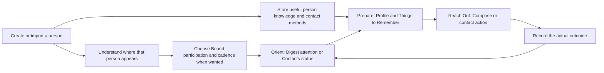

# Phase 39 — Fresh-Install & Foundation Journey Audit

**Workpaper · 2026-10-02 · Owner/ChatGPT triage evidence · No onboarding design or implementation**

## 1. Executive Summary

A pristine installation opens directly to **Digest**, with ordinary “caught up,” empty Horizon and quiet-week copy. There is no acquisition choice, first-run setup, account gate or permission prompt. Contacts supplies a manual **Add your first contact** button; Import is several steps away in Settings. Both acquisition workflows successfully save people, but their default **Unbound** people disappear from the principal Contacts population and do not populate Digest attention. Acquisition alone therefore produces a usable person record, not necessarily an understandable relationship dashboard.

Manual creation needs only a name. Its collapsed Relationship Basics hides **Last spoke = Today**, which creates an actual first interaction. Import creates none. This difference is visible immediately in Your Week. The UI does not explain the creation consequence beside Last spoke.

The intended **Orient → Prepare → Reach Out → Record → updated Orient** loop was visible once a person had Bound status, cadence, communication methods, stored knowledge and history. A backdated interaction made that person overdue; Profile/Compose exposed fictional conversation context; SMS handoff asked whether communication happened; Quick Log and detailed Save updated History and cleared attention. No message was sent and no call was made.

The six-action FAB is a coherent container-level learning opportunity. Its commit boundaries and targeting vary: Quick Log writes immediately, the detailed log waits for Save, focused Update edits save independently, and Group Log does not assume the open Profile person is a participant. **Import is not a FAB action.**

The findings below are recommendations for review, not Phase 39 requirements. Existing Bound/Unbound defaults and population semantics reflect recorded product decisions; this audit does not authorize reversing them. The [original 145-candidate inventory](phase-39-onboarding-journey-discovery.md) is retained unchanged.

## 2. Test Environment / Isolation Method

### Isolation and provenance

The documented Windows desktop pipeline was used: marker-confirmed `droid` checkout, source transport over SSH, `npm ci` with repository patches, clean noninteractive Expo prebuild, standalone arm64 release build. The source baseline at sync was **305ed1eabe580a4c8122f5261aabe16c7fea8a0e**. Other agents subsequently committed Phase 38.7 planning documents; those commits did not change the audited application source. The prior report inspected an earlier code baseline and the owner's installed release; this run supplies a freshly built runtime with known source provenance.

A temporary **external Gradle init script**, outside the repository, assigned only the test APK's application ID:

```groovy
gradle.beforeProject { p ->
  if (p.path == ':app') {
    p.afterEvaluate {
      p.android.defaultConfig.applicationId = 'com.bwales.orbit.foundation39'
    }
  }
}
```

This preserved the production source/configuration and generated activity class while giving the test installation a separate Android package, UID, private SQLite/files/preferences and runtime permissions. APK badging confirmed the unique package before install. It was absent beforehand. The owner's **`com.bwales.orbit`** installation was neither replaced nor cleared. No source modification, commit, push or worktree was used. The standalone release has an embedded JS bundle and ran without Metro; “release” here describes the build variant, not the owner's production data installation.

Build command followed prebuild with `assembleRelease --console=plain --no-daemon -PreactNativeArchitectures=arm64-v8a --init-script …`. The successful build took 4m57s. Temporary APK and scripts are under `/tmp/orbit39-foundation/`; desktop build logs are `C:\Users\bwales\orbit39-{npm-ci,prebuild,build}.log`.

### Device, fixtures and evidence

The lead alone drove one physical **Pixel 3a (sargo), Android SDK 32**, found through `emu-connect status` and SDK adb v37. The serial was resolved from `adb devices` at runtime, never hardcoded. Screen: 1080×2220, density 440, existing font scale 1.15 and timezone America/Chicago; these settings were not changed. Device date during the walkthrough was October 2, 2026.

Three independent pristine-data runs were used: manual-first, single-import-first, then batch-import-first. Reset used `pm clear` **only for `com.bwales.orbit.foundation39`**. The contact permission primer and Android permission prompt reappeared after reset, establishing fresh permission state as well as an empty Orbit library.

Manual fictional people were Mira Vale, Jules Oak and Remy Finch. Android source fixtures were **ZZ39 Avery Demo, ZZ39 Blake Demo and ZZ39 Casey Demo**, with reserved 555-01xx phone numbers and `example.invalid` email addresses. They were newly inserted null-account raw contacts, with aggregation disabled and uniquely tagged source IDs. Only those fixtures were selected. No personal Android contact was edited, deleted or imported. One blank raw-contact probe created by this audit was separately identified for cleanup.

Semantic UIAutomator text/labels/bounds guided taps; screenshots corroborated visible state. The clock screensaver was dismissed when necessary. Keyboard occlusion required checking screenshots and dismissing the keyboard; a node in the tree can still be behind the keyboard. Those driver retries are not app defect claims. Private intermediate picker trees may contain the existing address book; **they are not included in the report assets**. Retained PNGs contain empty or fictional app data only, and are design references, not final marketing material.

### Cleanup completed

After evidence capture, the unsent fictional Messages draft was cleared through its text editor (verified empty **Text message** placeholder; Send was never pressed). All three tagged, null-account, aggregation-disabled source raw contacts were deleted with exact ID/tag/account guards and verified absent. The separately verified empty raw-contact probe was also removed; no existing personal source row was touched.

The isolated audit APK was uninstalled and its package verified absent. The desktop's canonical `app-release.apk` was independently rechecked as the audit package and removed so that output cannot be mistaken for a production APK; the external init script was removed there too. The pulled audit APK remains only in the temporary local research directory for provenance. Ordinary future builds use the unchanged production application ID.

Before/after package checks confirmed the owner's production UID, code path, version, installation/update timestamps and Contacts permission state unchanged. This establishes installation/permission isolation, not a bitwise production-database comparison; its private content was not accessed or mutated. No production-app launch/reset/import command was used during this audit.

### Grounding and classification

Read `AGENTS.md`, `HANDOFF.md`, Android guidance in `CLAUDE.md`, the desktop pipeline, the relevant import runbook and the earlier workpaper's foundation/permission/logging/dependency/gap material. A foundation subagent read actual current navigation, screens, components, stores, services and data owners. The lead compared code with completed UI outcomes. A second reviewer checked this workpaper against the previous inventory and actual source after the walkthrough; disposition is recorded in §15.

Meaningful findings use exactly these owner-requested classifications:

- **Existing UI already teaches this adequately** — evidence that the existing surface conveys the relevant action or consequence.
- **Likely Foundation teaching opportunity** — knowledge needed early to understand/use the core loop.
- **Likely Progressive teaching opportunity** — teach when encountered, including the unchosen acquisition path.
- **UX ambiguity / possible product issue** — underlying copy, visibility or consequence deserves product review before relying on teaching.
- **Advanced / defer** — beyond the narrow foundation exercise.

These are provisional recommendations, not measured novice comprehension. This was one agent simulating a new user, not a participant study or formal UAT.

**Orrery exclusion:** the current Orrery tab, renderer, controls and Preview were never entered or audited. The future orientation model acknowledges Digest, Orrery V2 and Contacts. Only Digest and Contacts behavior is established here; Orrery V2 navigation/empty/populated orientation needs a separate pass after Phase 38.7.

### Primary code grounding

The implemented behavior above was checked against these actual subsystem files, not just planning prose:

- Shell/landing: `App.tsx`, `src/services/bootstrap-sequence.ts`, `src/navigation/RootNavigator.tsx`, `shell-contract.ts`, `focused-route-classification.ts`, `src/screens/DigestScreen.tsx`, Digest section components, `HomeScreen.tsx`, `src/logic/dashboard-empty-logic.ts`.
- Acquisition/visibility: `CreateContactScreen.tsx`, `create-contact-logic.ts`, `TriStateLastSpoke.tsx`, `contacts-dao.ts`, `recency-dao.ts`, `dashboard-query-store.ts`, `dashboard-query-logic.ts`, `dashboard-read.ts`, `up-next-read.ts`, `your-week-read.ts` and `status.ts` under their `src/screens`, `src/components`, `src/stores`, `src/logic` and `src/db` owners.
- Import: `SettingsContactsScreen.tsx`, `LegacyContactPickerScreen.tsx`, `ImportReviewScreen.tsx`, `BulkImportSetupScreen.tsx`, `bulk-import-setup-logic.ts`, `ImportCompleteScreen.tsx`, `DuplicateReviewScreen.tsx`, `CandidateCardGrid.tsx`, `src/services/import/`, `src/db/imported-contact-dao.ts`, import session owners, and `modules/orbit-contact-picker/android/src/main/java/expo/modules/orbitcontactpicker/OrbitContactPickerModule.kt`.
- Profile/record: `src/profile/presentation-schema.ts`, `src/components/profile/ProfileModuleHost.tsx`, `ContactProfileScreen.tsx`, `UniversalFab.tsx`, `universal-fab-logic.ts`, `ContactPicker.tsx`, `src/services/quick-log-command.ts`, `src/stores/snackbar-store.ts`, `LogInteractionScreen.tsx`, `log-interaction-logic.ts`, `GroupLogScreen.tsx`, `UpdateContactScreen.tsx`, `MemoryScreen.tsx` and related interaction/group/knowledge DAOs.
- Communication: `ComposeScreen.tsx`, `ComposeResearchScreen.tsx`, `src/db/compose-research-read.ts`, `src/services/reach-out/handoff.ts`, `AssistBanner.tsx`, `AssistConfirmation.tsx`, `src/stores/assist-store.ts` and `src/db/interaction-assist-dao.ts`.

## 3. Absolute First Launch

Chronological observations, before creating anything:

| ID | Actual experience | Classification | Reference |
|---|---|---|---|
| F01 | Normal launch lands on Digest. No account, welcome/setup, acquisition-choice UI or first-run permission request appears. | Likely Foundation teaching opportunity | 01 |
| F02 | Up Next says “You're all caught up” / “No one needs a nudge right now.” Horizon says “Nothing on the horizon” / “No birthdays or overlooked people to flag right now.” Your Week shows zero People reached, Interactions and Events, then “A quiet week.” No Add/Import CTA appears inside Digest. | UX ambiguity / possible product issue | 01 |
| F03 | Five tabs are visible: Contacts, Events, Digest, Orrery, Settings. The plus FAB is available. Neither the tab labels nor empty copy explains the core loop or the future three orientation choices. | Likely Foundation teaching opportunity | 01–03 |
| F04 | Contacts has Population = Active Contacts, Filters, Sort, search and list/card controls, plus a clear **Add your first contact** button. Tapping it opens manual creation directly. | Existing UI already teaches this adequately | 02, 05 |
| F05 | Opening the FAB reveals all six actions even with no people. Quick Log then opens a person picker showing “No contacts yet” and “Use Add Contact to start logging.” That is explanatory text, not a clickable acquisition shortcut; Back and another FAB action are needed. | Likely Progressive teaching opportunity | 03–04 |
| F06 | There is no corresponding fresh Import CTA in Contacts or Digest, and no manual/import chooser. Import lives under Settings → Contacts & Relationships → Contact Sources. | UX ambiguity / possible product issue | 20–21 |

A new user can infer “this app holds people” and “plus offers capture actions.” They are not yet shown why the dashboard matters, why some people need attention, or which first acquisition route best fits them. F04 is helpful existing instruction but only after the user leaves the initial landing tab.

## 4. Manual-First Journey

### Completed runs and consequences

1. **Mira Vale:** Contacts' first-contact CTA → enter name only → Save contact, leaving all hidden defaults unchanged. Save opens the Profile. The Profile is **Unbound**, explains that details/history stay outside the active orbit and offers cadence/Bind controls. Message and Call are disabled with reasons because no endpoint was supplied. Back returns to Contacts with only **“Everyone's tucked away”**; there is no Mira row or Unbound recovery pointer. Digest still has no attention, but Your Week now reports **1 person / 1 interaction**. Tapping today's activity shows “Interaction with Mira Vale.” No separate logging workflow was used.
2. **Jules Oak:** FAB Add Contact → name → expand Relationship Basics → **Not yet**, **Bound**, **Weekly** → Show More inspection → Save. Selecting Bound without a cadence initially exposes a custom zero/positive-number validation message; selecting Weekly resolves it. Profile has the four main modules collapsed. Interaction History, when expanded, says **“No history yet”** and provides a Log interaction entry. Digest Horizon shows **Never Contacted (1)**. Default Contacts still hides Jules but now supplies **“1 not yet contacted →”**.
3. **Remy Finch:** FAB Add Contact → name → Relationship Basics → native Pick date **September 20, 2026**, Bound, Weekly → Save. Digest Up Next now says **“Overdue for a check-in.”** The initial interaction falls outside the current rolling seven days, so Your Week remains Mira's one current-week interaction.

| ID | Finding | Classification | Reference |
|---|---|---|---|
| F07 | Name is the only minimum requirement. Identity starts expanded; Relationship Basics and Contact Methods are collapsed. Category defaults Uncategorized. Show More exposes optional Last Talked About, Key People, Current Location, Memories and Off Limits without requiring them. | Existing UI already teaches this adequately | 05, 12, 26 |
| F08 | Actual defaults are **Unbound**, no cadence, **Today**. Today is hidden unless Relationship Basics is expanded. A stale source-file header suggesting Monthly/Bound is not the implemented default. | UX ambiguity / possible product issue | 06–10 |
| F09 | Today creates a real interaction at creation time; Pick date creates one at that day's local midnight; Not yet creates none. The UI label “Last spoke” does not disclose that this is creating history and metrics. | UX ambiguity / possible product issue | 09–10, 15, 17–18 |
| F10 | Bound/Unbound captions explain active cadence participation versus retained details/history without active cadence reminders. Category is independent of tracking. A valid cadence is required for Bound creation. | Likely Foundation teaching opportunity | 10–11 |
| F11 | Default creation saves a real record, but returning to main Contacts can look as if no person was added. Unbound Profile explains the lifecycle, while the resulting list does not provide a direct route back to that population. | UX ambiguity / possible product issue | 06–08 |
| F12 | Bound Not Yet is a backlog/Horizon state, not overdue and not a member of the default already-contacted Active list. A dated interaction plus cadence creates actionable attention. | Likely Foundation teaching opportunity | 14–18 |

Manual-first is **mechanically straightforward** and discoverable from Contacts/FAB. It is not a complete natural path to a visible relationship dashboard when the user accepts defaults. Phase 39 would need to bridge first-person creation to the meaning of tracking, initial history and where the person can next be found; resolving F08–F11 is owner product triage, not automatically tutorial work.

**Potential teaching moments:** acquisition alternative; minimum name; optional enrichment; classification versus cadence; Bound/Unbound; honest Today/Pick date/Not yet; Save→Profile; endpoint prerequisites; where saved people appear. No teaching format or copy is selected here.

## 5. Import-First Journey

After clearing only the audit package, the fresh acquisition entry was **Settings → Contacts & Relationships → Import contacts**. The entry subtitle says “Choose people from your phone and review each import first.” This placement assumes the user already knows import is a configuration-adjacent capability.

The SDK32 flow first displays: **“Orbit reads your contacts on this device so you can choose which to import. Nothing leaves your device.”** Only Continue invokes Android's **“Allow Orbit to access your contacts?”** prompt. Denial shows “Contact access is needed to choose contacts to import” with **Grant access**; granting later proceeds. No permission was requested at first launch or merely by opening the entry.

The granted in-app picker was searched for ZZ39 before screenshots/selection. One selected person routed to single review; two routed to shared batch setup.

### Single-first completion

Avery's review prefills name, phone and email, shows Unbound/Bound, defaults Unbound, and offers Uncategorized plus seeded Family/Friends/Work/Community category choices. It has no Last spoke control. **Import** successfully creates the person and lands on their Profile. Message/Call now have methods available. There is no ordinary new-single completion summary. Back leads to “Everyone's tucked away”; Digest remains all zero, without a Never Contacted preview. This differs from name-only manual creation's hidden Today interaction.

### Batch-first completion in another fresh state

Blake and Casey were selected together. Setup displayed **2 contacts selected**, shared **Orbit participation = Unbound**, Category override = Uncategorized and **Import 2 contacts**. No individual form was required for every new record. Code confirms choosing Bound would supply Monthly unless changed, and show “Bound adds every imported contact to your reminders at this frequency”; this Bound-batch branch was inspected in source, not separately completed on the Pixel.

The small batch completed too quickly to retain a distinct in-progress screenshot. Completion reported **Imported (1), Need review (1)**, with other summary buckets zero. The naturally occurring match was **Similar name** between the prefixed fictional records. This was not a deliberately engineered duplicate suite. Review possible matches opened a card; ordinary tapping did nothing. Actual code makes `onInspect` a no-op on this screen. Long-press selected the card, exposed **1 selected · Choose action**, then **Import as New** resolved Casey. The refreshed summary showed Imported (2), Need review (0). Done returned to the default hidden Contacts list; Digest remained zero. Contacts → More actions → **Unbound Contacts** displayed both saved people.

| ID | Finding | Classification | Reference |
|---|---|---|---|
| F13 | In-context local-only permission explanation, explicit Continue and recoverable denial precede access. This adequately explains why this permission is needed on this device branch. | Existing UI already teaches this adequately | 21–24 |
| F14 | Picker selection/count and single prefilled review are understandable; single and batch have different review/commit/completion routes. | Likely Progressive teaching opportunity | 24–31 |
| F15 | Import can save a first person or cohort safely and repeatably, but neither fresh landing nor FAB advertises it. Default Unbound import produces an empty-looking main dashboard. | UX ambiguity / possible product issue | 27–30, 35–37 |
| F16 | A possible-match card with no effect on normal tap requires undisclosed long-press selection before resolution actions appear. An encountered first acquisition interruption cannot be treated only as an advanced theoretical edge case. | UX ambiguity / possible product issue | 32–34 |
| F17 | “Review each import first” overstates normal per-person review in the batch path, which applies shared choices and auto-imports ordinary new rows. | UX ambiguity / possible product issue | 20, 30–31 |

Import-first is **a viable existing acquisition workflow to wrap**, but is not naturally discoverable as a first-run peer of manual Add. The owner-directed choice would need to bridge to existing acquisition routes and their different outcomes, not merely expose an existing chooser.

The fixture insertion script attempted Android Note rows, but cleanup-time queries of all three exact fictional raw contacts returned **no Note rows**. Thus this run had no verified source notes to import. Empty imported knowledge is a **fixture coverage gap, not evidence of an Orbit import failure**. Current native selected-read and import DAO code support provider-supplied Note→Imported Memory, AI OFF; that outcome was not exercised here. Useful imported methods were established, and separately added Memory/current-state knowledge worked. Imported Contact Notes are distinct from ordinary Memories in Profile; §14 records the remaining limitation.

**Potential teaching moments:** choosing people rather than copying the entire address book; Orbit record versus Android source record; access permission; one versus many; shared category/lifecycle; completion versus unresolved review; finding Unbound imports; importing alone does not record communication.

## 6. First Core Loop

### Orient

After batch import, the lead explicitly opened Blake from Unbound Contacts, selected Weekly and tapped **Bind contact**. Then a detailed fictional interaction dated September 20 was saved as fixture preparation. This was a deliberate setup step, not an asserted real communication.

Digest then showed Blake **“Overdue for a check-in”**. Contacts showed **1 contact**, **12d ago**, **Decaying**, and “What should you remember about …?” Profile Relationship Overview displayed cadence **Every 7 days**, last interaction date and an accessible status explanation **“12 of 7 days since the last interaction.”** Gravity explained its derivation from interaction history; those additional metrics need not be first-use lessons.

**F18 — Likely Foundation teaching opportunity:** elapsed time relative to the chosen cadence explains attention; “caught up” after a recent log does not mean contacts vanished. Existing readable Up Next reason and Overview explanation already teach parts adequately. [References 40–43.]

### Prepare

Fresh Bound Profile's **Relationship Overview, Things to Remember, Contact Methods and Interaction History** all started collapsed. Expanding Things to Remember exposed empty knowledge sections and their edit affordances. The lead used FAB **Memory** to add and pin **“Ask about the autumn hiking trip”**, then FAB **Update Contact → Last talked about** to save **“Weekend hiking plans”**. The focused update returned to its chooser with an **Updated** cue before Done. Profile showed the pinned memory.

**F19 — Likely Foundation teaching opportunity:** first reveal of the Profile content needed for orientation/preparation, then store and consult person knowledge; knowledge updates and communication records serve different purposes. All four top-level modules start collapsed; most knowledge children start expanded once their parent is opened (Imported Contact Notes is the factory exception). **F20 — Likely Progressive teaching opportunity:** later disclosure preferences/customization, adding/pinning Memory, and current Last talked about versus interaction Note. Knowledge writes did not substitute for recording a conversation. [References 38, 44–47, 49, 64.]

### Reach Out

Profile **Message** opened a blank manual Compose editor. It offered Make this an email, **Things to Remember · 3**, Copy and Transmit. No AI action appeared with fresh AI setup OFF/unconfigured. Research showed the current conversation topic, seven-day frequency and the new memory, with Back to compose; no editing was necessary to consult the context. This compact research page also exposed shell tabs/FAB, whereas Compose itself hid them.

The lead typed a fictional draft and used Transmit to the fixture's reserved phone number. Android Messages displayed the fictional recipient/draft and its separate **Send SMS** control. **Send was never pressed.** On returning to Orbit, a global banner asked **“Did you text ZZ39 Blake Demo?”**, with Yes, Don't log and Add a note. Compose also had a local “Did you send it?” confirmation in its UI tree; the returning keyboard initially obscured lower controls. **Don't log** was used; the local panel was then closed with Not yet. No interaction was added by the cancelled handoff.

**F21 — Likely Foundation teaching opportunity:** preparing a draft, launching another app and actually communicating are separate events; Orbit relies on the user's truthful recording. **F22 — Likely Progressive teaching opportunity:** first native handoff/Assist; Copy versus Transmit; Not yet versus durable Don't log. Code establishes Not yet only hides the local panel and leaves pending Assist; this exact pending-preservation sequence was not independently demonstrated because Don't log was applied first. Both confirmation surfaces refer to the same pending communication, not two conversations. [References 48–52.]

### Record

The actual disposable sequence was:

| Action | Observed result |
|---|---|
| Backdated detailed Log, Save | September 20 interaction creates overdue Weekly attention; outside the rolling seven-day metric window. |
| FAB Quick Log on Blake's Profile | Immediate write; **Logged / Undo / Add Note** feedback. No form or Save. |
| Undo that Quick Log | Blake again overdue in Up Next; current week returns to zero. |
| Another Quick Log, kept | Up Next becomes caught up; Your Week = **1 person / 1 interaction / 0 events**. |
| Detailed Log with fictional conversation note, Save | History current cycle shows **2 interactions**, with one older interaction in the preceding cycle. |
| Group Log, two fictional participants, Log group | Your Week = **2 people / 4 interactions / 1 event**; the group contributes one interaction per participant and one group event. |

**F23 — Likely Foundation teaching opportunity:** Quick Log means “record now,” while detailed Log means “prepare a record, then Save.” Fresh detailed defaults were Message, outbound, Connected on, Tone unset, Note empty and Allow AI off. Those defaults express assumptions about the event being recorded; they are not evidence a message was sent. Success feedback and visible refresh adequately demonstrate the write afterward.

**F24 — Likely Progressive teaching opportunity:** short-lived Undo/Add Note (six seconds in code), backdating and History drill-down. A backdated record can add history without appearing in the current week or replacing a newer interaction. Full History cycles/wheels/intensity instruction remains deferred. [References 39, 42, 54–61, 65–66.] History's day details were also opened: they displayed the Quick Log Message, noted detailed Message, group In Person interaction and a separate Last talked about knowledge change. This reinforces that knowledge history and interaction history coexist without making a knowledge update an interaction.

The useful learning dependency observed here is:



A recent Bound person may have no Up Next row because no attention is due; a Bound Not Yet person instead appears in Horizon. The loop does not require deliberately making someone overdue. The historical fixture merely made the status transition observable during one session. Orrery V2's future orientation role is acknowledged without assigning behavior to it.

## 7. FAB as Action Hub

| Actual action | Device exercise | Commit boundary / targeting | Classification |
|---|---|---|---|
| Add Contact | Three manual saves; later blank Add reopened after Import | Always opens manual creation; Save contact commits. | Likely Foundation teaching opportunity |
| Quick Log | Empty picker, immediate Profile writes, Undo and kept write | Profile targets that person; root selects from a picker. Selection/writing has no Save screen. | Likely Foundation teaching opportunity |
| Log Interaction | Backdated and current noted saves | Profile supplies person; root opens picker. Detailed Save commits. | Likely Foundation teaching opportunity |
| Group Log | Fictional titled event with Blake + Casey saved | No Profile person preselected; explicit participant choice and Log group. | Likely Progressive teaching opportunity |
| Update Contact | Last talked about saved, Updated cue, Done | Each focused editor saves independently before overall Done. | Likely Progressive teaching opportunity |
| Memory | New pinned fictional memory saved | Person context or picker, explicit inner Add/Save; no automatic interaction. | Likely Progressive teaching opportunity |

The FAB was available on Digest, Contacts, Settings/browse surfaces, Unbound manager and live Profile, and hidden inside focused acquisition/log/update/memory/Compose flows. Code establishes common shell ownership, profile targeting and hidden-workflow allow-list. Research's browse treatment is a caveat to “always hidden throughout Compose-related work.” Switching tabs can restore their existing Profile stack; tapping the active Contacts tab again returns its root. Global authoring routes target the Contacts stack, so Back from acquisition may take the user to Contacts even when the FAB was opened on Digest.

**F25 — Likely Foundation teaching opportunity:** teach the hub's broad role once; its routes support progressive action-specific introduction. Complications are the immediate Quick Log exception, contextual person targeting, independent Update saves, and Import's separate Settings entry. Teaching “every action is a draft until Save” or “all acquisition lives here” would be false. First empty-person actions explain their prerequisite but add a dismiss-and-reopen step.

## 8. Progressive Acquisition Cross-Check

| Scenario | Actual later entry found | What Phase 39 would need to bridge |
|---|---|---|
| Manual chosen first | Settings → Contacts & Relationships → Import contacts; contact-access status and explanation nearby | Discoverability of the separate source acquisition capability; then the actual platform permission/picker path. No Import action in FAB or manual form was found. |
| Import chosen first | Plus → Add Contact from populated Digest/Contacts | Existing manual form can be introduced on this later encounter. Opening it did not force an import lesson or another setup gate. |

These entry points can support the intended progressive model without forcing both acquisition workflows at first launch. Current code has **no persistent per-path teaching state**.

| Proposed state distinction | Existing observable boundary | Caution for later design |
|---|---|---|
| Never introduced | Separate, repeatable manual/import entries | Contact count alone cannot establish which path was taught. |
| Currently active | Create form; Import primer/picker/review/batch/session | App acquisition progress is different from tutorial progress; resuming an import is not necessarily a new first encounter. |
| Completed | Successful manual Save→Profile; successful single import; terminal batch summary | Batch can be partly successful with Need review. Contact creation success does not establish tracking or loop comprehension. |
| Dismissed/skipped | Back/cancel, denied permission, workflow exit | These do not currently mean “skip this lesson.” Permission denial, cancellation, errors and explicit teaching dismissal need distinguishable semantics. |

**F26 — Likely Progressive teaching opportunity:** introduce the unchosen path at its own later real entry. The distinctions are conceptually feasible, but their persistence and exact completion policy remain Phase 39 design work; this audit creates no state machine.

## 9. First Relaunch / Returning-New-User Experience

After useful fictional state existed, the audit package was force-stopped and relaunched through its ordinary launcher. This killed-process launch returned to **Digest**, not the last Profile, Add form or setup UI. It retained **2 people / 4 interactions / 1 event**, the heatmap and caught-up attention. There was no repeated permission prompt, acquisition gate or new welcome sequence. The dated September 20 record remained outside current-week totals. [Reference 63.]

**F27 — Existing UI already teaches this adequately:** persistent activity makes Digest function as a returning relationship dashboard. **F28 — UX ambiguity / possible product issue:** its top empty-attention wording is identical to pristine launch. The useful distinction is lower activity/state, which a default Unbound-import-only user would still lack. A saved-but-hidden cohort can therefore relaunch into an apparently unconfigured dashboard indefinitely. No elapsed-day/reminder-delivery simulation was performed.

## 10. Existing UI That Already Teaches Well

- Contacts' truly empty Add your first contact CTA, minimum name-only creation and Show More separation (F04/F07).
- Disabled manual Profile communication actions explain that a phone/email is missing rather than silently failing.
- Bound/Unbound captions and the Unbound Profile's retained-data explanation/Bind action supply useful in-context knowledge, although they do not solve downstream list visibility.
- Import's local-only primer, user-initiated permission request and recoverable denial (F13).
- Single import's editable prefill and completion's Imported/Need review distinction.
- Populated Up Next reason, Overview's elapsed-versus-cadence explanation, explicit detailed Save, Quick Log success/Undo and refresh (F18/F23).
- Compose's research link, offline person context, native Send boundary and Assist's actual-outcome question (F19/F21).

These adequacy judgments concern the specific observed cue, not the entire parent journey.

## 11. Foundation Teaching Opportunities

For owner review, the early knowledge dependencies are:

1. **What Orbit is for:** Orient, Prepare, Reach Out, Record; three conceptual orientation destinations including future Orrery V2. Current pristine Digest does not convey the loop (F01–F03).
2. **Acquire the first person through the chosen path:** manual and phone Import are both supported, but have different location, permission, review and outcome behavior (F06/F14/F15).
3. **A saved person is not automatically an actively tracked relationship:** Bound, cadence, Unbound, Not Yet and the populations determine dashboard visibility (F10–F12/F18).
4. **Prepare using information about the person:** open knowledge modules, store a useful detail and consult it in Profile/Compose; acquisition may provide methods but little knowledge (F19).
5. **Reach-out launch does not prove communication:** record truthfully afterward, including declining a cancelled handoff (F21).
6. **Record and recognize feedback:** Quick Log's immediate write versus detailed Save; history/recency/attention feed the next orientation cycle (F23).
7. **Use the plus hub to add/update/log:** container role first, detailed action distinctions on encounter (F25).

No delivery mechanism, lesson order, tutorial text or selected requirement set is proposed.

## 12. Progressive Teaching Opportunities

The unchosen acquisition path (F26); first person picker/contextual FAB use; first Memory or focused Update; pinning/current knowledge versus interaction notes; category/enrichment; first native handoff and Assist; Quick Log Add Note/Undo; Not Yet recovery/population selection; first group event and participant effects; meaningful History day drill-down/backdating. These support later contextual discovery without requiring all features during initial acquisition.

A17 should not become a compulsory first-use tour of favourite/snooze/mute/archive merely because Bound/Unbound is foundational. Likewise A24's post-log Memory fork is progressive, while A22/A23's core commit distinction matters earlier.

## 13. UX Ambiguities / Possible Product Issues

| Finding | Underlying concern for product triage | Why teaching alone may be insufficient |
|---|---|---|
| F02/F28 | Pristine and fully configured-but-caught-up Digest share empty-attention language and no first-acquisition bridge. | First launch can communicate completion before any useful setup exists. |
| F08/F09 | Hidden Today default creates real history and People reached activity during a name-only save. | The write consequence is absent beside the control and can occur without seeing it. This is not just explaining a terminology choice. |
| F11/F15 | Default Unbound acquisition is excluded from main Contacts/Digest; “Everyone's tucked away” has no Unbound pointer. | Successful save can look like disappearance. Existing intentional lifecycle policy does not make the resulting recovery guidance adequate. |
| F12 | “All Contacts” still excludes Unbound in the current population model (code-grounded); implicit Active also excludes Bound Not Yet. | A user seeking “the person I just saved” can misread population names. No recommendation to change the governed policy is made here. |
| F16 | Review matches normal tap is a no-op; long-press is required to expose actions. | A first importer can be stranded in review before a progressive lesson has a clear action entry. |
| F17 | Import entry promises review of each person, while ordinary batch uses shared setup/automatic rows. | Acquisition guidance should agree with actual single/batch behavior. |
| F10/F15 | Bound copy refers to cadence “reminders”; global notifications master is OFF in fresh code defaults. | Users may infer a notification promise from tracking. This audit did not test delivery or enable notifications. |
| F22 | Global Assist and local Compose confirmation coexist; Not yet is not Don't log. | Outcome/pending semantics need clear communication. The observed banner is helpful, but two surfaces should be triaged before assuming one generic lesson covers them. |

These are owner questions, not bug tickets, fixes, approved decision reversals or a hidden redesign proposal. The independently reviewed source defaults are authoritative over old comments and old-runbook examples.

## 14. Advanced / Deferred Items

**Advanced / defer:** AI provider/model setup and generation, per-item AI eligibility details, reconciliation/merge beyond the naturally encountered match, recovery/backup/restore, widgets, notification scheduling/delivery, appearance/templates, Systems configuration, custom field definitions, additional relationship metrics and metric/window customization and a complete History gesture lesson. No real call, email send, SMS send or AI request was performed.

**Coverage limits:** this was SDK32's permissioned Orbit picker, not API37's system picker/notes-enrichment path; permanent permission denial/settings redirection was code-grounded only. Batch Bound/Monthly was source-grounded; the actual batch saved Unbound then one Profile was bound Weekly. Batch in-progress animation was too brief to capture distinctly. Source-note enrichment was not established because the attempted Note fixture rows were not persisted; no root-cause investigation of fixture insertion or database-integrity assertion was undertaken. Reminder copy was examined without testing Android notification delivery. Relaunch was same-day, not a time-advanced returning session. No automated tests were added for this exploratory report.

**ORRERY-V2 FOLLOW-UP:** repeat absolute-empty and acquired-person orientation with the implemented V2 destination, check how those three orientation routes connect, and revisit the meaning of Bound/Unbound visibility there. Do not inherit controls or future behavior from the excluded renderer. That separate pass can change the foundation synthesis.

## 15. Differences or Corrections vs Initial Journey Discovery

| Earlier inventory/reference | Fresh audit addition or correction |
|---|---|
| §4 FAB surface row; E01 entry wording | The old surface row included Import Contacts in the speed dial. Actual fixed FAB has six actions and **no Import**. E01's “contact creation acquisition” is not an observed current chooser; actual Import entry is Settings. |
| A03/A04; first-use foundations | Completed minimum save proves actual Unbound/no cadence plus hidden Today defaults and their real first-interaction outcome. Today/Pick date versus Not Yet semantics are confirmed, not reversed. |
| A05/A06, A11–A14, A16–A17 | Fresh UI reveals saved-but-hidden people, Bound Not Yet Horizon/default-list distinction and all four initial Profile modules collapsed. Existing populated owner state did not establish these initial defaults. |
| E01–E03 | Permission denial/recovery, single save, batch completion and natural possible-match resolution now have disposable runtime evidence. Single→Profile versus batch→summary→Contacts matters for a shared first-run acquisition concept. |
| A22/A23/A24, E16/E17 | Immediate Quick Log, successful Undo, detailed/backdated Save, safe cancelled SMS handoff and declined Assist were actually exercised; post-log Add Note/Memory fork remains progressive/code-grounded. |
| R01 | Standalone app demonstrated local creation/import/read/log without AI setup. No claim of airplane-mode or offline-network-disable testing is made. |
| Previous dependency graph | Acquisition→tracking/visibility→Orient is a prerequisite bridge; The synthesis makes Prepare explicit as a conceptual learning stage, and Record closes the feedback loop. Stored knowledge is not a hard software prerequisite: Compose/handoff can work with empty knowledge when an actionable endpoint exists. The prior exhaustive graph is not replaced with a new 145-item map. |
| Previous coverage gaps | Fresh data, mutation outcomes, import completion, source fixtures and cold relaunch are substantially closed for this narrow scope. Advanced/other-platform/Orrery gaps remain. |

**Review / collision check:** the independent reviewer inspected actual acquisition/lifecycle writers, population logic, Profile schema/host, imported Memory path, FAB, Compose handlers and durable Assist owners. No material source contradiction or new distinct candidate was found. Four precision refinements were incorporated: first reveal of essential Profile content is Foundation while later disclosure customization is progressive; Prepare is a conceptual stage rather than a mandatory software prerequisite; basic status remains foundational while additional metrics are deferred; review/evidence/cleanup status is reported explicitly. The lead checked the factory layout and Compose confirmation handlers on disk and retained runtime limitations. Subsequent cleanup verified the source-note fixture gap (§5) and completed the isolation cleanup (§2); these cleanup observations belong to the lead, not the code reviewer. Both Assist confirmations address the same durable UID; Not yet after Don't log cannot restore pending state. No Orrery material was introduced.

## 16. Screenshots / Visual References

There are **62 retained PNG references**, with APK/source provenance and per-image SHA-256 checksums in [evidence-manifest.json](phase-39-fresh-install-foundation-audit/evidence-manifest.json). Retained research references are in `phase-39-fresh-install-foundation-audit/`. The index below links the materially different states; all retained files are fictional-only/empty-state PNGs. Intermediate private source-address-book XML is excluded. These are not staged marketing screenshots or onboarding graphics. The OS keyboard can obscure app controls on return; screenshots distinguish visible context from the larger accessibility tree.

| ID | Visual reference |
|---|---|
| 01 | [First launch digest](phase-39-fresh-install-foundation-audit/01-first-launch-digest.png) |
| 02 | [Empty contacts](phase-39-fresh-install-foundation-audit/02-empty-contacts.png) |
| 03 | [Empty fab](phase-39-fresh-install-foundation-audit/03-empty-fab.png) |
| 04 | [Empty action picker](phase-39-fresh-install-foundation-audit/04-empty-action-picker.png) |
| 05 | [Manual initial form](phase-39-fresh-install-foundation-audit/05-manual-initial-form.png) |
| 06 | [Manual default profile](phase-39-fresh-install-foundation-audit/06-manual-default-profile.png) |
| 07 | [Default person hidden contacts](phase-39-fresh-install-foundation-audit/07-default-person-hidden-contacts.png) |
| 08 | [Default manual digest](phase-39-fresh-install-foundation-audit/08-default-manual-digest.png) |
| 09 | [Manual starting activity](phase-39-fresh-install-foundation-audit/09-manual-starting-activity.png) |
| 10 | [Manual relationship defaults](phase-39-fresh-install-foundation-audit/10-manual-relationship-defaults.png) |
| 11 | [Bound needs frequency](phase-39-fresh-install-foundation-audit/11-bound-needs-frequency.png) |
| 12 | [Manual enrichment](phase-39-fresh-install-foundation-audit/12-manual-enrichment.png) |
| 13 | [Manual bound not yet profile](phase-39-fresh-install-foundation-audit/13-manual-bound-not-yet-profile.png) |
| 14 | [Bound not yet horizon](phase-39-fresh-install-foundation-audit/14-bound-not-yet-horizon.png) |
| 15 | [Not yet empty history](phase-39-fresh-install-foundation-audit/15-not-yet-empty-history.png) |
| 16 | [Bound not yet contacts](phase-39-fresh-install-foundation-audit/16-bound-not-yet-contacts.png) |
| 17 | [Manual picked date](phase-39-fresh-install-foundation-audit/17-manual-picked-date.png) |
| 18 | [Manual attention digest](phase-39-fresh-install-foundation-audit/18-manual-attention-digest.png) |
| 20 | [Manual later import entry](phase-39-fresh-install-foundation-audit/20-manual-later-import-entry.png) |
| 21 | [Import permission primer](phase-39-fresh-install-foundation-audit/21-import-permission-primer.png) |
| 22 | [Android contacts permission](phase-39-fresh-install-foundation-audit/22-android-contacts-permission.png) |
| 23 | [Import denied recovery](phase-39-fresh-install-foundation-audit/23-import-denied-recovery.png) |
| 24 | [Import filtered fictional picker](phase-39-fresh-install-foundation-audit/24-import-filtered-fictional-picker.png) |
| 25 | [Single import review](phase-39-fresh-install-foundation-audit/25-single-import-review.png) |
| 26 | [Fresh category choices](phase-39-fresh-install-foundation-audit/26-fresh-category-choices.png) |
| 27 | [Single import profile](phase-39-fresh-install-foundation-audit/27-single-import-profile.png) |
| 28 | [Single import contacts](phase-39-fresh-install-foundation-audit/28-single-import-contacts.png) |
| 29 | [Single import digest](phase-39-fresh-install-foundation-audit/29-single-import-digest.png) |
| 30 | [Batch import setup](phase-39-fresh-install-foundation-audit/30-batch-import-setup.png) |
| 31 | [Batch import complete](phase-39-fresh-install-foundation-audit/31-batch-import-complete.png) |
| 32 | [Batch possible match](phase-39-fresh-install-foundation-audit/32-batch-possible-match.png) |
| 33 | [Match resolution actions](phase-39-fresh-install-foundation-audit/33-match-resolution-actions.png) |
| 34 | [Batch resolved complete](phase-39-fresh-install-foundation-audit/34-batch-resolved-complete.png) |
| 35 | [Batch result hidden contacts](phase-39-fresh-install-foundation-audit/35-batch-result-hidden-contacts.png) |
| 36 | [Batch result empty digest](phase-39-fresh-install-foundation-audit/36-batch-result-empty-digest.png) |
| 37 | [Unbound imported people](phase-39-fresh-install-foundation-audit/37-unbound-imported-people.png) |
| 38 | [First imported bound profile](phase-39-fresh-install-foundation-audit/38-first-imported-bound-profile.png) |
| 39 | [First detailed log](phase-39-fresh-install-foundation-audit/39-first-detailed-log.png) |
| 40 | [Core loop attention](phase-39-fresh-install-foundation-audit/40-core-loop-attention.png) |
| 41 | [First active contact](phase-39-fresh-install-foundation-audit/41-first-active-contact.png) |
| 42 | [Backdated log save](phase-39-fresh-install-foundation-audit/42-backdated-log-save.png) |
| 43 | [First relationship overview](phase-39-fresh-install-foundation-audit/43-first-relationship-overview.png) |
| 44 | [Imported knowledge](phase-39-fresh-install-foundation-audit/44-imported-knowledge.png) |
| 45 | [First memory editor](phase-39-fresh-install-foundation-audit/45-first-memory-editor.png) |
| 46 | [First update contact](phase-39-fresh-install-foundation-audit/46-first-update-contact.png) |
| 47 | [Focused update committed](phase-39-fresh-install-foundation-audit/47-focused-update-committed.png) |
| 48 | [First compose](phase-39-fresh-install-foundation-audit/48-first-compose.png) |
| 49 | [Compose research](phase-39-fresh-install-foundation-audit/49-compose-research.png) |
| 51 | [Safe sms handoff](phase-39-fresh-install-foundation-audit/51-safe-sms-handoff.png) |
| 52 | [Compose after handoff](phase-39-fresh-install-foundation-audit/52-compose-after-handoff.png) |
| 54 | [Quick log feedback](phase-39-fresh-install-foundation-audit/54-quick-log-feedback.png) |
| 55 | [Quick log undone](phase-39-fresh-install-foundation-audit/55-quick-log-undone.png) |
| 56 | [Quick log kept digest](phase-39-fresh-install-foundation-audit/56-quick-log-kept-digest.png) |
| 57 | [Saved history](phase-39-fresh-install-foundation-audit/57-saved-history.png) |
| 59 | [First group log](phase-39-fresh-install-foundation-audit/59-first-group-log.png) |
| 60 | [Group log participants](phase-39-fresh-install-foundation-audit/60-group-log-participants.png) |
| 61 | [Populated digest after group](phase-39-fresh-install-foundation-audit/61-populated-digest-after-group.png) |
| 62 | [Import first later add](phase-39-fresh-install-foundation-audit/62-import-first-later-add.png) |
| 63 | [First relaunch digest](phase-39-fresh-install-foundation-audit/63-first-relaunch-digest.png) |
| 64 | [Memory list after import](phase-39-fresh-install-foundation-audit/64-memory-list-after-import.png) |
| 65 | [History day detail](phase-39-fresh-install-foundation-audit/65-history-day-detail.png) |
| 66 | [First day details](phase-39-fresh-install-foundation-audit/66-first-day-details.png) |

## 17. Recommended Questions for Owner + ChatGPT Triage

1. What should count as the **first useful state**: a saved person, a visible Bound person, a first honest logged interaction, or completing an initial core loop?
2. How should the intended manual/import choice connect to the existing routes and their different completion destinations, without forcing the unchosen path?
3. Should the hidden Today creation consequence remain as implemented, or does the underlying form need clearer consent/consequence before onboarding wraps it? Any default reversal is an owner decision.
4. How should successful default Unbound acquisition remain findable from principal views while preserving the recorded lifecycle/population policy?
5. Does first-use teaching need to cover Bound Not Yet/Horizon explicitly, and what explanation makes Active/All/Unbound distinctions understandable?
6. Which existing cues can be trusted without additional teaching, and which UX ambiguities in §13 should be resolved first?
7. At what first encounters should the FAB's immediate Quick Log, independently saved Update edits, Memory and Group Log targeting be introduced?
8. How should “acquisition completed” differ from “lesson completed,” cancelled/denied/skipped, and a partly completed import with Need review?
9. Does the observed Prepare→Compose→Assist progression adequately express the core loop, and should pending confirmation language be clarified before teaching it?
10. Which conclusions must wait for the implemented Orrery V2 orientation pass or another Android picker version?
