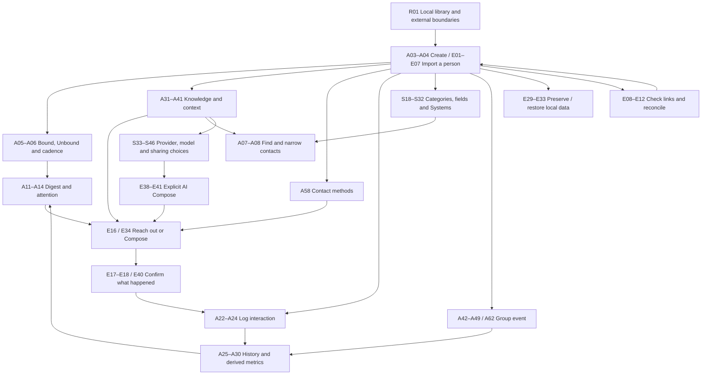

# Phase 39 — Exhaustive New-User Journey Discovery

**Workpaper · 2026-10-02 · Current Android product · No onboarding selection or design**

## 1. Executive summary

This discovery inventory contains **145 candidate journeys/concepts**, deliberately including conditional, advanced, recovery and configuration workflows. **11 were directly explored as read/concept journeys on the Pixel, 63 were partially exercised or inspected before their consequential step, and 71 are code-grounded only**. Thus 74 candidates have device evidence. These are discovery observation counts, not successful completion or UAT pass counts.

Coverage spans Digest, Contacts, relationship tracking, Profiles and presentation, interaction logging/history, group events, Things to Remember, categories/custom fields, Systems management, Compose/AI, Settings, Android import/reconciliation/share/communication, reminders/widget, archive/recovery and backup/restore. Seven exact duplicates were consolidated from 149 initial entries; independent coverage review added three concepts, yielding 145. No candidate was excluded for being obvious, low priority or unsuitable for a particular teaching mechanism. Parent workflows and their **Potential teaching moments** are retained separately.

The current Orrery was never opened or exercised. Its controls and interaction model contribute no candidates. Two existing Orrery-adjacent Settings candidates and eight System-management candidates remain in scope outside the renderer; future visualization teaching awaits an implemented Phase 38.7.

The largest observation limits are fresh-install/empty-library states, saved mutation outcomes, AI setup/generation, notification delivery/actions, functioning widget contents, import completion/duplicate resolution, destructive recovery/merge/restore and all current/future Orrery behavior. Those capabilities are preserved as candidates with actual source grounding rather than staged on personal data.

## 2. Method and scope

### Sources and product baseline

Read `AGENTS.md`, `HANDOFF.md`, the Android/device guidance in `CLAUDE.md`, `docs/runbooks/desktop-build-pipeline.md`, `.planning/ROADMAP.md`, relevant KB/runbooks and actual navigation/screens/components/stores/services/DAOs. The current Phase 39 roadmap entry defines first-run setup/teaching against the implemented product, with requirements, plans and success criteria deferred. Phases 37, 38 and the completed intervening polish/hardening/photo work inform the current app; Phase 38.7 is planned and separate. This workpaper supplies discovery evidence, not a Phase 39 plan or canonical dossier.

Code baseline inspected: `e545af03` (`docs(38.7): cross-AI review (codex + claude)`). Installed runtime corroborated package `com.bwales.orbit`, versionName `1.0.0`/versionCode `1`, on the owner-provided recent release. The semantic APK version alone does not identify its source commit; code-only conditional behavior is not asserted to have run in that APK.

`emu-connect status` and SDK adb confirmed **one physical Pixel 3a**, with serial resolved from `adb devices` at runtime. No serial was hardcoded. The lead alone drove the phone. Semantic UIAutomator bounds/labels guided taps; screenshots supported visual context for Digest/events/Capture. Dumps occasionally returned only the lock screen or failed, so they were retried rather than treated as application defects. No performance conclusion is drawn.

Three independent code inventories covered product reachability, Settings/configuration and external/conditional workflows. A fourth reviewer checked the combined inventory against actual code after the physical exploration. Each inspected full current files and related data owners rather than a diff or another agent's summary. The lead checked review corrections against current implementation, including starting-interaction creation, metric windows, cadence-only Profile actions, photo lightbox and actual reconciliation/merge callers. Graph discovery was used for governing-decision discovery; returned `governed_by` evidence was **INFERRED**, not a substitute for actual code. No graph was rebuilt.

### Safe exploration and runtime side effects

No application source/configuration changes, builds, installs, commits, pushes, data clearing, device reset, contact edits/deletions, message sends, calls, AI requests or backup/restore operations were performed. Forms were opened and left without saving changed content. Persistent settings and OS permissions were not intentionally changed. The phone was returned to Digest.

A linked-contact check created a durable unresolved reconciliation session and staged source review assets. Its resume prompt was inspected, and **only the unresolved session created in this walkthrough was discarded**. No reconciliation Apply, relink, unlink or contact merge was executed. This is a real discovery-time session write, not a claim of zero runtime writes. App launch/resume may also run its ordinary housekeeping, scheduling or already-configured backup policy; those background effects were not used as evidence of successful maintenance.

A disposable text share opened Capture, cancelled before a contact tap could save it. Widget setup reached the Android Launcher 4×2 pin prompt, then cancelled without adding a widget. Android Contacts was already permitted; notification OS access was allowed while Orbit's master was off; Assist was on; AI master was off; Archived Contacts was empty. These existing conditions explain several gaps. No Android permission request was newly staged.

### Evidence labels and counting

- **YES:** a safe read/concept journey was directly explored, such as reading Digest/day detail, Profile navigation or History date detail. Untested alternate branches remain explicitly described.
- **PARTIAL:** a meaningful workflow surface/form/configuration or conditional subflow was reached, but Save/Apply/Transmit/provider request/destructive consequence or another major branch was withheld.
- **NO:** the workflow itself was not entered. A visible menu item alone is insufficient. Actual source establishes the candidate, not runtime completion.

Private XML/image research artifacts remain under `/tmp/orbit39-private`; they may contain personal information and are **non-public reference material**. They are not embedded, copied into the repository or intended for marketing. Evidence labels in individual records identify observations without disclosing contact identities or destinations. The only repository deliverable is this workpaper, at the requested location, which fits the existing `docs/dossier/workpapers/` organization.

## 3. Explicit Orrery exclusion

Excluded: current Orrery screen, renderer, gestures, camera/pan/zoom, body/satellite interactions, visual System switching, old Unbound Belt controls and visualization onboarding. No current renderer Preview was entered, including SystemBuilder Preview. No future interaction model is inferred from old code.

Included outside Orrery: categories, Bound/Unbound/cadence, Profile Status/Gravity/Intensity, Key People/links, own identity/star/center Settings, existing Density/Relationship Satellites Settings and full Systems membership management. S05/S06 inventory the present configuration surfaces; their future significance/survival requires V2 revalidation. The dedicated follow-up list is in §10.

## 4. Current product surface map

| Surface / entry | Connected user work | Candidate IDs / reachability limits |
|---|---|---|
| Root shell | Digest landing; Contacts, Events, Settings tabs; stacks/Back; universal FAB and person picker | A01–A02, R03. Orrery destination acknowledged only as excluded. |
| Digest | Up Next attention; Horizon birthday/overlooked/never-contacted; Your Week metrics and read-only day detail | A11–A14; A12 is classified under Relationship & Tracking. |
| Contacts | Population/Filter/Sort; card/list/search; swipe/long-press; Select/bulk; unbound/archived entry | A07–A10, A15, A19, E26–E27. Search includes remembered knowledge; match explanations are informational. |
| FAB / creation | Add Contact, Import Contacts, Log Interaction, Group Log, Add Memory, Update Contact; contextual targeting | A02–A06, A22–A24, A32, A41–A42, E01–E07. Quick Log is an immediate-write shortcut, not an untouched draft. |
| Profile | Photo/identity/star; Message/Call; Overview explanations; knowledge/contact methods/History; overflow lifecycle and presentation | A16–A20, A25–A40, A51–A61, E16–E18, E34–E41, R02. Actual Profile has no merge/reconciliation launcher. |
| Edit / focused Update | Full-form Save with independent immediate commits; focused knowledge/frequency workflows | A18, A36–A41, A51–A52, A57–A58. Save/discard contracts vary by host. |
| Knowledge surfaces | Things to Remember; typed Memories; current values and history; Key People; Off Limits; custom values; per-item AI eligibility; memory trash | A31–A41, E28. Recently Deleted is person-scoped memory recovery, not contact trash. |
| Interaction History | Last interaction explanation; heatmap/Rolodex day drill-down; windows/cycles; detail/refine/delete/group conversion | A25–A30, A62. Overview and History Intensity windows differ. |
| Events | Group list/detail; group logging/editing; participant records/inheritance; add/remove/dissolve/delete | A42–A49, A62. Zero-participant event is valid; group notes differ from person notes. |
| Compose / Research | Manual body/subject, Copy/Transmit, session draft, read-only knowledge, focus, explicit AI alternatives/context/errors | E34–E41, E16–E18. Endpoint/host eligibility differs from already-open session fallbacks. |
| Settings directory | Appearance; Contacts & Relationships; Interactions; Notifications; Orrery settings; Data & Backup; AI; About; widget entry | S01–S46 excluding exact aliases; E23, E29–E33. About is version-only. |
| Categories / fields | Category CRUD/order/reassignment; ten custom types, visibility/options/raw-value preservation, quarantine/recovery | S18–S24, A40. Current normalized storage is authoritative; no dynamic-column teaching. |
| Systems outside renderer | Built-in/custom catalog, rules, manual deltas, duplicate/order/hide/delete/Undo/reset/Needs attention | S25–S32. Preview and visualization use excluded. |
| Android import / linked check | Runtime-dependent picker; review/batch/source consolidation/dedup/progress/recovery; explicit reconciliation/missing source/merge | E01–E12, S07–S08. Current merge launcher exists through linked-check detail/relink conflict. |
| External share | ACTION_SEND Capture, single/multiple recipients, optional inline creation/context | E13–E15. Single recipient tap commits immediately. |
| Android messaging / Assist | Direct phone/email actions, destination chooser, handler failures, return confirmations/pending queue | E16–E18, E34–E41. Handoff does not prove send or connection. |
| Notifications / launcher widget | Consent/master/types/timing/privacy; reminder taps/actions; favourites-backed widget by size | S14–S17, E20–E25. No live reminder/widget actions staged. |
| Data maintenance | Archive/restore/permanent deletion; memory recovery; JSON export/automatic SAF backups/encryption/restore preview/merge/replace/recovery | E26–E33, S24. Multiple retention and deletion models coexist. |

## 5. Exhaustive candidate journey inventory

Stable temporary prefixes identify source tracks (**A** product surfaces, **S** Settings, **E** external/conditional, **R** coverage additions), not priority. Area grouping is for retrieval. Related IDs/ranges identify overlap or useful connections, not a requirement that all be taught. Every record preserves the requested fields and a separate teaching-moments list. Moments are discovery prompts, not tutorial copy or a selected delivery method.

### AI

#### S33 — Turn optional AI on/off without losing setup

- **ID:** S33
- **Name:** Turn optional AI on/off without losing setup
- **Area:** AI
- **User goal:** Decide when AI capability is available.
- **Entry point(s):** Settings → AI → AI Enabled.
- **Prerequisites:** Setup for Ready; not required for toggle.
- **Flow:** Enable exposes hierarchy; disable simplifies; manage saved connections even while off; reenable restores settings.
- **Concepts being learned:** Master differs from connection/model/readiness/item permission; off retains configuration; AI only invoked intentionally from Compose.
- **Why it might need teaching:** Enabling is not blanket permission or automatic generation.
- **Related journeys:** S34-S46, AI Compose.
- **Observed on device:** PARTIAL
- **Grounding:** Device observation (see Device evidence) and code inspection: src/screens/SettingsAIScreen.tsx; src/screens/settings-ai-hub-logic.ts; src/stores/ai-config-store.ts
- **Device evidence:** ai-hub; current AI master-off state and saved-setup explanation inspected; no toggle.
- **Notes:** None specifically identified.

**Potential teaching moments**

- Off explanatory state.
- saved escape hatch.
- Ready vs Needs attention.
- no consent changed by master.

#### S34 — Connect OpenRouter through Android browser

- **ID:** S34
- **Name:** Connect OpenRouter through Android browser
- **Area:** AI
- **User goal:** Access available AI models using one connection.
- **Entry point(s):** AI → Connection → Recommended OpenRouter → Connect.
- **Prerequisites:** Network, browser, OpenRouter authorization/account.
- **Flow:** Start browser authorization; return via callback; choose model if none remembered; activate.
- **Concepts being learned:** Provider path can include OpenRouter and model provider; connection/model separate; cancellation retains former active lane.
- **Why it might need teaching:** External auth and app return can be confusing; selected provider affects data route.
- **Related journeys:** S37/S38/S46, external OAuth.
- **Observed on device:** PARTIAL
- **Grounding:** Device observation (see Device evidence) and code inspection: src/screens/AIConnectionScreen.tsx; src/ai/openrouter-oauth.ts
- **Device evidence:** ai-connections; OpenRouter connection option inspected; browser OAuth not launched.
- **Notes:** Do not authorize/connect owner's account for discovery.

**Potential teaching moments**

- Browser handoff.
- returning.
- model choice.
- previous-connection-preserved error.

#### S35 — Configure direct AI provider keys

- **ID:** S35
- **Name:** Configure direct AI provider keys
- **Area:** AI
- **User goal:** Use own OpenAI/Anthropic/Google Gemini access.
- **Entry point(s):** AI → Connection → Advanced Setup provider cards.
- **Prerequisites:** User-owned credential, chosen model, network only on generation.
- **Flow:** Expand card; paste masked API key; Save key; choose/remember model; activate.
- **Concepts being learned:** Keys stored device-locally; provider metadata/model separate; each lane remembers model.
- **Why it might need teaching:** BYO-key setup is unlike enabling bundled assistant.
- **Related journeys:** S33/S37/S38, credential restore gap.
- **Observed on device:** NO
- **Grounding:** Code inspection: src/screens/AIConnectionScreen.tsx; src/screens/ai-connection-logic.ts; src/db/ai-connections-dao.ts; src/services/ai-key-store.ts
- **Device evidence:** No workflow branch entered on Pixel. Grounded through actual code; seeing an entry/menu label alone is not counted as exercise.
- **Notes:** None specifically identified.

**Potential teaching moments**

- Secure field.
- Save key.
- selection completeness.
- lane switching.
- no key display in previews.

#### S36 — Configure a custom AI endpoint

- **ID:** S36
- **Name:** Configure a custom AI endpoint
- **Area:** AI
- **User goal:** Use selected OpenAI-compatible public HTTPS endpoint.
- **Entry point(s):** AI → Connection → Custom Endpoint.
- **Prerequisites:** Endpoint URL, model ID; optional endpoint-bound credential.
- **Flow:** Enter URL/credential/model; Connect; review validation/error.
- **Concepts being learned:** Public HTTPS only; custom model manual; credential belongs to endpoint; Orbit cannot govern operator retention.
- **Why it might need teaching:** LAN/Ollama or arbitrary URL expectations aren't supported; endpoint/model/credential must agree.
- **Related journeys:** S35/S37/S38/S46.
- **Observed on device:** NO
- **Grounding:** Code inspection: src/screens/AIConnectionScreen.tsx; src/screens/ai-connection-logic.ts; src/ai/custom-endpoint.ts
- **Device evidence:** No workflow branch entered on Pixel. Grounded through actual code; seeing an entry/menu label alone is not counted as exercise.
- **Notes:** No live requests/config changes for discovery.

**Potential teaching moments**

- URL requirements.
- optional credential.
- operator caveat.
- replacement endpoint may require fresh key.

#### S37 — Select, inspect, and refresh AI models

- **ID:** S37
- **Name:** Select, inspect, and refresh AI models
- **Area:** AI
- **User goal:** Choose suitable model and understand current selection/cost.
- **Entry point(s):** AI → Model; connection Choose model.
- **Prerequisites:** Saved connection lane; network for catalog refresh.
- **Flow:** Browse recommendations/all; search; More Info; inspect provider/pricing; choose; optionally manual ID; refresh catalog.
- **Concepts being learned:** Model belongs to lane; selected marker survives hidden/manual IDs; OpenRouter real pricing vs direct cost unavailable; catalog cache usable offline.
- **Why it might need teaching:** Many model names/costs; refresh is catalog lookup rather than generation; choosing may activate lane.
- **Related journeys:** S34-S36/S38/S42.
- **Observed on device:** NO
- **Grounding:** Code inspection: src/screens/AIModelPickerScreen.tsx; src/screens/ai-model-picker-logic.ts; src/db/ai-connections-dao.ts
- **Device evidence:** No workflow branch entered on Pixel. Grounded through actual code; seeing an entry/menu label alone is not counted as exercise.
- **Notes:** None specifically identified.

**Potential teaching moments**

- Current model.
- recommended/all.
- search.
- context More Info.
- manual fallback.
- saved-list failure.

#### S38 — Switch or remove saved AI credentials

- **ID:** S38
- **Name:** Switch or remove saved AI credentials
- **Area:** AI
- **User goal:** Reuse several setups or revoke a saved provider credential.
- **Entry point(s):** AI Connections, including master-off escape hatch.
- **Prerequisites:** Saved lane(s).
- **Flow:** Expand Active/Saved card; Use saved connection; Choose model; Disconnect/Remove key confirm.
- **Concepts being learned:** One active lane but many saved; keys removable while remembered model/personalization retained; other connections unaffected.
- **Why it might need teaching:** Saved isn't active/ready; off doesn't erase secrets; disconnect isn't wiping all AI config.
- **Related journeys:** S33-S37, backup/restore credential re-entry.
- **Observed on device:** NO
- **Grounding:** Code inspection: src/screens/AIConnectionScreen.tsx; src/screens/ai-connection-logic.ts; src/services/ai-key-store.ts
- **Device evidence:** No workflow branch entered on Pixel. Grounded through actual code; seeing an entry/menu label alone is not counted as exercise.
- **Notes:** None specifically identified.

**Potential teaching moments**

- Active/Saved badges.
- retained model.
- confirmation consequence.
- removed key makes active lane need attention.

#### S39 — Tune global AI Writing Style

- **ID:** S39
- **Name:** Tune global AI Writing Style
- **Area:** AI
- **User goal:** Make generated messages match one's voice.
- **Entry point(s):** AI → Writing Style.
- **Prerequisites:** None for editing; configured AI for use.
- **Flow:** Choose Tone/Length/Directness; choose custom guidance per axis; freeform instructions; Save Writing Style.
- **Concepts being learned:** Global guidance influences drafts, doesn't send message; custom mode replaces that axis controls; explicit save.
- **Why it might need teaching:** Three independent style dimensions and freeform can overlap.
- **Related journeys:** S40/S42, AI Compose adjustments.
- **Observed on device:** NO
- **Grounding:** Code inspection: src/screens/AIPersonalizationScreen.tsx; src/db/personalization-dao.ts
- **Device evidence:** No workflow branch entered on Pixel. Grounded through actual code; seeing an entry/menu label alone is not counted as exercise.
- **Notes:** None specifically identified.

**Potential teaching moments**

- Balanced defaults.
- per-axis custom mode.
- Save.
- distinction from session rewrite adjustments.

#### S40 — Maintain AI Personalization Context sections

- **ID:** S40
- **Name:** Maintain AI Personalization Context sections
- **Area:** AI
- **User goal:** Give AI relevant general background while keeping selected sections local.
- **Entry point(s):** AI → Personalization Context.
- **Prerequisites:** None; optional AI use later.
- **Flow:** Add/paste titled body; Save section; enable/disable Send toggle; rename/edit; reorder; delete confirm.
- **Concepts being learned:** Global enabled sections sent when AI invoked; disabled remain stored locally; order organizational/equal weight; new sections enabled.
- **Why it might need teaching:** Saving context and allowing transmission are linked through enabled flag, unlike note defaults.
- **Related journeys:** S39/S41-S45.
- **Observed on device:** NO
- **Grounding:** Code inspection: src/screens/AIPersonalizationScreen.tsx; src/db/personalization-dao.ts
- **Device evidence:** No workflow branch entered on Pixel. Grounded through actual code; seeing an entry/menu label alone is not counted as exercise.
- **Notes:** None specifically identified.

**Potential teaching moments**

- Empty transition.
- title/body.
- enabled consequence.
- Move up/down.
- section options.
- deletion vs disabling.

#### S41 — Import or replace AI context from a text file

- **ID:** S41
- **Name:** Import or replace AI context from a text file
- **Area:** AI
- **User goal:** Reuse existing writing/context notes.
- **Entry point(s):** Personalization Context → Import .txt / .md; section options → Replace from file.
- **Prerequisites:** Plain text/Markdown file accessible through picker.
- **Flow:** Pick file; store editable section or replace body; review locally.
- **Concepts being learned:** Imports snapshot text, not live linked file; filename seeds title; replacing differs from adding; enabled sections may be sent later.
- **Why it might need teaching:** Editing source file won't update app; replace may overwrite prior local section text.
- **Related journeys:** S40/S42/S45.
- **Observed on device:** NO
- **Grounding:** Code inspection: src/screens/AIPersonalizationScreen.tsx; src/db/personalization-dao.ts
- **Device evidence:** No workflow branch entered on Pixel. Grounded through actual code; seeing an entry/menu label alone is not counted as exercise.
- **Notes:** None specifically identified.

**Potential teaching moments**

- Native picker.
- accepted file types.
- cancellation.
- independent local copy.
- replacement consequence.

#### S42 — Understand AI context estimates/capacity

- **ID:** S42
- **Name:** Understand AI context estimates/capacity
- **Area:** AI
- **User goal:** Keep personalization compatible with chosen model and understand likely cost.
- **Entry point(s):** Personalization estimate card; Compose pre-request overflow.
- **Prerequisites:** Guidance/context; selected model metadata for capacity; OpenRouter pricing for cost.
- **Flow:** Review estimated tokens/cost; see overflow; reduce/disable context or choose suitable model.
- **Concepts being learned:** Estimates local/approximate; direct/custom cost may be unavailable; personalization estimate isn't complete final prompt bill; no silent content truncation.
- **Why it might need teaching:** Tokens and context window/cost differ from text length and actual charge.
- **Related journeys:** S37/S39-S41, AI Compose.
- **Observed on device:** NO
- **Grounding:** Code inspection: src/screens/AIPersonalizationScreen.tsx; src/screens/ai-personalization-logic.ts; src/ai/context-estimate.ts
- **Device evidence:** No workflow branch entered on Pixel. Grounded through actual code; seeing an entry/menu label alone is not counted as exercise.
- **Notes:** None specifically identified.

**Potential teaching moments**

- Recalculating.
- known/unknown capacity.
- unavailable cost.
- overflow consequence.

#### S43 — Choose AI defaults for new information

- **ID:** S43
- **Name:** Choose AI defaults for new information
- **Area:** AI
- **User goal:** Decide whether newly created memories/interaction notes/custom fields default to shareable.
- **Entry point(s):** AI → AI Data Permissions → Defaults for new information.
- **Prerequisites:** None.
- **Flow:** Toggle three category defaults; follow Review existing for old items.
- **Concepts being learned:** New items only; no retroactive grant/revoke; custom-field default applies new definitions.
- **Why it might need teaching:** A global-looking switch isn't a bulk change to existing data.
- **Related journeys:** S21/S44, memories/logging creation.
- **Observed on device:** NO
- **Grounding:** Code inspection: src/screens/AIPermissionsScreen.tsx; src/db/ai-permissions-dao.ts
- **Device evidence:** No workflow branch entered on Pixel. Grounded through actual code; seeing an entry/menu label alone is not counted as exercise.
- **Notes:** None specifically identified.

**Potential teaching moments**

- Explicit new-only note.
- default-off.
- Review existing link.
- per-item editor can override creation default.

#### S44 — Review/revoke/grant AI access to existing information

- **ID:** S44
- **Name:** Review/revoke/grant AI access to existing information
- **Area:** AI
- **User goal:** Know and control what information AI may use.
- **Entry point(s):** AI → AI Data Permissions → Review existing; local item editor consent switches.
- **Prerequisites:** Nonblank live memories/notes/custom values.
- **Flow:** Search contacts; filter type/Enabled only; expand contact; select rows; Enable/Disable selected; review impact/confirm.
- **Concepts being learned:** Access total vs currently filtered list; visible explicit selection; permission != current prompt inclusion; custom-field permission is definition-wide across contacts; Off Limits/Group Notes unavailable for AI.
- **Why it might need teaching:** A row under one contact can expand sharing across every value of that definition; filtering doesn't revoke data.
- **Related journeys:** S43/S45, memories/logging/custom fields, Off Limits.
- **Observed on device:** NO
- **Grounding:** Code inspection: src/screens/AIPermissionsScreen.tsx; src/db/ai-permissions-dao.ts; src/db/ai-context-read.ts; src/screens/settings-ai-logic.ts
- **Device evidence:** No workflow branch entered on Pixel. Grounded through actual code; seeing an entry/menu label alone is not counted as exercise.
- **Notes:** None specifically identified.

**Potential teaching moments**

- Global/list/contact counts.
- Enabled only initially on.
- Review existing turns off.
- checkboxes select rather than instantly toggle.
- full impact confirmation.

#### S45 — Preview what Orbit sends without making a request

- **ID:** S45
- **Name:** Preview what Orbit sends without making a request
- **Area:** AI
- **User goal:** Inspect permitted contact/global context before invoking AI.
- **Entry point(s):** AI → Preview What Orbit Sends; Compose context review.
- **Prerequisites:** Contact optional; existing configuration/context.
- **Flow:** Inspect example prompt; choose real contact; toggle readable/raw view; inspect contact sharing summary.
- **Concepts being learned:** Resolution local; keys never in prompt; selected permission items plus baseline name/category/aggregate context; no-permitted-items doesn't mean empty payload; Off Limits excluded.
- **Why it might need teaching:** Local-first exception and actual transmitted context need clear understanding.
- **Related journeys:** S33/S39-S44, AI Compose/Message Focus.
- **Observed on device:** NO
- **Grounding:** Code inspection: src/screens/AIPreviewScreen.tsx; src/screens/settings-ai-logic.ts; src/db/ai-context-read.ts
- **Device evidence:** No workflow branch entered on Pixel. Grounded through actual code; seeing an entry/menu label alone is not counted as exercise.
- **Notes:** None specifically identified.

**Potential teaching moments**

- Example vs chosen contact.
- whole prompt vs contact-only review.
- raw bytes/readable.
- credential separation.
- loading/error.

#### S46 — Understand the first AI data-path disclosure

- **ID:** S46
- **Name:** Understand the first AI data-path disclosure
- **Area:** AI
- **User goal:** Understand where intentional AI requests go.
- **Entry point(s):** One-time disclosure after complete local AI setup (Settings AI / Compose host).
- **Prerequisites:** AI enabled, connection/model complete; hosted credential if applicable; undisclosed device.
- **Flow:** Read Before you use AI; note provider path; acknowledge Got it; later inspect preview.
- **Concepts being learned:** OpenRouter+model provider vs direct/custom operator; only allowed information; device-local acknowledgment is transparency, not recurring send gate.
- **Why it might need teaching:** App is otherwise local-first; routing chain differs by setup.
- **Related journeys:** S34-S38/S44-S45, AI Compose.
- **Observed on device:** NO
- **Grounding:** Code inspection: src/components/AIFirstUseDisclosure.tsx; src/screens/settings-ai-logic.ts
- **Device evidence:** No workflow branch entered on Pixel. Grounded through actual code; seeing an entry/menu label alone is not counted as exercise.
- **Notes:** None specifically identified.

**Potential teaching moments**

- Path names.
- Got it.
- prompt preview availability.
- custom operator caveat.

### Appearance

#### S02 — Personalize the app's appearance

- **ID:** S02
- **Name:** Personalize the app's appearance
- **Area:** Appearance
- **User goal:** Make the app comfortable/readable and visually personal.
- **Entry point(s):** Settings → Appearance → Theme.
- **Prerequisites:** None.
- **Flow:** Choose Galaxy/Standard, light/dark/system mode, accent, background.
- **Concepts being learned:** Package and mode are independent; each package remembers mode/accent/background; backgrounds fixed behind screens; None solid/default.
- **Why it might need teaching:** Several axes can seem interchangeable, and switching package does not discard old choices.
- **Related journeys:** S03/S04, profile presentation.
- **Observed on device:** PARTIAL
- **Grounding:** Device observation (see Device evidence) and code inspection: src/screens/SettingsAppearanceScreen.tsx; src/screens/settings-appearance-background.ts; src/screens/settings-appearance-persist.ts; src/stores/theme-store.ts
- **Device evidence:** appearance, appearance-middle; theme/mode/accent/background controls inspected, no preference changed.
- **Notes:** None specifically identified.

**Potential teaching moments**

- Live restyle.
- mode-specific thumbnail.
- per-package remembering.
- accent changes buttons/links.
- save-error restores last saved appearance.

#### S03 — Set your own identity

- **ID:** S03
- **Name:** Set your own identity
- **Area:** Appearance
- **User goal:** Personalize the owner identity distinct from contacts.
- **Entry point(s):** Settings → Appearance → Your profile.
- **Prerequisites:** Photo source access when chosen.
- **Flow:** Enter name (save on blur/submit), choose/crop/remove own photo.
- **Concepts being learned:** Owner profile is separate; blank name uses You.
- **Why it might need teaching:** No ordinary contact edit route for owner.
- **Related journeys:** photo/crop journeys, S05.
- **Observed on device:** PARTIAL
- **Grounding:** Device observation (see Device evidence) and code inspection: src/screens/SettingsAppearanceScreen.tsx; src/db/profile-dao.ts; src/components/PhotoSourcePicker.tsx
- **Device evidence:** appearance-middle; own-name/photo/star controls inspected, no name typed or blurred after change.
- **Notes:** None specifically identified.

**Potential teaching moments**

- Name save behavior.
- You fallback.
- self photo target and source picker.

#### S04 — Choose global profile presentation defaults

- **ID:** S04
- **Name:** Choose global profile presentation defaults
- **Area:** Appearance
- **User goal:** Reuse a saved layout/background across contacts.
- **Entry point(s):** Settings → Appearance → Profile Defaults.
- **Prerequisites:** Saved templates for meaningful alternatives.
- **Flow:** Choose default layout/background or Default / None.
- **Concepts being learned:** Global defaults are separate axes and weaker than individual profile assignments; no global override returns to factory/inherited defaults.
- **Why it might need teaching:** Changing an app theme, a profile template, and a particular contact's presentation are different operations.
- **Related journeys:** Profile layout/background/template journeys.
- **Observed on device:** PARTIAL
- **Grounding:** Device observation (see Device evidence) and code inspection: src/screens/SettingsAppearanceScreen.tsx; src/db/profile-presentation-read.ts
- **Device evidence:** appearance-bottom; global Profile defaults inspected, no assignment changed.
- **Notes:** None specifically identified.

**Potential teaching moments**

- Template names, Default/None clearing, own-layout/background exception.

### Backup & Restore

#### E29 — Export a portable copy of Orbit data

- **ID:** E29
- **Name:** Export a portable copy of Orbit data
- **Area:** Backup & Restore
- **User goal:** Keep a transferable backup or take data outside Orbit intentionally.
- **Entry point(s):** Settings Backup & Restore → Export now.
- **Prerequisites:** Local records; optional encryption passphrase.
- **Flow:** Export; if encryption enabled choose encrypted export or explicitly readable JSON alternative; Android share sheet selects destination; see missing-photo notice if applicable.
- **Concepts being learned:** Local-first data needs intentional backup; export includes contacts/notes/photos/settings and excludes API keys; exported readable data is accessible to whoever holds file; handing share sheet file is not proof user retained it.
- **Why it might need teaching:** Backup destination/security choice sits outside normal local-only use.
- **Related journeys:** E30–E33, local-first/AI credentials.
- **Observed on device:** NO
- **Grounding:** Code inspection: src/screens/BackupScreen.tsx; src/services/backup/share-export.ts; src/backup/export-manifest.ts
- **Device evidence:** No workflow branch entered on Pixel. Grounded through actual code; seeing an entry/menu label alone is not counted as exercise.
- **Notes:** No export performed during discovery absent staging authorization.

**Potential teaching moments**

- Export.
- encrypted/readable choice.
- OS destination.
- contents.
- missing photos.
- manual save versus automatic backup.

#### E30 — Configure and monitor automatic local backups

- **ID:** E30
- **Name:** Configure and monitor automatic local backups
- **Area:** Backup & Restore
- **User goal:** Preserve changes without manually exporting every time.
- **Entry point(s):** Backup health card Set up/Manage backups → Backup settings.
- **Prerequisites:** User-selected Android Storage Access Framework folder/grant.
- **Flow:** Choose folder in Android; choose backup cadence/retention in days; Save schedule; open backup folder; return to health card to inspect last backup/file count; reconnect lost folder when needed.
- **Concepts being learned:** Automatic backup runs after app opens when due and changed, not a continuous background/cloud account service; permission grants belong to chosen folder; retention governs copies; health can be stale/unconfigured/lost-folder/too-large.
- **Why it might need teaching:** The word automatic can imply stronger guarantees than implemented scheduling and access.
- **Related journeys:** E29, E31, E32.
- **Observed on device:** PARTIAL
- **Grounding:** Device observation (see Device evidence) and code inspection: src/screens/BackupSettingsScreen.tsx; src/screens/backup-health-logic.ts; src/services/backup-sweep.ts
- **Device evidence:** backup, backup-settings, backup-settings-bottom; existing chosen folder/cadence/retention and health state inspected. Automatic job not deliberately triggered.
- **Notes:** User may choose a provider shown by Android; app itself has no backend/sync. Folder Open fallback instructs Files when unsupported.

**Potential teaching moments**

- Backup nudge.
- folder picker/grant.
- changed+due+open.
- cadence.
- retention.
- health.
- reconnect.
- Files fallback.

#### E31 — Set up or change backup encryption

- **ID:** E31
- **Name:** Set up or change backup encryption
- **Area:** Backup & Restore
- **User goal:** Protect exported backup contents and maintain a usable passphrase.
- **Entry point(s):** Backup Encryption row → Backup settings.
- **Prerequisites:** New passphrase/confirmation; current passphrase for change; accessible folder for reencrypt.
- **Flow:** Enable with confirmed passphrase; change using current/new confirmation and choose re-encrypt accessible automatic copies or future-only; forgotten passphrase sets new protection only for future files; turn off with explicit readable-new-backups confirmation.
- **Concepts being learned:** Backup encryption is not an app lock; old encrypted copies need old passphrase; shared manual copies are not rewritten; forgetting passphrase does not make old encrypted backups recoverable; disabling doesn't decrypt old files.
- **Why it might need teaching:** Several future-versus-existing-file boundaries have permanent recovery implications.
- **Related journeys:** E29, E30, E32.
- **Observed on device:** PARTIAL
- **Grounding:** Device observation (see Device evidence) and code inspection: src/screens/BackupSettingsScreen.tsx; src/screens/backup-settings-logic.ts; src/services/backup/passphrase-store.ts
- **Device evidence:** backup-settings-bottom; encryption-off and passphrase enable form inspected, no phrase entered or settings saved.
- **Notes:** Owner security posture must not be changed for discovery.

**Potential teaching moments**

- Long unique phrase.
- confirmation.
- irrecoverability.
- current vs future.
- reencrypt scope.
- forgotten workflow.
- disable consequence.

#### E32 — Restore with preview and choose Merge versus Replace all

- **ID:** E32
- **Name:** Restore with preview and choose Merge versus Replace all
- **Area:** Backup & Restore
- **User goal:** Recover or move Orbit data from an existing backup while controlling local consequences.
- **Entry point(s):** Backup & Restore → Restore a backup; Android Files JSON share → Orbit.
- **Prerequisites:** Valid compatible backup; encrypted file's passphrase; available photos/backgrounds where applicable.
- **Flow:** Choose/share file; decrypt if needed; validate before preview; inspect source date/counts/version/encryption/tombstones; choose Merge (keeps newer local changes) or Replace all (destructive); answer relevant confirmation; apply; inspect result counts and return.
- **Concepts being learned:** Merge is identity/timestamp reconciliation, not another contact import; backup deletions can apply; Replace destroys current dataset; configured backup destination enables verified pre-restore snapshot; API keys require separate reconfiguration.
- **Why it might need teaching:** A single restore feature offers two materially different consequences and protected preview is not yet application.
- **Related journeys:** E29–E31, E33, credentials.
- **Observed on device:** NO
- **Grounding:** Code inspection: src/screens/BackupScreen.tsx; src/screens/RestorePreviewScreen.tsx; src/screens/RestoreResultScreen.tsx; src/backup/restore-apply.ts
- **Device evidence:** No workflow branch entered on Pixel. Grounded through actual code; seeing an entry/menu label alone is not counted as exercise.
- **Notes:** Restore not executed on owner's state. Background no longer available prompts before default replacement. Replace without configured destination explains missing safety snapshot.

**Potential teaching moments**

- File selection vs share ingress.
- passphrase.
- preview.
- source date.
- tombstones.
- Merge/Replace.
- safety snapshot.
- background consent.
- result.

#### E33 — Recover from backup selection, decryption or restore problems

- **ID:** E33
- **Name:** Recover from backup selection, decryption or restore problems
- **Area:** Backup & Restore
- **User goal:** Complete recovery without confusing failed preview or incomplete side effects with lost local data.
- **Entry point(s):** Restore error/passphrase panel; expired RestorePreview; RestoreResult pending notices; backup health warnings.
- **Prerequisites:** Invalid/incompatible file, wrong passphrase, expired preview or failed ancillary work.
- **Flow:** Try passphrase again or choose another file; Files share fallback if picker cannot open; choose file again for expired preview; after committed restore notice photos/cleanup/reminders scheduled to retry on next Orbit open.
- **Concepts being learned:** Failed validation hasn't changed local data; restored data can be committed while photo/reminder effects remain pending; skipped photo warning differs from failed entire restore.
- **Why it might need teaching:** Error messages mention related assets and can make user repeat a restore unnecessarily.
- **Related journeys:** E30–E32.
- **Observed on device:** NO
- **Grounding:** Code inspection: src/screens/backup-restore-logic.ts; src/screens/BackupScreen.tsx; src/screens/RestorePreviewScreen.tsx; src/screens/RestoreResultScreen.tsx
- **Device evidence:** No workflow branch entered on Pixel. Grounded through actual code; seeing an entry/menu label alone is not counted as exercise.
- **Notes:** Code-grounded only; no malformed restore or intentional folder/permission failure staged.

**Potential teaching moments**

- No-local-change notice.
- retry passphrase.
- reselect.
- expired preview.
- background unavailable.
- restored-missing photos.
- next-open retries.

### Capture

#### E13 — Save shared text or a link to a person

- **ID:** E13
- **Name:** Save shared text or a link to a person
- **Area:** Capture
- **User goal:** Remember something useful to discuss later while in another app.
- **Entry point(s):** Android Share → Orbit (plain text/link).
- **Prerequisites:** Share payload; live person or inline create.
- **Flow:** See payload preview; optionally reveal search; tap a person to save immediately; briefly see Saved to …; automatically return to source app.
- **Concepts being learned:** Captured content becomes a topic/Things to Remember, not an interaction; link is stored, not opened during capture; favourites and capture recency influence picker order.
- **Why it might need teaching:** The one-tap write/return workflow differs from a conventional editor with Save.
- **Related journeys:** Memories/fuel, E14, E15.
- **Observed on device:** PARTIAL
- **Grounding:** Device observation (see Device evidence) and code inspection: src/screens/CaptureScreen.tsx; src/db/capture-dao.ts; src/db/capture-read.ts; app.config.ts
- **Device evidence:** capture-reference; ACTION_SEND disposable text entered Capture preview/grid; cancelled before contact tap (which would commit).
- **Notes:** Plain-text shares supported; image/file/multi-item sharing is not the text Capture feature. Research must not launch a real external share accidentally.

**Potential teaching moments**

- Android share target.
- preview.
- search reveal.
- tap commits.
- auto-return.
- locate later on profile.
- capture does not reset relationship recency.

#### E14 — Share one item to several people

- **ID:** E14
- **Name:** Share one item to several people
- **Area:** Capture
- **User goal:** Save the same conversation topic independently to multiple contacts.
- **Entry point(s):** Capture → long-press a contact.
- **Prerequisites:** Plain-text share and live people.
- **Flow:** Long-press into multiselect; tap to toggle people; Done saves to selected people; optional note applies to all resulting rows; Back exits selection without writing; Close cancels whole capture.
- **Concepts being learned:** Multiselect fans out independent saved topics; selecting does not write until Done; Back and Close differ.
- **Why it might need teaching:** Gesture and changed save semantics are hidden from ordinary one-tap flow.
- **Related journeys:** E13, E15.
- **Observed on device:** NO
- **Grounding:** Code inspection: src/screens/CaptureScreen.tsx; src/db/capture-dao.ts
- **Device evidence:** No workflow branch entered on Pixel. Grounded through actual code; seeing an entry/menu label alone is not counted as exercise.
- **Notes:** Done disabled at zero; single selected person still possible.

**Potential teaching moments**

- Long-press.
- selection count.
- Done.
- independent per-person items.
- Back versus Close.

#### E15 — Add context or create a person during capture

- **ID:** E15
- **Name:** Add context or create a person during capture
- **Area:** Capture
- **User goal:** Preserve why an item matters or attach it to someone not yet in Orbit.
- **Entry point(s):** Capture Add a note after save; plus New contact tile before save.
- **Prerequisites:** Shared item; for note, saved row(s).
- **Flow:** Tap New contact; type name; Create and save creates person and topic; or tap Add a note after selecting person to stop auto-return, type context and Done/Skip.
- **Concepts being learned:** Name-only person can be enriched later; person has no logged interaction simply because a link was saved; note supplements existing captured text/link after commit.
- **Why it might need teaching:** Post-save note is easy to miss and inline creation bypasses full contact form.
- **Related journeys:** E13, E14, manual creation/profile.
- **Observed on device:** NO
- **Grounding:** Code inspection: src/screens/CaptureScreen.tsx; src/db/capture-dao.ts
- **Device evidence:** No workflow branch entered on Pixel. Grounded through actual code; seeing an entry/menu label alone is not counted as exercise.
- **Notes:** Blank note behaves as skip; canceling note does not undo initial saved capture.

**Potential teaching moments**

- Plus tile.
- minimum name.
- later enrichment.
- immediate saved row.
- stop timer.
- optional note.
- preserved URL.

### Categories

#### S18 — Build and maintain your category taxonomy

- **ID:** S18
- **Name:** Build and maintain your category taxonomy
- **Area:** Categories
- **User goal:** Organize people into personally useful relationship groups.
- **Entry point(s):** Settings → Contacts & Relationships → Categories; contact/import category selectors.
- **Prerequisites:** None; contacts for assignments.
- **Flow:** Add category; name; assign in contact workflow; inspect counts; rename.
- **Concepts being learned:** Category is reusable taxonomy and produces category System; Uncategorized permanent fallback; names unique across categories/Systems.
- **Why it might need teaching:** Categories affect more than a visible list label; Uncategorized is not an editable real category.
- **Related journeys:** contact creation/edit/import, S25-S26.
- **Observed on device:** PARTIAL
- **Grounding:** Device observation (see Device evidence) and code inspection: src/screens/CategoryManagementScreen.tsx; src/db/categories-dao.ts; src/screens/settings-contacts-model.ts
- **Device evidence:** categories; custom and permanent Uncategorized entries/counts inspected; no creation/rename.
- **Notes:** None specifically identified.

**Potential teaching moments**

- Add/name/duplicate-name rejection.
- counts all contact statuses.
- Uncategorized.
- rename keeps identity.

#### S19 — Reorder categories

- **ID:** S19
- **Name:** Reorder categories
- **Area:** Categories
- **User goal:** Put useful groups first.
- **Entry point(s):** Categories drag handle or overflow Move earlier/later.
- **Prerequisites:** Multiple categories.
- **Flow:** Long-press drag or explicit movement action.
- **Concepts being learned:** Order shared across category consumers, distinct from renaming.
- **Why it might need teaching:** Drag gesture and alternate overflow actions may be undiscovered.
- **Related journeys:** S18/category selectors/Systems ordering.
- **Observed on device:** NO
- **Grounding:** Code inspection: src/screens/CategoryManagementScreen.tsx; src/db/categories-dao.ts
- **Device evidence:** No workflow branch entered on Pixel. Grounded through actual code; seeing an entry/menu label alone is not counted as exercise.
- **Notes:** None specifically identified.

**Potential teaching moments**

- Long-press handle.
- move alternatives.
- saved order.
- rollback on failed save.

#### S20 — Delete a category while preserving people

- **ID:** S20
- **Name:** Delete a category while preserving people
- **Area:** Categories
- **User goal:** Remove obsolete grouping without deleting contacts.
- **Entry point(s):** Categories → row options → Delete.
- **Prerequisites:** Category; dependencies for full impact flow.
- **Flow:** Review affected references; choose reassignment to another category/Uncategorized; Review deletion; permanent confirm.
- **Concepts being learned:** Contacts/imports move together; category rules removed; profile/saved presentation settings removed rather than transferred; empty Systems may need attention; no undo.
- **Why it might need teaching:** Wider consequences than renaming or deleting a contact.
- **Related journeys:** S18/S25/S32, import/profile presentation.
- **Observed on device:** NO
- **Grounding:** Code inspection: src/screens/CategoryManagementScreen.tsx; src/db/categories-dao.ts
- **Device evidence:** No workflow branch entered on Pixel. Grounded through actual code; seeing an entry/menu label alone is not counted as exercise.
- **Notes:** Device walkthrough should inspect only, never commit owner-data deletion.

**Potential teaching moments**

- Unused vs used flow.
- impact list.
- reassignment.
- permanent warning.

### Communication & Assist

#### E16 — Hand a communication to Android

- **ID:** E16
- **Name:** Hand a communication to Android
- **Area:** Communication & Assist
- **User goal:** Call, message or email a person using installed Android apps. Use a chosen contact method directly.
- **Entry point(s):** Profile Reach Out sheet; Compose send; widget Contact; decay notification Compose. Profile hero Call; Contact Methods per-number Call/Text and per-email Email.
- **Prerequisites:** Suitable phone/email endpoint and Android handler; optional Assist enabled. Valid actionable endpoint; device handler app.
- **Flow:** Choose a transport and actionable endpoint; multiple endpoints may open a selector. Compose can prepare body/subject; direct per-method actions can bypass Compose. Launch the Android message composer/dialer/email handler, complete or cancel there, and return to Orbit.
- **Concepts being learned:** Orbit prepares/launches communication; Android app performs it; opening a composer does not prove contact occurred. Native handoff distinct from Compose and does not prove interaction occurred; methods can be invalid yet visible; hero Call follows resolved phone capability.
- **Why it might need teaching:** Returning with nothing logged is intentional unless user confirms or logs independently. Native handoff distinct from Compose and does not prove interaction occurred; methods can be invalid yet visible; hero Call follows resolved phone capability.
- **Related journeys:** A23, A58, A61, E17–E18, E34–E41.
- **Observed on device:** NO
- **Grounding:** Code inspection: src/services/reach-out/handoff.ts; src/components/ReachOutRouter.tsx; src/components/AssistConfirmation.tsx; src/components/profile/ProfileModuleHost.tsx; src/profile/relationship-sheet-model.ts; src/screens/ContactProfileScreen.tsx
- **Device evidence:** No workflow branch entered on Pixel. Grounded through actual code; seeing an entry/menu label alone is not counted as exercise.
- **Notes:** Native launch failure shows channel-specific error and never presents completed handoff as successful. Call allowed even archived/Settings-hosted unlike Compose Message; don't send communications in discovery.

**Potential teaching moments**

- Channel/method chooser.
- primary endpoint.
- subject/body.
- external handoff.
- return.
- cancellation.
- no-handler error. Multiple numbers.
- direct vs prepared message.
- Android handoff.
- disabled reason.
- return/record what happened.

#### E17 — Confirm or decline logging after reach out

- **ID:** E17
- **Name:** Confirm or decline logging after reach out
- **Area:** Communication & Assist
- **User goal:** Record whether communication actually occurred after Android handoff.
- **Entry point(s):** Returned-app Assist banner; Compose post-send confirmation panel.
- **Prerequisites:** Interaction Assist enabled; successful handoff; pending prompt.
- **Flow:** Read Did you reach/text/email …; Yes confirms; calls also offer No answer; optionally Add a note; Don't log dismisses.
- **Concepts being learned:** Handoff and interaction differ; No answer records a disconnected attempt; confirmation logs handoff-time occurrence, not return-time; rarely-responds setting influences recency meaning.
- **Why it might need teaching:** A new user may think launch logged automatically or treat No answer as identical to Don't log.
- **Related journeys:** E16, E18, interaction history and tracking configuration.
- **Observed on device:** NO
- **Grounding:** Code inspection: src/components/AssistBanner.tsx; src/components/AssistConfirmation.tsx; src/db/interaction-assist-dao.ts; src/logic/assist-eligibility.ts
- **Device evidence:** No workflow branch entered on Pixel. Grounded through actual code; seeing an entry/menu label alone is not counted as exercise.
- **Notes:** Banner eligibility begins after 15 seconds and expires after 24 hours; no need to expose timing constants as separate journey.

**Potential teaching moments**

- Return banner.
- Yes/No answer/Don't log.
- optional note.
- occurrence time.
- later refinement in history.

#### E18 — Review several pending reach-out confirmations

- **ID:** E18
- **Name:** Review several pending reach-out confirmations
- **Area:** Communication & Assist
- **User goal:** Catch up on unresolved communications.
- **Entry point(s):** Assist banner N more pending.
- **Prerequisites:** Multiple eligible pending assists.
- **Flow:** Open Pending confirmations sheet; inspect named/photo-labelled rows; confirm/dismiss each independently; close sheet; caught-up state when none remain.
- **Concepts being learned:** Pending prompts are distinct communications, not extra contacts requiring reach out; closing review is not dismissing all prompts; bounded/expiring queue is not permanent history.
- **Why it might need teaching:** Small banner link hides another workflow and repeated questions require per-row context.
- **Related journeys:** E16, E17.
- **Observed on device:** NO
- **Grounding:** Code inspection: src/components/PendingConfirmationsSheet.tsx; src/db/interaction-assist-dao.ts
- **Device evidence:** No workflow branch entered on Pixel. Grounded through actual code; seeing an entry/menu label alone is not counted as exercise.
- **Notes:** At most five newest pending rows retained; prompt expiration does not constitute a logged interaction.

**Potential teaching moments**

- More pending link.
- per-person questions.
- independent resolution.
- close versus Don't log.
- caught up.

### Compose

#### E34 — Write, copy or transmit a manual message

- **ID:** E34
- **Name:** Write, copy or transmit a manual message
- **Area:** Compose
- **User goal:** Prepare a personal check-in with remembered context and send through a preferred app. Prepare a thoughtful message to a person.
- **Entry point(s):** Profile Message → Compose; decay reminder; contact deep link/other Compose entry mapped by lead. Profile Message; contact context Message; reach-out intent opens Profile chooser where supported.
- **Prerequisites:** Live person; destination/SMS capability required for Transmit but not for manual drafting/Copy. Actionable phone/email; nonarchived contact; compatible host stack for Compose.
- **Flow:** Open blank message editor; type; use Things to Remember without losing draft; Copy body for another app or Transmit to Android handler; return and explicitly confirm logging if Assist enabled. Enter Compose from Profile/context; use relevant knowledge; send/copy via separate Compose flow.
- **Concepts being learned:** Compose is editor-first and has no automatic AI/greeting; Copy is independent from sending/logging; Transmit requests OS handoff rather than delivering; missing destination still permits Copy. Profile Message opens app Compose rather than direct endpoint text button; availability depends on endpoint/archive/navigation host; outcome logging separate.
- **Why it might need teaching:** Space-themed Transmit label and retained session draft can obscure familiar communication semantics. Profile Message opens app Compose rather than direct endpoint text button; availability depends on endpoint/archive/navigation host; outcome logging separate.
- **Related journeys:** A31, A39, A58, E16–E18, E35–E41.
- **Observed on device:** PARTIAL
- **Grounding:** Device observation (see Device evidence) and code inspection: src/screens/ComposeScreen.tsx; src/logic/compose-logic.ts; src/screens/ContactProfileScreen.tsx; src/profile/relationship-sheet-model.ts; src/navigation/shell-contract.ts
- **Device evidence:** reachout, compose-research; Profile Message opened blank manual Compose; no text typed, Copy/Transmit not invoked.
- **Notes:** Missing/archived contact returns Contacts; unavailable SMS gets Copy fallback; no-destination Add phone/email goes to Edit; multiple actionable methods with no explicit primary expose establishment picker without blocking first-actionable fallback. Settings-hosted Profile Message disabled by navigation contract, not missing data alone.

**Potential teaching moments**

- Blank start.
- body.
- Research.
- destination.
- multiple method picker.
- Copy fallback.
- Transmit.
- explicit confirmation.
- origin-aware Back. Disabled reason.
- Profile Message vs individual method Text.
- target and origin.
- knowledge/Off Limits consulted.

#### E35 — Switch text/email and handle Subject separately

- **ID:** E35
- **Name:** Switch text/email and handle Subject separately
- **Area:** Compose
- **User goal:** Use the right communication format for this person or message.
- **Entry point(s):** Compose Make this an email / Make this a text; default mode in settings.
- **Prerequisites:** Compose session; suitable method if transmitting.
- **Flow:** Switch mode while retaining body; email shows Subject and Copy subject; type/copy subject separately; Transmit carries subject/body through mailto when usable email exists.
- **Concepts being learned:** Main Copy always copies body only; Subject has its own copy; selected/default mode can fall back to available destination; Remember last used advances on body Copy or started Transmit, not mode switch/Subject copy.
- **Why it might need teaching:** Copy can appear to promise whole email and switching mode can look like durable preference change.
- **Related journeys:** E34, interaction defaults, contact methods.
- **Observed on device:** NO
- **Grounding:** Code inspection: src/screens/ComposeScreen.tsx; src/logic/compose-logic.ts
- **Device evidence:** No workflow branch entered on Pixel. Grounded through actual code; seeing an entry/menu label alone is not counted as exercise.
- **Notes:** Email doesn't need SMS capability; native email handler can fail and show honest launch error. Subject persists in session even when temporarily hidden by text mode.

**Potential teaching moments**

- Mode switch.
- Subject.
- Copy subject versus Copy.
- usable-method fallback.
- fixed default versus Remember.
- when memory updates.

#### E36 — Return to an unfinished Compose draft

- **ID:** E36
- **Name:** Return to an unfinished Compose draft
- **Area:** Compose
- **User goal:** Consult context or pause without losing in-progress wording.
- **Entry point(s):** Compose → Research → Back; background return; ordinary Back then same-person Compose re-entry.
- **Prerequisites:** Current active-contact draft in running app session.
- **Flow:** Type draft/subject; navigate to Research or away/back; same-person session resumes; Copy/Not yet leave draft intact; successful Yes log clears finished session and returns toward origin.
- **Concepts being learned:** Session memory is not durable draft storage; switching to another person replaces the one active draft; relaunch loses it; confirmed completion clears body/subject/focus; ordinary Back preserves.
- **Why it might need teaching:** Familiar apps often have durable drafts or per-person draft collections, which this app does not.
- **Related journeys:** E34, E35, E37, E40.
- **Observed on device:** NO
- **Grounding:** Code inspection: src/stores/compose-session-store.ts; src/logic/compose-logic.ts; src/screens/ComposeScreen.tsx
- **Device evidence:** No workflow branch entered on Pixel. Grounded through actual code; seeing an entry/menu label alone is not counted as exercise.
- **Notes:** Do not kill app to test owner's in-progress draft.

**Potential teaching moments**

- Research preserves draft.
- same-person resume.
- background.
- different person.
- relaunch boundary.
- clearing on confirmed log.

#### E37 — Consult Things to Remember while composing

- **ID:** E37
- **Name:** Consult Things to Remember while composing
- **Area:** Compose
- **User goal:** Recall personal context without leaving the communication workflow.
- **Entry point(s):** Compose Things to Remember · N (only when populated knowledge exists).
- **Prerequisites:** Visible populated knowledge for person.
- **Flow:** Open read-only Research; inspect populated Current/Basics/Key people/memory/custom groups and distinct Avoid group; return to draft.
- **Concepts being learned:** Research is a read-only conversation projection, distinct from profile editor; empty/hidden/deleted/history values are absent; Avoid is human guidance; visible knowledge does not imply AI permission.
- **Why it might need teaching:** Same Things to Remember name appears in editable profile and read-only Compose context with different powers.
- **Related journeys:** Memories/custom fields/current-state/key-people, E34, E36, E38.
- **Observed on device:** YES
- **Grounding:** Device observation (see Device evidence) and code inspection: src/screens/ComposeResearchScreen.tsx; src/db/compose-research-read.ts; src/screens/ComposeScreen.tsx
- **Device evidence:** compose-research; read-only Things to Remember opened from Compose and returned. All knowledge families not populated.
- **Notes:** Research includes four populated Basics fields (birthday/social battery/contact frequency/category), excludes operational gravity/intensity; only memory allow_ai/custom share_with_ai permit selection.

**Potential teaching moments**

- Count entry.
- read-only groups.
- Avoid.
- Back preserves draft.
- edit at profile instead.
- human visible versus provider shareable.

#### E38 — Choose session Message Focus for AI

- **ID:** E38
- **Name:** Choose session Message Focus for AI
- **Area:** Compose
- **User goal:** Emphasize particular permitted personal facts in this message.
- **Entry point(s):** Research Add to AI / Added ✓ on eligible items.
- **Prerequisites:** Memory Allow AI or custom-field Share with AI already set; active person's Compose session.
- **Flow:** Select up to three eligible items; tap again to remove; Back shows Message focus · N; explicitly invoke generation later.
- **Concepts being learned:** Focus is emphasis, not permission and not an immediate transmission; only already-permitted items qualify; Avoid never qualifies; selected content/permissions are freshly rechecked before generation; selection is session-only.
- **Why it might need teaching:** Add to AI could be mistaken for granting persistent permission or making a network request.
- **Related journeys:** E37, E39, per-item AI permissions.
- **Observed on device:** NO
- **Grounding:** Code inspection: src/screens/ComposeResearchScreen.tsx; src/stores/compose-session-store.ts; src/ai/message-focus.ts
- **Device evidence:** No workflow branch entered on Pixel. Grounded through actual code; seeing an entry/menu label alone is not counted as exercise.
- **Notes:** Fourth selection no-ops; basic/current/key-people have no Add to AI; eligible toggles currently render independently of master AI switch, so can be seen even when generation is disabled.

**Potential teaching moments**

- Eligibility.
- Add/Added toggle.
- cap three.
- remove.
- focus summary.
- persistent permission versus ephemeral focus.
- no-send-until-generation.

#### E39 — Draft, rewrite or adjust with AI and choose an alternative

- **ID:** E39
- **Name:** Draft, rewrite or adjust with AI and choose an alternative
- **Area:** Compose
- **User goal:** Get help wording an intentionally invoked message while keeping editorial control.
- **Entry point(s):** Empty Compose Draft with AI; nonempty Rewrite with AI; Adjust Shorter/Warmer/More direct/custom guidance.
- **Prerequisites:** Master AI enabled; active configured connection; credentials where required; exact selected model usable; network/provider reachable.
- **Flow:** Explicitly invoke; see Drafting a few options with Cancel; review exactly three suggestions; for Rewrite original remains visible; Choose this applies one; Try Again replaces option set; Cancel/Keep original leave draft; edit chosen wording manually before Copy/Transmit.
- **Concepts being learned:** AI doesn't auto-start or auto-send; generation and applying suggestion differ; Rewrite transmits current draft as rewriting source; Adjust is one-request guidance, not persisted writing style; choosing replaces editor body only.
- **Why it might need teaching:** Master-off posture has no AI affordance, Ready shows actions, Needs attention shows repair notice; capability is conditional rather than always visible.
- **Related journeys:** E34, E38, E40, E41, AI settings/personalization.
- **Observed on device:** NO
- **Grounding:** Code inspection: src/screens/ComposeScreen.tsx; src/logic/ai-suggestion-logic.ts
- **Device evidence:** No workflow branch entered on Pixel. Grounded through actual code; seeing an entry/menu label alone is not counted as exercise.
- **Notes:** Subject is not automatically generated by this body-only suggestion flow; focus loss aborts active generation; no provider call from ordinary Research open.

**Potential teaching moments**

- Draft versus Rewrite.
- Adjust.
- request data.
- loading Cancel.
- three choices.
- original.
- Choose applies.
- retry set.
- manual final edit.
- explicit send.

#### E40 — Finish or postpone a Compose send confirmation

- **ID:** E40
- **Name:** Finish or postpone a Compose send confirmation
- **Area:** Compose
- **User goal:** Tell Orbit whether prepared message was actually sent.
- **Entry point(s):** Compose Did you send it? after successful Transmit with Assist enabled.
- **Prerequisites:** Started OS handoff; pending Assist.
- **Flow:** Return; Yes, log interaction records handoff-time Message interaction, clears session and returns to launch origin; Not yet closes local panel but retains draft and durable pending Assist; Don't log is available separately in global Assist flow.
- **Concepts being learned:** Not yet is not Don't log; Copy never produces this confirmation; failed launch or Assist-off produces no panel; actual send occurs in Android app; finish clears draft only when logging succeeds.
- **Why it might need teaching:** Several superficially similar dismissal/finish actions have different persistence effects.
- **Related journeys:** E16–E18, E34, E36.
- **Observed on device:** NO
- **Grounding:** Code inspection: src/screens/ComposeScreen.tsx
- **Device evidence:** No workflow branch entered on Pixel. Grounded through actual code; seeing an entry/menu label alone is not counted as exercise.
- **Notes:** None specifically identified.

**Potential teaching moments**

- Return panel.
- Yes log.
- Not yet.
- global pending banner.
- Don't log distinction.
- handoff time.
- cleared finished route.

#### E41 — Inspect AI sharing and recover generation failure

- **ID:** E41
- **Name:** Inspect AI sharing and recover generation failure
- **Area:** Compose
- **User goal:** Understand a generation's contact context and keep composing when AI cannot complete.
- **Entry point(s):** Review what is shared during non-idle resolved generation; AI needs attention → Open AI settings; error Try Again/Cancel/Details.
- **Prerequisites:** Resolved generation context or configuration/runtime failure.
- **Flow:** Open contact-only transparency modal for exact generation; inspect What Orbit is sharing; Done returns; if bad key/model/connection repair in settings; transient error Try Again/Cancel preserves manual wording; Details shows sanitized technical diagnostic.
- **Concepts being learned:** Contact-only review is generation transparency, not a guaranteed pre-send approval step; visible Research isn't automatically provider context; errors don't replace manual draft; configuration repair differs from retrying a transient generation; diagnostics show metadata without raw personal prompt contents.
- **Why it might need teaching:** Optional network feature's privacy boundary and varied recovery posture are materially different from offline core.
- **Related journeys:** E38, E39, AI settings/permissions.
- **Observed on device:** NO
- **Grounding:** Code inspection: src/components/AIComposeContextReview.tsx; src/screens/ComposeScreen.tsx
- **Device evidence:** No workflow branch entered on Pixel. Grounded through actual code; seeing an entry/menu label alone is not counted as exercise.
- **Notes:** Review appears only after prompt resolved and AI status non-idle; don't describe as a mandatory confirmation before request. Context too large can fail locally before provider egress.

**Potential teaching moments**

- Review shared data.
- per-item consent.
- Needs attention.
- Open settings.
- transient retry.
- Cancel.
- safe Details.
- context-size error.

### Contacts

#### A03 — Add a person manually with minimal or enriched details

- **ID:** A03
- **Name:** Add a person manually with minimal or enriched details
- **Area:** Contacts
- **User goal:** Create a useful local record.
- **Entry point(s):** FAB Add Contact; true-empty Contacts action.
- **Prerequisites:** Name; cadence required only if bound.
- **Flow:** Enter name, optional category/relationship basics/methods; Show More for enrichment; Save opens Profile.
- **Concepts being learned:** Name-only is valid; manual contact is independent of Android contacts; Today's default Last Spoke changes initial recency; Unbound is current default.
- **Why it might need teaching:** Name-only is valid; manual contact is independent of Android contacts; Today's default Last Spoke changes initial recency; Unbound is current default.
- **Related journeys:** A04–A06, A18, A33–A41, E01–E07.
- **Observed on device:** PARTIAL
- **Grounding:** Device observation (see Device evidence) and code inspection: src/screens/CreateContactScreen.tsx; src/components/PhotoSourcePicker.tsx; src/components/FieldValueInput.tsx
- **Device evidence:** create-top, create-relationship, create-more; lean and enriched form inspected, no person saved.
- **Notes:** Contact photo is added after creation; custom photo field needs an existing contact.

**Potential teaching moments**

- Name minimum.
- manual vs import elsewhere.
- duplicate-name Save Anyway.
- Last Spoke Today/date/Not Yet.
- Show More.
- optional categories/knowledge/custom fields.
- validation reveals hidden section. Today default creates a real first History entry.
- Not Yet avoids inventing an interaction. Create does not use the shared Keep editing/Discard guard.
- do not assume ordinary Back protects a draft.

#### A04 — Set the starting Last Spoke state honestly

- **ID:** A04
- **Name:** Set the starting Last Spoke state honestly
- **Area:** Contacts
- **User goal:** Distinguish a recent conversation, old conversation and never-contacted person.
- **Entry point(s):** New Contact Relationship Basics; Edit for never-contacted record only.
- **Prerequisites:** New/never-contacted record.
- **Flow:** Keep Today, choose past date, or Not Yet; save; later actual interactions establish/change recency.
- **Concepts being learned:** Today/Pick Date creates a real, minimally specified first interaction, not a separate date outside History. Not Yet creates no interaction and feeds never-contacted surfaces. The first interaction has unset direction, so it does not count as outbound/mutual effort in Intensity. Established recency is corrected through interaction History, not by overwriting a Profile date.
- **Why it might need teaching:** A default Today choice creates history even before a detailed log; Not Yet preserves an honest never-contacted state, and existing recency must be corrected through history.
- **Related journeys:** A03, A13, A23, A29.
- **Observed on device:** PARTIAL
- **Grounding:** Device observation (see Device evidence) and code inspection: src/screens/CreateContactScreen.tsx; src/screens/EditContactScreen.tsx; src/db/recency-dao.ts src/screens/create-contact-logic.ts; src/db/contacts-dao.ts
- **Device evidence:** create-relationship; Today/Pick Date/Not Yet inspected, no initial interaction created.
- **Notes:** Future interaction timestamps rejected by logging; historical log does not necessarily become latest.

**Potential teaching moments**

- Today default.
- date picker.
- Not Yet.
- correcting established dates through History rather than general edit.

#### A07 — Browse/search the contact library in lists and cards

- **ID:** A07
- **Name:** Browse/search the contact library in lists and cards
- **Area:** Contacts
- **User goal:** Find a person or remembered detail.
- **Entry point(s):** Contacts root list/card toggle and search.
- **Prerequisites:** Records for populated state.
- **Flow:** Switch list/card presentation; open search; search a name, endpoint or remembered fact; inspect relevance-ranked matches and explanations; open Profile; collapse search to clear the term.
- **Concepts being learned:** Search spans identity name/phone/email/category, eligible visible non-outdated memories, visible Key People/relationships and eligible custom values, with legacy note/fuel fallback. Accent folding, bounded typo tolerance and partial-term coverage can surface unexpected matches. Population/filter eligibility still applies. Snippets and match-family/count labels explain matches but do not navigate directly to each matching source.
- **Why it might need teaching:** Search can find a person by remembered knowledge rather than identity; hidden/outdated items and current population restrict coverage, while approximate matching and ranking need interpretation.
- **Related journeys:** A08–A10, A16, A35.
- **Observed on device:** PARTIAL
- **Grounding:** Device observation (see Device evidence) and code inspection: src/screens/HomeScreen.tsx; src/components/control-surface/control-labels.ts src/db/dashboard-search-read.ts; src/db/knowledge-search-read.ts; src/services/knowledge-search.ts; src/logic/dashboard-search-match.ts
- **Device evidence:** contacts-start, final-library; populated card library and search/list controls inspected. No search term entered; approximate knowledge search is code-only.
- **Notes:** Archived and unbound populations have separate entry points; no destructive search exercise needed.

**Potential teaching moments**

- List/card toggle.
- find someone by a fact or role.
- phone/email/category search.
- visibility/outdated limits.
- current population and filters.
- relevance versus ordinary sort.
- approximate matches.
- informational match descriptors/snippets/+N more.
- collapse clears term.
- empty results.

#### A08 — Define who appears using Population, Filter and Sort

- **ID:** A08
- **Name:** Define who appears using Population, Filter and Sort
- **Area:** Contacts
- **User goal:** Focus on relevant people.
- **Entry point(s):** Contacts Control Surface; Digest drill-through.
- **Prerequisites:** Contacts; optional category/birthday/tracking/snooze data.
- **Flow:** Pick population, add filters, choose sort, inspect result count; Reset Dashboard View if needed.
- **Concepts being learned:** Population selects universe; filters narrow; sort changes order; Active differs from All; persisted view can hide contacts unexpectedly.
- **Why it might need teaching:** Population selects universe; filters narrow; sort changes order; Active differs from All; persisted view can hide contacts unexpectedly.
- **Related journeys:** A07, A12, A13, A17, A19.
- **Observed on device:** PARTIAL
- **Grounding:** Device observation (see Device evidence) and code inspection: src/screens/HomeScreen.tsx; src/components/control-surface/control-labels.ts; src/logic/dashboard-query-logic.ts
- **Device evidence:** populations, filters, sorts; each control panel opened. No persisted choice changed.
- **Notes:** Do not interpret names alone as exact inclusion predicate; list/query code is authoritative.

**Potential teaching moments**

- Active/All/Favourites/Birthdays/Not Contacted/Snoozed.
- Category/Social Battery/Needs Attention/Gravity/Contact Frequency filters.
- name/recency/status sorting.
- reset.
- displayed count.

#### A09 — Use swipe and long-press contact shortcuts

- **ID:** A09
- **Name:** Use swipe and long-press contact shortcuts
- **Area:** Contacts
- **User goal:** Act without opening full Profile.
- **Entry point(s):** List row swipes; card long press.
- **Prerequisites:** Contact; right-swipe action preference.
- **Flow:** Swipe right to Quick/detailed Log, left to Edit; long press card for View/Log/Message/Edit/Favourite/Snooze/Select.
- **Concepts being learned:** View mode changes available gestures; right swipe can commit immediately; setting determines depth.
- **Why it might need teaching:** View mode changes available gestures; right swipe can commit immediately; setting determines depth.
- **Related journeys:** A07, A10, A22, A23.
- **Observed on device:** NO
- **Grounding:** Code inspection: src/screens/HomeScreen.tsx; src/services/quick-log-command.ts
- **Device evidence:** No workflow branch entered on Pixel. Grounded through actual code; seeing an entry/menu label alone is not counted as exercise.
- **Notes:** Record configured behavior, never blindly test a write on owner's data.

**Potential teaching moments**

- Direction and consequence.
- Quick vs detailed distinction.
- long-press action menu.
- swipe dismissal.
- shortcut target.

#### A10 — Act on several contacts with explicit selection

- **ID:** A10
- **Name:** Act on several contacts with explicit selection
- **Area:** Contacts
- **User goal:** Apply the same activity or organization change to many people.
- **Entry point(s):** Overflow Select Contacts; card context Select.
- **Prerequisites:** Eligible visible contacts; selection is based on current view.
- **Flow:** Enter card selection, select individuals/all; Quick Log, detailed/group log, favourites, snooze/unsnooze, category, archive, or frequency.
- **Concepts being learned:** Select All means frozen eligible current set; >5 bulk Quick Logs require confirmation; detailed one-person vs group route; shared edits have scope consequences.
- **Why it might need teaching:** Select All means frozen eligible current set; >5 bulk Quick Logs require confirmation; detailed one-person vs group route; shared edits have scope consequences.
- **Related journeys:** A08, A19–A24, A42.
- **Observed on device:** NO
- **Grounding:** Code inspection: src/screens/HomeScreen.tsx
- **Device evidence:** No workflow branch entered on Pixel. Grounded through actual code; seeing an entry/menu label alone is not counted as exercise.
- **Notes:** Bulk writes should be code-grounded when real data would be changed.

**Potential teaching moments**

- Selection mode/count.
- eligible universe.
- one vs many log.
- Undo for quick log/archive.
- Uncategorized.
- frequency confirmation.

#### A15 — Recover a useful view when it is empty or cannot load

- **ID:** A15
- **Name:** Recover a useful view when it is empty or cannot load
- **Area:** Contacts
- **User goal:** Understand missing records and resume work.
- **Entry point(s):** Empty results, true-empty library, hidden population message, read error, unavailable Profile.
- **Prerequisites:** Conditional empty/error state.
- **Flow:** Add first contact, clear/reset restrictive view, use named other population entry, refresh/retry, or return when record unavailable.
- **Concepts being learned:** No records, no matches, hidden records and read failure are distinct; read failure must not look like empty data.
- **Why it might need teaching:** No records, no matches, hidden records and read failure are distinct; read failure must not look like empty data.
- **Related journeys:** A03,A08,A11,E26,A52.
- **Observed on device:** PARTIAL
- **Grounding:** Device observation (see Device evidence) and code inspection: src/screens/HomeScreen.tsx; src/screens/DigestScreen.tsx; src/screens/ContactProfileScreen.tsx; src/screens/MemoryScreen.tsx
- **Device evidence:** archived, system-builder, systems-bottom; genuine empty collections/builder visible. Fresh-install and error/retry branches not staged.
- **Notes:** Code-ground unsafe/error cases; not a bug hunt.

**Potential teaching moments**

- Add vs reset vs retry.
- active/unbound/archived/snoozed distinctions.
- no blind repeated saves.

#### A18 — Maintain identity, birthdays and social context

- **ID:** A18
- **Name:** Maintain identity, birthdays and social context
- **Area:** Contacts
- **User goal:** Keep descriptive details accurate.
- **Entry point(s):** Profile/row Edit; Create optional fields.
- **Prerequisites:** Contact for Edit; name required.
- **Flow:** Edit name/category/birthday/year-unknown/Social Battery/Rarely Responds/Mute and Save.
- **Concepts being learned:** Unknown birthday year differs from no birthday; Social Battery means Charger/Neutral/Drain; response behavior affects meaningful recency; mute retains tracked status.
- **Why it might need teaching:** Unknown birthday year differs from no birthday; Social Battery means Charger/Neutral/Drain; response behavior affects meaningful recency; mute retains tracked status.
- **Related journeys:** A03,A12,A13,A17,A51.
- **Observed on device:** PARTIAL
- **Grounding:** Device observation (see Device evidence) and code inspection: src/screens/EditContactScreen.tsx
- **Device evidence:** edit-contact, edit-middle; identity/birthday/social battery/rarely responds controls inspected, no Save.
- **Notes:** Category grouping distinct from Key People relationships and Systems.

**Potential teaching moments**

- Section accordions.
- duplicate-name Save Anyway.
- independent flags.
- form discard prompt.
- saved partial-error cases A52.

#### A19 — Mark and browse favourite people

- **ID:** A19
- **Name:** Mark and browse favourite people
- **Area:** Contacts
- **User goal:** Keep important people easy to find.
- **Entry point(s):** Profile heart; card menu; bulk; Favourites population.
- **Prerequisites:** Eligible bound contact for Profile heart.
- **Flow:** Toggle or bulk mark; use population later; remove mark.
- **Concepts being learned:** Favourite is an organizational signal, distinct from cadence; may affect what feels prominent without logging anything.
- **Why it might need teaching:** Favourite is an organizational signal, distinct from cadence; may affect what feels prominent without logging anything.
- **Related journeys:** A08,A10,A17.
- **Observed on device:** NO
- **Grounding:** Code inspection: src/screens/ContactProfileScreen.tsx; src/screens/HomeScreen.tsx
- **Device evidence:** No workflow branch entered on Pixel. Grounded through actual code; seeing an entry/menu label alone is not counted as exercise.
- **Notes:** No recommendation about whether to teach an obvious heart; inclusion deliberate.

**Potential teaching moments**

- Heart state.
- population.
- add/remove bulk.
- unavailable unbound state.

#### A51 — Edit all person details and understand save boundaries

- **ID:** A51
- **Name:** Edit all person details and understand save boundaries
- **Area:** Contacts
- **User goal:** Make coordinated person updates.
- **Entry point(s):** Profile/row/context Edit; knowledge child pencils for key people/custom.
- **Prerequisites:** Contact.
- **Flow:** Expand sections, change identity/relationship/methods/links/knowledge/custom/Off Limits; Save; discard unsaved draft if leaving.
- **Concepts being learned:** Edit covers metadata and knowledge, not historical interaction recency; contact photo and per-memory AI toggles commit immediately; most form details wait Save; links have separate commit boundary.
- **Why it might need teaching:** Edit covers metadata and knowledge, not historical interaction recency; contact photo and per-memory AI toggles commit immediately; most form details wait Save; links have separate commit boundary.
- **Related journeys:** A18,A29,A36,A41,A52,A57.
- **Observed on device:** PARTIAL
- **Grounding:** Device observation (see Device evidence) and code inspection: src/screens/EditContactScreen.tsx; src/screens/contact-profile-logic.ts
- **Device evidence:** edit-contact, edit-middle; full person editor opened and scrolled. No changed draft/Save/discard dialog staged.
- **Notes:** Contextual edit pencil can navigate to full Edit, not inline edit. Full Edit, Edit Interaction, Group Log, Edit Group Event, Edit Participant and SystemBuilder have the shared dirty-form guard; it is not a universal app rule.

**Potential teaching moments**

- Accordion sections.
- Save validation reveals errors.
- duplicate confirmation.
- immediate photo/AI changes.
- discard prompt.
- updating vs logging.

#### A52 — Recover from a partial save or unavailable record safely

- **ID:** A52
- **Name:** Recover from a partial save or unavailable record safely
- **Area:** Contacts
- **User goal:** Finish an update without duplicating a successful write.
- **Entry point(s):** Save failure/stale read-back helper; missing interaction/contact; loading errors.
- **Prerequisites:** Conditional failure.
- **Flow:** Retain/retry unsaved portion; heed Contact Saved—Some Links Couldn't Save; reopen after stale read-back; avoid repeating committed create.
- **Concepts being learned:** Read-back failure differs from write failure; part of edit may already persist; missing/undone target isn't a blank editor.
- **Why it might need teaching:** Read-back failure differs from write failure; part of edit may already persist; missing/undone target isn't a blank editor.
- **Related journeys:** A15,A24,A29,A51.
- **Observed on device:** NO
- **Grounding:** Code inspection: src/screens/EditContactScreen.tsx; src/components/PostLogNoteEditor.tsx; src/screens/EditInteractionScreen.tsx; src/screens/ContactProfileScreen.tsx
- **Device evidence:** No workflow branch entered on Pixel. Grounded through actual code; seeing an entry/menu label alone is not counted as exercise.
- **Notes:** Code-ground conditional failures; no fault injection.

**Potential teaching moments**

- Specific helper language.
- retry draft vs reopen.
- partial links.
- duplicate phone canonical helper after other save success.
- unavailable target return.

#### A57 — Maintain and view a person's contact photo

- **ID:** A57
- **Name:** Maintain and view a person's contact photo
- **Area:** Contacts
- **User goal:** Recognize a person visually.
- **Entry point(s):** Edit Photo Source Picker; Profile photo lightbox; custom photo separate.
- **Prerequisites:** Existing contact; local image or HTTPS URL for paste option.
- **Flow:** Add/change from the Android image picker and fixed-square crop; Add-only Paste Image URL explicitly downloads a valid HTTPS JPEG/PNG/WebP image; Remove confirms. Tap a loadable Profile hero photo to view full-screen; pinch/double-tap zoom, pan when zoomed, or dismiss using Close/Back/downward swipe at 1×.
- **Concepts being learned:** Avatar differs from Profile background; photo saves immediately independently of Edit form Save; valid local image versus inaccessible source; no camera workflow implemented here.
- **Why it might need teaching:** Avatar differs from Profile background; photo saves immediately independently of Edit form Save; valid local image versus inaccessible source; no camera workflow implemented here.
- **Related journeys:** A16,A51,A55,A40.
- **Observed on device:** PARTIAL
- **Grounding:** Device observation (see Device evidence) and code inspection: src/components/PhotoSourcePicker.tsx; src/screens/EditContactScreen.tsx; src/screens/ContactProfileScreen.tsx; src/components/FieldValueInput.tsx src/components/PhotoLightbox.tsx; src/services/photos/url-image.ts
- **Device evidence:** photo-lightbox, edit-contact; existing photo opened full-screen and closed; Change/Remove visible. Picker/crop/URL download/zoom gestures not exercised.
- **Notes:** Custom-field photo waits form Save, contrasting avatar immediate commit.

**Potential teaching moments**

- Android picker.
- fixed-square crop pan/pinch and Cancel/Use photo (no rotation).
- add-only HTTPS URL download.
- invalid/offline URL recovery.
- immediate avatar save vs deferred custom-field photo save.
- initials/unavailable fallback.
- Profile-only lightbox.
- pinch/double-tap/zoomed pan.
- downward-dismiss at 1×.
- Close/Back.

#### A58 — Maintain several contact methods and select primary endpoints

- **ID:** A58
- **Name:** Maintain several contact methods and select primary endpoints
- **Area:** Contacts
- **User goal:** Store the right numbers/email addresses for reaching a person.
- **Entry point(s):** Create/Edit Contact Methods; Update Contact Method; Profile Contact Methods.
- **Prerequisites:** Contact (create can collect methods); valid actionable methods for handoff.
- **Flow:** Add phone/email rows, labels, primary selection; Save; inspect Profile endpoint buttons/invalid reason.
- **Concepts being learned:** Person can have multiple methods; display value and usable/canonical endpoint differ; primary influences convenient reach-out; invalid stored method can stay visible but disabled.
- **Why it might need teaching:** Person can have multiple methods; display value and usable/canonical endpoint differ; primary influences convenient reach-out; invalid stored method can stay visible but disabled.
- **Related journeys:** A03,A41,A51,E34–A61.
- **Observed on device:** PARTIAL
- **Grounding:** Device observation (see Device evidence) and code inspection: src/screens/CreateContactScreen.tsx; src/screens/EditContactScreen.tsx; src/components/profile/ProfileModuleHost.tsx; src/screens/contact-profile-logic.ts
- **Device evidence:** profile-knowledge-lower, edit-middle; multiple phone/email values and editor inspected; primary selection/handoff not changed.
- **Notes:** Invalid nonblank endpoints can remain stored and visible but cannot be used for handoff. Primary resolution and multiple-method choices are grounded in the current method model and communication callers.

**Potential teaching moments**

- Add multiple.
- label.
- primary.
- phone extension.
- duplicates canonicalized helper.
- editing vs handoff.

#### A61 — Store and use additional person links

- **ID:** A61
- **Name:** Store and use additional person links
- **Area:** Contacts
- **User goal:** Keep useful websites or external profile references.
- **Entry point(s):** Edit Links; Profile Contact Methods links; Memory optional link.
- **Prerequisites:** Contact; URL validation/handler.
- **Flow:** Add/edit/remove labelled links in Edit draft; Save; later follow from available detail.
- **Concepts being learned:** Link differs from phone/email method and Memory link; links commit separately from metadata; partial failure can leave contact saved but link changes incomplete.
- **Why it might need teaching:** Link differs from phone/email method and Memory link; links commit separately from metadata; partial failure can leave contact saved but link changes incomplete.
- **Related journeys:** A32,A51,A52,A58,E16.
- **Observed on device:** NO
- **Grounding:** Code inspection: src/screens/EditContactScreen.tsx; src/components/MemoryEditor.tsx
- **Device evidence:** No workflow branch entered on Pixel. Grounded through actual code; seeing an entry/menu label alone is not counted as exercise.
- **Notes:** Outbound link opening was not invoked on the phone; labels, supported destinations and recovery behavior are grounded in actual Profile methods/link handling.

**Potential teaching moments**

- Label vs URL.
- draft vs commit.
- partial-save helper.
- external handoff.

#### S07 — Manage Android contact access

- **ID:** S07
- **Name:** Manage Android contact access
- **Area:** Contacts
- **User goal:** Permit import/reconciliation and recover from blocked access. Make import/reconciliation available after denying or revoking Contacts access.
- **Entry point(s):** Settings → Contacts & Relationships → Contacts access; import entry. Import permission-blocked screen; reconciliation Open Settings.
- **Prerequisites:** Android permission state. Denied/permanent/revoked READ_CONTACTS.
- **Flow:** See fresh permission status; grant in context or Open system settings; return to source actions. Grant access intentionally; after permanent/repeated denial use Open Settings; enable Contacts in Android app info; return and retry/recheck.
- **Concepts being learned:** OS owns permission; import and linked-check remain visible even when blocked; Orbit contacts remain local. OS owns revocable access; imported Orbit data remains local without continuing grant; system picker versus direct provider reads have different requirements.
- **Why it might need teaching:** Revocation/denial differs from an empty contact database. Android can stop showing permission dialog and a grant is not obvious to recover in Orbit.
- **Related journeys:** E01–E12, R01.
- **Observed on device:** PARTIAL
- **Grounding:** Device observation (see Device evidence) and code inspection: src/screens/SettingsContactsScreen.tsx; src/services/contacts/use-read-contacts-permission.ts; src/services/contacts/use-read-contacts-permission.ts; src/screens/LegacyContactPickerScreen.tsx
- **Device evidence:** settings-contacts, import-picker; existing granted contact access and permission-related entry inspected. No permission prompt/denial staged.
- **Notes:** Legacy picker refreshes after Android Settings return; failure to launch Settings has manual instructions. Do not revoke owner's grant to stage this.

**Potential teaching moments**

- OS prompt, denied/permanent state, permission-limited picker behavior. Primer.
- Grant access.
- Open Settings.
- Android permission page.
- return.
- optional notes enrichment denial.

#### S08 — Set phone-number region fallback

- **ID:** S08
- **Name:** Set phone-number region fallback
- **Area:** Contacts
- **User goal:** Interpret national-format numbers correctly.
- **Entry point(s):** Settings → Contacts & Relationships → Phone number region.
- **Prerequisites:** Region-dependent future phone entry/import.
- **Flow:** Search region or Use device region.
- **Concepts being learned:** Region is formatting/parsing fallback for numbers without country code, not language or timezone; future writes only.
- **Why it might need teaching:** National numbers may otherwise be ambiguous.
- **Related journeys:** manual methods/import/reconciliation/handoff.
- **Observed on device:** PARTIAL
- **Grounding:** Device observation (see Device evidence) and code inspection: src/screens/SettingsContactsScreen.tsx; src/screens/settings-region-logic.ts; src/screens/settings-lifecycle-logic.ts
- **Device evidence:** settings-contacts-bottom; phone-region setting inspected, no override changed.
- **Notes:** None specifically identified.

**Potential teaching moments**

- Search code/name.
- device-region fallback.
- explicit country-code numbers.

#### E26 — Archive, inspect and restore a person

- **ID:** E26
- **Name:** Archive, inspect and restore a person
- **Area:** Contacts
- **User goal:** Remove a person from active working surfaces while retaining history. Remove a person from active attention without erasing history.
- **Entry point(s):** Profile archive action; Contacts archived entry; Settings Archived. Profile Archive; Contacts bulk Archive; Archived Contacts menu.
- **Prerequisites:** Live person for archive, archived person for restore. Contact.
- **Flow:** Archive; browse Archived; open archived profile; restore from row/profile; person returns to live surfaces. Archive; revisit archived collection/profile; reverse using archived flow.
- **Concepts being learned:** Archive is reversible and indefinite, not temporary snooze, Unbound, or Recently Deleted; favourite can return to widget on restore. Archive and deletion differ; profile action eligibility/context changes; bulk supports Undo; preserved data remains discoverable.
- **Why it might need teaching:** Several kinds of removal/deactivation coexist and archive preserves different data. Archive and deletion differ; profile action eligibility/context changes; bulk supports Undo; preserved data remains discoverable.
- **Related journeys:** A08, A10, A17, E27–E28.
- **Observed on device:** PARTIAL
- **Grounding:** Device observation (see Device evidence) and code inspection: src/screens/ArchivedContactsScreen.tsx; src/db/contacts-dao.ts; src/screens/ContactProfileScreen.tsx; src/screens/HomeScreen.tsx; src/components/ContactPicker.tsx
- **Device evidence:** archived; Archived Contacts empty state inspected; no person archived/restored.
- **Notes:** Archive is indefinite until explicit permanent deletion. Archived Profile preserves origin-aware Back. Restore and permanent-delete actions were inspected in code; no owner contact was archived to stage them.

**Potential teaching moments**

- Archive consequence.
- finding Archived.
- archived profile mode.
- Restore.
- indefinite retention.
- Back. Archive navigation return.
- active exclusion.
- archived picker search conditional.
- Message disabled.
- locate archived collection.

#### E27 — Permanently delete an archived person

- **ID:** E27
- **Name:** Permanently delete an archived person
- **Area:** Contacts
- **User goal:** Remove an unwanted person's record and associated data permanently.
- **Entry point(s):** Archived contact row Delete permanently.
- **Prerequisites:** Archived person.
- **Flow:** Request deletion; inspect real impact summary of associated interactions/fuel/links; cancel or confirm; row disappears.
- **Concepts being learned:** Two-stage lifecycle; permanently deleting person removes much more than visible profile; no recovery through Archived/Recently Deleted.
- **Why it might need teaching:** The data consequence is broader than deleting a list row.
- **Related journeys:** E26, backups.
- **Observed on device:** NO
- **Grounding:** Code inspection: src/screens/ArchivedContactsScreen.tsx; src/db/purge-dao.ts
- **Device evidence:** No workflow branch entered on Pixel. Grounded through actual code; seeing an entry/menu label alone is not counted as exercise.
- **Notes:** Do not execute on owner's data; impact summary omits zero-count parts.

**Potential teaching moments**

- Archived-only destructive entry.
- associated-data counts.
- cannot undo.
- backup relevance.

### Custom Fields

#### S21 — Define a new custom field

- **ID:** S21
- **Name:** Define a new custom field
- **Area:** Custom Fields
- **User goal:** Record information Orbit's fixed fields don't cover.
- **Entry point(s):** Settings → Contacts & Relationships → Custom Fields → New field.
- **Prerequisites:** None.
- **Flow:** Label; choose type; dropdown options if relevant; try preview; Create field; fill contact values separately.
- **Concepts being learned:** Definition vs a contact's value; ten supported types; global reusable field; not every preview supports photo.
- **Why it might need teaching:** User may expect to create definition from a contact value editor; creating field does not fill values.
- **Related journeys:** contact creation/edit/update/Things to Remember, S22-S24, S43-S44.
- **Observed on device:** PARTIAL
- **Grounding:** Device observation (see Device evidence) and code inspection: src/screens/CustomFieldsScreen.tsx; src/components/FieldDefForm.tsx; src/db/field-ddl.ts
- **Device evidence:** fields, field-editor; new definition editor and all ten current types inspected; no definition saved.
- **Notes:** None specifically identified.

**Potential teaching moments**

- Types.
- live preview.
- dropdown option add/remove.
- blank vs filled value.
- photo edit-only.

#### S22 — Curate custom field visibility and order

- **ID:** S22
- **Name:** Curate custom field visibility and order
- **Area:** Custom Fields
- **User goal:** Keep new-contact forms short while presenting useful information on profiles.
- **Entry point(s):** Custom Fields → Edit; Up/Down.
- **Prerequisites:** Definition.
- **Flow:** Set Show on new-contact form/Always show on profile; reorder.
- **Concepts being learned:** New form curation differs from edit (all active fields); profiles normally show valued fields; always-show is global; not per-contact exceptions.
- **Why it might need teaching:** Similar visibility switches affect different contexts.
- **Related journeys:** S21, contact edit/profile layout.
- **Observed on device:** PARTIAL
- **Grounding:** Device observation (see Device evidence) and code inspection: src/screens/CustomFieldsScreen.tsx; src/components/FieldDefForm.tsx; src/db/field-defs-dao.ts
- **Device evidence:** field-editor; show-on-new/always-on-profile/AI-sharing controls inspected; no visibility/order changed.
- **Notes:** None specifically identified.

**Potential teaching moments**

- Show-on-new vs always-show.
- existing edit availability.
- ordering.
- Share with AI is separate.

#### S23 — Change custom field type/options and resolve flagged values

- **ID:** S23
- **Name:** Change custom field type/options and resolve flagged values
- **Area:** Custom Fields
- **User goal:** Evolve a field without losing existing information.
- **Entry point(s):** Custom Fields → Edit → Type or dropdown options; profile invalid-value affordance.
- **Prerequisites:** Definition with stored values for meaningful preflight.
- **Flow:** Change type/options; inspect convert/needs-input summary; apply/cancel; correct flagged values now/later.
- **Concepts being learned:** Type drives interpretation/widget; raw values preserved; summary 'convert' does not mean overwrite; invalid values remain.
- **Why it might need teaching:** Type-changing commonly implies destructive conversion; flagged state needs explanation.
- **Related journeys:** S21, profile field edit/Update Contact.
- **Observed on device:** NO
- **Grounding:** Code inspection: src/screens/CustomFieldsScreen.tsx; src/db/field-type-change.ts; src/components/CustomFieldValue.tsx
- **Device evidence:** No workflow branch entered on Pixel. Grounded through actual code; seeing an entry/menu label alone is not counted as exercise.
- **Notes:** None specifically identified.

**Potential teaching moments**

- Preflight summary.
- whole-edit cancel.
- no data cleared.
- tap-to-fix.

#### S24 — Retire and restore custom fields

- **ID:** S24
- **Name:** Retire and restore custom fields
- **Area:** Custom Fields
- **User goal:** Remove unneeded field safely, restore if reconsidered.
- **Entry point(s):** Custom Fields → Delete/Quarantine; Quarantined → Restore.
- **Prerequisites:** Populated field for quarantine; quarantined field for restore.
- **Flow:** Empty field permanent Delete; populated field Quarantine; restore before 30-day expiry.
- **Concepts being learned:** Quarantine hides everywhere while preserving values; expiry happens at app launch; audit trace isn't backup.
- **Why it might need teaching:** Action label/behavior depends on data; a field disappearing is not immediately permanent.
- **Related journeys:** S21-S23, backup.
- **Observed on device:** NO
- **Grounding:** Code inspection: src/screens/CustomFieldsScreen.tsx; src/db/field-ddl.ts; src/db/field-defs-dao.ts; src/services/field-sweep.ts
- **Device evidence:** No workflow branch entered on Pixel. Grounded through actual code; seeing an entry/menu label alone is not counted as exercise.
- **Notes:** Do not exercise destructive paths against owner's data.

**Potential teaching moments**

- Dynamic Delete/Quarantine.
- 30 days.
- Restore.
- value preservation.
- distinction from contact archive/deletion.

### Digest

#### A11 — Understand Digest as a landing summary

- **ID:** A11
- **Name:** Understand Digest as a landing summary
- **Area:** Digest
- **User goal:** Decide what to do today.
- **Entry point(s):** Initial tab; Digest tab.
- **Prerequisites:** Contacts/activity for populated state.
- **Flow:** Read Up Next, Horizon and Your Week; open Profile or Contacts drill-through.
- **Concepts being learned:** Digest composes different time horizons and signals, rather than mirroring the whole contact list; local reads work offline.
- **Why it might need teaching:** Digest composes different time horizons and signals, rather than mirroring the whole contact list; local reads work offline.
- **Related journeys:** A12–A15, A23.
- **Observed on device:** YES
- **Grounding:** Device observation (see Device evidence) and code inspection: src/screens/DigestScreen.tsx; src/logic/digest-composition.ts
- **Device evidence:** digest-top, digest-bottom; populated landing summary and its sections inspected.
- **Notes:** No ranking redesign or tutorial priority inferred.

**Potential teaching moments**

- Three sections.
- limited previews.
- read vs action.
- empty and partial-error states.
- row navigation.

#### A13 — Use Horizon birthdays, overlooked and never-contacted paths

- **ID:** A13
- **Name:** Use Horizon birthdays, overlooked and never-contacted paths
- **Area:** Digest
- **User goal:** Notice upcoming/pending people beyond immediate top suggestions.
- **Entry point(s):** Horizon preview rows / See everyone / +N.
- **Prerequisites:** Birthday, attention or never-contacted data.
- **Flow:** Open a birthday/person Profile or drill through to Contacts scoped to Needs Attention/Not Contacted.
- **Concepts being learned:** Birthday window includes today through next six days; overlooked excludes current Up Next; previews are incomplete; drill-through changes persisted Contacts view.
- **Why it might need teaching:** Birthday window includes today through next six days; overlooked excludes current Up Next; previews are incomplete; drill-through changes persisted Contacts view.
- **Related journeys:** A04,A08,A11,A18.
- **Observed on device:** PARTIAL
- **Grounding:** Device observation (see Device evidence) and code inspection: src/components/digest/HorizonSection.tsx; src/logic/digest-composition.ts; src/screens/DigestScreen.tsx
- **Device evidence:** digest-bottom; Never Contacted preview/more affordance visible. Birthday/overlooked populated sections absent in current data.
- **Notes:** Revisit Contacts reset after drill-through if expected person absent.

**Potential teaching moments**

- Today/Tomorrow/date.
- preview limits.
- birthday vs cadence signal.
- altered destination filter.

#### A14 — Read Your Week and inspect a day's activity

- **ID:** A14
- **Name:** Read Your Week and inspect a day's activity
- **Area:** Digest
- **User goal:** Understand recent relationship effort. Interpret a retrospective using familiar time boundaries.
- **Entry point(s):** Your Week metrics/heatmap/window chooser. Settings → Interactions → Your Week period; Digest retrospective.
- **Prerequisites:** Logged interactions/group events for populated detail. Interactions/history for populated retrospective.
- **Flow:** Choose Rolling 7 Days or Calendar Week; read People Reached/Interactions/Events; tap day for read-only breakdown. Choose Rolling 7 Days/Calendar Week.
- **Concepts being learned:** Distinct people differ from interactions/events; week window choice persists; quiet week is an empty-state interpretation. Moving seven-day window differs from named calendar week; shared global preference.
- **Why it might need teaching:** Distinct people differ from interactions/events; week window choice persists; quiet week is an empty-state interpretation. Counts/highlights can differ even with same history.
- **Related journeys:** A22,A23,A42,A28. Digest Your Week/history.
- **Observed on device:** YES
- **Grounding:** Device observation (see Device evidence) and code inspection: src/components/digest/YourWeekSection.tsx; src/screens/DigestScreen.tsx; src/screens/SettingsInteractionsScreen.tsx; src/screens/settings-interactions-logic.ts; src/db/app-settings-dao.ts
- **Device evidence:** digest-bottom, digest-day, settings-interactions; read retrospective counts and selected day breakdown. Calendar Week not switched.
- **Notes:** Digest day detail read-only unlike profile detail actions.

**Potential teaching moments**

- Window boundaries.
- counts.
- day detail.
- independent retry.
- logged actions feed summary. Boundary labels, shared preference, retrospective interpretation.

### Events

#### A42 — Record a group event and participant interactions

- **ID:** A42
- **Name:** Record a group event and participant interactions
- **Area:** Events
- **User goal:** Capture an activity involving several people.
- **Entry point(s):** FAB Group Log; Events; Contacts overflow; multi-contact detailed log.
- **Prerequisites:** Required title; nonfuture timestamp; zero participants permitted.
- **Flow:** Enter title/date/channel/Tone/duration/shared note; choose participants; Save creates event and individual participant activity.
- **Concepts being learned:** Event represents shared context plus per-person interactions; title mandatory but participants can be added later; shared note isn't individual note.
- **Why it might need teaching:** Event represents shared context plus per-person interactions; title mandatory but participants can be added later; shared note isn't individual note.
- **Related journeys:** A10,A14,A43–A49.
- **Observed on device:** PARTIAL
- **Grounding:** Device observation (see Device evidence) and code inspection: src/screens/GroupLogScreen.tsx; src/components/ContactPicker.tsx
- **Device evidence:** group-log, group-log-bottom; zero-participant-capable group form inspected, no event saved.
- **Notes:** Do not save on owner data just to inspect.

**Potential teaching moments**

- Initial In Person channel.
- participants picker.
- zero-member draft event.
- common fields.
- save/discard.
- Digest Events vs Interactions counts.

#### A43 — Find and understand a group event

- **ID:** A43
- **Name:** Find and understand a group event
- **Area:** Events
- **User goal:** Retrieve shared activity and its people.
- **Entry point(s):** Events tab; Contacts Group Events overflow; History View Group Event.
- **Prerequisites:** Event.
- **Flow:** Search title/participant, open Detail, inspect common fields/shared note/participants, open person Profile.
- **Concepts being learned:** Events catalogue differs from contact history; event common context and participant records interrelate; participant count can start zero.
- **Why it might need teaching:** Events catalogue differs from contact history; event common context and participant records interrelate; participant count can start zero.
- **Related journeys:** A25,A42,A44–A49.
- **Observed on device:** YES
- **Grounding:** Device observation (see Device evidence) and code inspection: src/screens/GroupEventsScreen.tsx; src/screens/GroupEventDetailScreen.tsx
- **Device evidence:** events, event-detail; populated group-event library and event detail explored; search text not entered.
- **Notes:** Empty catalogue leads creation.

**Potential teaching moments**

- Search dimensions.
- title/date/count.
- participant Profile.
- group note vs participant note.
- edit scope.

#### A44 — Add people to an existing event

- **ID:** A44
- **Name:** Add people to an existing event
- **Area:** Events
- **User goal:** Complete participant list later.
- **Entry point(s):** Event Detail/Add Participant; Edit Group participants.
- **Prerequisites:** Event; eligible contact not already participant.
- **Flow:** Open picker excluding existing members; add; new participant inherits common fields.
- **Concepts being learned:** Adding participants creates corresponding person interactions; participants can commit independently of unsaved Edit Group common fields.
- **Why it might need teaching:** Adding participants creates corresponding person interactions; participants can commit independently of unsaved Edit Group common fields.
- **Related journeys:** A42,A43,A45,A46.
- **Observed on device:** NO
- **Grounding:** Code inspection: src/screens/GroupEventDetailScreen.tsx; src/screens/EditGroupEventScreen.tsx; src/components/ContactPicker.tsx
- **Device evidence:** No workflow branch entered on Pixel. Grounded through actual code; seeing an entry/menu label alone is not counted as exercise.
- **Notes:** Particularly useful after zero-participant save.

**Potential teaching moments**

- Existing-member exclusion.
- Profile linking.
- event defaults.
- immediate participant changes vs form Save.

#### A45 — Edit shared event facts and understand propagation

- **ID:** A45
- **Name:** Edit shared event facts and understand propagation
- **Area:** Events
- **User goal:** Correct common event details.
- **Entry point(s):** Event Detail Edit Group; linked interaction Edit→Group.
- **Prerequisites:** Event.
- **Flow:** Edit date/channel/Tone/duration/shared note; Save; following participants reflect changes; added/removed participants handled separately.
- **Concepts being learned:** Shared fields propagate only where participant follows; individual override persists; date event-owned; title shown but not editable in current form.
- **Why it might need teaching:** Shared fields propagate only where participant follows; individual override persists; date event-owned; title shown but not editable in current form.
- **Related journeys:** A29,A44,A46,A47.
- **Observed on device:** PARTIAL
- **Grounding:** Device observation (see Device evidence) and code inspection: src/screens/EditGroupEventScreen.tsx; src/logic/group-inheritance.ts; src/components/group/ParticipantOverrideEditor.tsx
- **Device evidence:** edit-group; group facts editor opened; no Save/propagation exercised.
- **Notes:** Don't turn visible immutable title into an invented rename workflow.

**Potential teaching moments**

- Group vs participant scope.
- Follow states.
- immediate member edits vs pending common facts.
- dirty discard prompt.

#### A46 — Override a participant's experience and rejoin event defaults

- **ID:** A46
- **Name:** Override a participant's experience and rejoin event defaults
- **Area:** Events
- **User goal:** Reflect different outcomes for different people.
- **Entry point(s):** Event participant Edit; linked interaction Edit→Participant.
- **Prerequisites:** Participant interaction.
- **Flow:** Set channel/Tone/duration overrides, direction/connected/note; Save; use Follow Event controls to restore inheritance.
- **Concepts being learned:** Channel/Tone/duration inherit independently; date belongs to event; participant note separate; follow differs from copying today's value.
- **Why it might need teaching:** Channel/Tone/duration inherit independently; date belongs to event; participant note separate; follow differs from copying today's value.
- **Related journeys:** A23,A25,A29,A45.
- **Observed on device:** PARTIAL
- **Grounding:** Device observation (see Device evidence) and code inspection: src/screens/EditParticipantScreen.tsx; src/components/group/ParticipantOverrideEditor.tsx; src/logic/group-inheritance.ts
- **Device evidence:** participant-edit; participant refinement form opened; follow/override controls and effects completed through code inspection.
- **Notes:** NO participant-specific Allow AI UI: visibleFields exclude it; don't inventory one.

**Potential teaching moments**

- Follows Event vs Overridden.
- individual vs group choice.
- Follow channel/Tone/duration.
- no date field.
- own direction/connection/note.

#### A47 — Remove a participant while choosing to keep or delete activity

- **ID:** A47
- **Name:** Remove a participant while choosing to keep or delete activity
- **Area:** Events
- **User goal:** Fix event membership with the right historical consequence.
- **Entry point(s):** Event Detail/ Edit Group Remove Participant.
- **Prerequisites:** Existing participant.
- **Flow:** Choose keep individual interaction (detach) or delete its interaction.
- **Concepts being learned:** Membership and person activity are separable; two removal actions have different recency/count consequences; removal can commit independently of form changes.
- **Why it might need teaching:** Membership and person activity are separable; two removal actions have different recency/count consequences; removal can commit independently of form changes.
- **Related journeys:** A30,A44–A46,A48,A49.
- **Observed on device:** NO
- **Grounding:** Code inspection: src/screens/GroupEventDetailScreen.tsx; src/screens/EditGroupEventScreen.tsx
- **Device evidence:** No workflow branch entered on Pixel. Grounded through actual code; seeing an entry/menu label alone is not counted as exercise.
- **Notes:** Destructive option not exercised.

**Potential teaching moments**

- Explicit keep vs delete choice.
- detach keeps individual history.
- cannot infer group note is copied.

#### A48 — Dissolve a group event into retained individual interactions

- **ID:** A48
- **Name:** Dissolve a group event into retained individual interactions
- **Area:** Events
- **User goal:** Preserve person history while removing shared grouping.
- **Entry point(s):** Event Detail Dissolve.
- **Prerequisites:** Group event.
- **Flow:** Confirm dissolution; event removed, participant interactions retained as individual records.
- **Concepts being learned:** Dissolve differs from delete; shared group note is removed, not copied to individual notes; grouping cannot be treated as harmless view setting.
- **Why it might need teaching:** Dissolve differs from delete; shared group note is removed, not copied to individual notes; grouping cannot be treated as harmless view setting.
- **Related journeys:** A47,A49,A25.
- **Observed on device:** NO
- **Grounding:** Code inspection: src/screens/GroupEventDetailScreen.tsx
- **Device evidence:** No workflow branch entered on Pixel. Grounded through actual code; seeing an entry/menu label alone is not counted as exercise.
- **Notes:** Code-ground only for owner records.

**Potential teaching moments**

- Confirmation scope.
- note loss.
- retained interaction facts.
- event counts change.

#### A49 — Delete a group event and all participant interactions

- **ID:** A49
- **Name:** Delete a group event and all participant interactions
- **Area:** Events
- **User goal:** Remove a wholly erroneous group record.
- **Entry point(s):** Event Detail Delete Group.
- **Prerequisites:** Group event.
- **Flow:** Confirm permanent group+all-interactions deletion; summaries/recency refresh.
- **Concepts being learned:** Cascading scope exceeds deleting grouping; no ordinary interaction recovery; distinct from Dissolve and detach one member.
- **Why it might need teaching:** Cascading scope exceeds deleting grouping; no ordinary interaction recovery; distinct from Dissolve and detach one member.
- **Related journeys:** A30,A47,A48.
- **Observed on device:** NO
- **Grounding:** Code inspection: src/screens/GroupEventDetailScreen.tsx
- **Device evidence:** No workflow branch entered on Pixel. Grounded through actual code; seeing an entry/menu label alone is not counted as exercise.
- **Notes:** Never delete owner event to observe.

**Potential teaching moments**

- Confirmation scope.
- permanent consequence.
- count and last-contact effects.
- compare keep alternatives.

#### A62 — Turn an individual interaction into a group event

- **ID:** A62
- **Name:** Turn an individual interaction into a group event
- **Area:** Events
- **User goal:** Recognize that an existing log was actually shared activity.
- **Entry point(s):** Standalone History Interaction Detail overflow Make This a Group Interaction.
- **Prerequisites:** Standalone interaction; new event title.
- **Flow:** Choose convert, enter title; original contact becomes participant; open/manage group event and add others.
- **Concepts being learned:** Conversion retains existing person activity while creating shared structure; differs from duplicate Group Log; event context can be enriched after conversion.
- **Why it might need teaching:** Conversion retains existing person activity while creating shared structure; differs from duplicate Group Log; event context can be enriched after conversion.
- **Related journeys:** A25,A42,A44–A49.
- **Observed on device:** NO
- **Grounding:** Code inspection: src/components/history/HistorySection.tsx; src/components/history/InteractionDetail.tsx
- **Device evidence:** No workflow branch entered on Pixel. Grounded through actual code; seeing an entry/menu label alone is not counted as exercise.
- **Notes:** Not offered for already group-linked interaction.

**Potential teaching moments**

- Hidden overflow.
- title prompt.
- existing participant preserved.
- add others.
- group/individual edit scope thereafter.

### First-use foundations

#### R01 — Understand device-local ownership and work without a network

- **ID:** R01
- **Name:** Understand device-local ownership and work without a network
- **Area:** First-use foundations
- **User goal:** Know where personal relationship information lives and use core features offline.
- **Entry point(s):** First launch/Digest; manually creating a person; Contacts import primer; Settings Data & Backup; optional AI setup disclosure.
- **Prerequisites:** Installed app; no account or provider configuration needed for the core local workflow.
- **Flow:** Open Digest/Contacts/Profile; add or consult local records and history; distinguish optional AI, URL photo download and external communication from ordinary reads; use explicit backup/export when preserving or moving records.
- **Concepts being learned:** Orbit is an independent local relationship library; Android Contacts is an explicit source rather than continuous automatic synchronization; core reading/logging does not need a network; optional AI requires configured provider and explicit invocation; exported copies require intentional handling.
- **Why it might need teaching:** A new user may otherwise assume cloud accounts, automatic cross-device synchronization, automatic contact sync or server recovery.
- **Related journeys:** A03,A11,E01,E08,E29-E33,S33,S46,E39,A57.
- **Observed on device:** NO
- **Grounding:** Code inspection: src/db/database.ts; src/db/profile-read.ts; src/screens/DigestScreen.tsx; src/screens/LogInteractionScreen.tsx; src/services/photos/url-image.ts; authoritative local-first commitment in AGENTS.md/HANDOFF.md.
- **Device evidence:** No workflow branch entered on Pixel. Grounded through actual code; seeing an entry/menu label alone is not counted as exercise.
- **Notes:** Concept candidate rather than a new configuration control. No network/offline device conditions staged by reviewer. A pasted photo URL makes an intentional download; communication handoff or selected export destination may use external apps. This must not be phrased as every app action being network-free.

**Potential teaching moments**

- Local library vs Android source.
- no account prerequisite.
- offline core.
- explicit import/check.
- optional AI boundary.
- intentional image download.
- export/restore and credential separation.

### History

#### A27 — Explore interaction history across lenses and cycles

- **ID:** A27
- **Name:** Explore interaction history across lenses and cycles
- **Area:** History
- **User goal:** See cadence and effort over time.
- **Entry point(s):** Profile History section; Last Interaction/Status View History.
- **Prerequisites:** Contact; cadence for Cycles meaningful lens.
- **Flow:** Select Cycles/7 Days/Month/Year; cycles count5/10/15/20; page previous/next; inspect heatmap and Intensity.
- **Concepts being learned:** Heatmap saturation counts interactions, not Tone; cycle window aligns with cadence; global preference persists; no-future paging; no-cadence fallback.
- **Why it might need teaching:** Heatmap saturation counts interactions, not Tone; cycle window aligns with cadence; global preference persists; no-future paging; no-cadence fallback.
- **Related journeys:** A06,A16,A26,A28.
- **Observed on device:** YES
- **Grounding:** Device observation (see Device evidence) and code inspection: src/components/history/HistorySection.tsx; src/components/history/ActivityHeatmap.tsx
- **Device evidence:** history, history-date, history-selected; changed displayed month and inspected cycle/lens controls and chart. Full year/cycle permutations code-only.
- **Notes:** Hidden-by-layout History cannot always be revealed through jump.

**Potential teaching moments**

- Lens chooser.
- count presets.
- current-cycle outline.
- legend.
- global preferences vs per-contact collapse.

#### A28 — Select a day through heatmap or Rolodex and reveal details

- **ID:** A28
- **Name:** Select a day through heatmap or Rolodex and reveal details
- **Area:** History
- **User goal:** Retrieve past activity or log a missing day.
- **Entry point(s):** Heatmap cell; Rolodex month/day/year wheels.
- **Prerequisites:** Contact; selected local date.
- **Flow:** Select date, inspect context card, explicitly See Details or Log; details interleave interactions, lifecycle and knowledge events.
- **Concepts being learned:** Date selection doesn't automatically open detail; heatmap counts only interactions but activity marker/summary can include other events; empty date can seed log.
- **Why it might need teaching:** Date selection doesn't automatically open detail; heatmap counts only interactions but activity marker/summary can include other events; empty date can seed log.
- **Related journeys:** A23,A25,A27,A29,A37.
- **Observed on device:** YES
- **Grounding:** Device observation (see Device evidence) and code inspection: src/components/history/HistorySection.tsx; src/components/history/RolodexBrowser.tsx
- **Device evidence:** history-selected, history-detail; selected activity date and opened detail sheet. Alternate Rolodex gesture not exercised.
- **Notes:** Year/month/day wheel gestures unusual enough to retain candidate.

**Potential teaching moments**

- First tap vs See Details.
- synchronized date wheels and boundary rolling.
- separate markers/counts.
- date-prefilled Log.

### Import

#### E01 — Import selected Android contacts

- **ID:** E01
- **Name:** Import selected Android contacts
- **Area:** Import
- **User goal:** Bring existing phone contacts into Orbit without retyping.
- **Entry point(s):** Import contacts entry in Settings/contact creation acquisition.
- **Prerequisites:** Android contacts; platform-dependent Contacts permission.
- **Flow:** Enter import; on API ≤36 use Orbit's permission primer then searchable multiselect picker; on API ≥37 use available system picker; select people and import; cancellation creates no import session. One selected person leads to Import Review; several lead to Bulk Import Setup.
- **Concepts being learned:** Phone address book versus Orbit relationship record; selected import versus importing everyone; permission is access, not cloud sync.
- **Why it might need teaching:** Two platform flows and a permission boundary precede familiar app forms.
- **Related journeys:** E02–E07, E08.
- **Observed on device:** PARTIAL
- **Grounding:** Device observation (see Device evidence) and code inspection: src/screens/LegacyContactPickerScreen.tsx; src/screens/use-contact-import-mode.ts; src/services/import/start-contact-import.ts; src/services/import/import-acquire.ts
- **Device evidence:** import-picker, import-selected; legacy Android import picker opened and one source selected; backed out before Import.
- **Notes:** API37 notes enrichment may request READ_CONTACTS after selection; denial still allows import without notes. Actual Pixel branch must be observed, not inferred from latest SDK support.

**Potential teaching moments**

- Import entry.
- local-only primer.
- search/selection count.
- OS permission.
- one-person versus batch routing.
- cancel.

#### E02 — Review one imported person before saving

- **ID:** E02
- **Name:** Review one imported person before saving
- **Area:** Import
- **User goal:** Correct and enrich a picked Android person before creating the Orbit record.
- **Entry point(s):** ImportReview after one selection.
- **Prerequisites:** Saved import snapshot.
- **Flow:** Review mapped name/methods/photo/birthday, category and Bound/Unbound participation; set frequency when Bound; resolve any possible existing match or import as new; save.
- **Concepts being learned:** Source snapshot is reviewed once; import starts Unbound; Bound cadence is explicit; imported source linkage is different from manually entered details.
- **Why it might need teaching:** Import is not automatically a tracked relationship and may find an existing person.
- **Related journeys:** E01, E03, E05, E08.
- **Observed on device:** NO
- **Grounding:** Code inspection: src/screens/ImportReviewScreen.tsx; src/services/import/import-acquire.ts
- **Device evidence:** No workflow branch entered on Pixel. Grounded through actual code; seeing an entry/menu label alone is not counted as exercise.
- **Notes:** Name-required handling, unreadable birthdays, and photo failure are conditional teaching moments rather than invented separate workflows.

**Potential teaching moments**

- Imported prefill.
- editing before save.
- Bound/Unbound.
- frequency.
- category.
- match choice.
- imported birthday/notes treatment.

#### E03 — Set up and run a batch import

- **ID:** E03
- **Name:** Set up and run a batch import
- **Area:** Import
- **User goal:** Bring several selected people into Orbit together.
- **Entry point(s):** BulkImportSetup after multiple selections.
- **Prerequisites:** Pending batch; optional category.
- **Flow:** Read selected count; choose shared category and participation (Unbound default); choose cadence if Bound; begin import; observe progress; review summary.
- **Concepts being learned:** Batch choices apply to all imported people; Bound needs valid frequency; contacts can save before photos finish; saved people survive a later failed row.
- **Why it might need teaching:** Shared defaults and partial success differ from a single all-or-nothing form.
- **Related journeys:** E01, E04–E07.
- **Observed on device:** NO
- **Grounding:** Code inspection: src/screens/BulkImportSetupScreen.tsx; src/screens/ImportProgressScreen.tsx; src/services/import/import-driver.ts
- **Device evidence:** No workflow branch entered on Pixel. Grounded through actual code; seeing an entry/menu label alone is not counted as exercise.
- **Notes:** Once batch processing starts, saved lifecycle is retained; stopped setup offers Continue/Discard instead of changing the batch into a mixed lifecycle.

**Potential teaching moments**

- Shared choices.
- selected count.
- Unbound default.
- category.
- frequency validation.
- progress.
- photos later.
- summary categories.

#### E04 — Combine duplicate phone source records before import

- **ID:** E04
- **Name:** Combine duplicate phone source records before import
- **Area:** Import
- **User goal:** Avoid creating two Orbit people for two address-book records of one person.
- **Entry point(s):** ConsolidationPrompt during bulk Import.
- **Prerequisites:** Detected source cluster in selected Android contacts.
- **Flow:** Inspect suggested cluster; Combine or Keep Separate; continue batch.
- **Concepts being learned:** Combining source records differs from linking an incoming source to an existing Orbit person and from merging two existing Orbit people.
- **Why it might need teaching:** Similar duplicate vocabulary masks three different data situations.
- **Related journeys:** E03, E05, E11.
- **Observed on device:** NO
- **Grounding:** Code inspection: src/screens/BulkImportSetupScreen.tsx; src/services/import/source-consolidation.ts; src/components/ConsolidationPrompt.tsx
- **Device evidence:** No workflow branch entered on Pixel. Grounded through actual code; seeing an entry/menu label alone is not counted as exercise.
- **Notes:** Combine persists the batch lifecycle/category before processing; after a successful combine the original import continues.

**Potential teaching moments**

- Cluster evidence.
- Combine versus Keep Separate.
- distinction from existing-person merge.

#### E05 — Resolve possible import matches

- **ID:** E05
- **Name:** Resolve possible import matches
- **Area:** Import
- **User goal:** Tell Orbit whether an incoming phone person already exists.
- **Entry point(s):** Single ImportReview or ImportComplete → Review possible matches → DuplicateReview.
- **Prerequisites:** Possible match candidates; existing Orbit people.
- **Flow:** Examine confidence/evidence (matching phone/email/similar name); long-press candidate card into selection; choose Link to Existing, Import as New, or Skip; choose specific existing record when linking; return to updated summary.
- **Concepts being learned:** Evidence suggests identity without deciding it; linking is not a merge; importing new deliberately preserves separate people; Skip discards this unresolved incoming row.
- **Why it might need teaching:** Candidate card single-tap is not an action in DuplicateReview; long-press exposes meaningful resolution controls.
- **Related journeys:** E01–E03, E08, E11.
- **Observed on device:** NO
- **Grounding:** Code inspection: src/screens/DuplicateReviewScreen.tsx; src/components/CandidateCardGrid.tsx; src/db/imported-contact-dao.ts
- **Device evidence:** No workflow branch entered on Pixel. Grounded through actual code; seeing an entry/menu label alone is not counted as exercise.
- **Notes:** Linking existing does not replace the existing person's relationship configuration. Batch new imports retain saved defaults; unnamed batch source records cannot import as new.

**Potential teaching moments**

- Confidence.
- evidence hint.
- long-press.
- multiselect.
- existing choice sheet.
- Link/New/Skip distinctions.
- summary refresh.

#### E06 — Understand import results and retry unfinished work

- **ID:** E06
- **Name:** Understand import results and retry unfinished work
- **Area:** Import
- **User goal:** Know what was imported and finish missing work safely.
- **Entry point(s):** ImportComplete; stopped ImportProgress → View import summary.
- **Prerequisites:** Completed or interrupted session; optional unfinished rows/photos.
- **Flow:** Read Imported / Already in Orbit / Need review / Failed-skipped counts; review possible matches; Retry unfinished rows/photos or Skip remaining photos; single already-linked source can View contact; Done returns to Contacts root.
- **Concepts being learned:** Partial completion is durable; Already in Orbit means no duplicate created; photos are optional and can lag; retry read is distinct from retry processing.
- **Why it might need teaching:** A completion screen can still contain work.
- **Related journeys:** E03, E05, E07.
- **Observed on device:** NO
- **Grounding:** Code inspection: src/screens/ImportCompleteScreen.tsx; src/screens/import-complete-logic.ts
- **Device evidence:** No workflow branch entered on Pixel. Grounded through actual code; seeing an entry/menu label alone is not counted as exercise.
- **Notes:** Counts also include skipped-no-name and unreadable birthdays; failed summary read explicitly says imported contacts remain saved.

**Potential teaching moments**

- Outcome buckets.
- review action.
- Retry.
- Skip photos.
- View contact.
- error versus empty summary.

#### E07 — Resume or discard a saved import

- **ID:** E07
- **Name:** Resume or discard a saved import
- **Area:** Import
- **User goal:** Recover after leaving, interruption or restart without repeating saved contacts.
- **Entry point(s):** App-root Resume your import prompt; stopped batch setup.
- **Prerequisites:** Durable unresolved import or outstanding photos.
- **Flow:** Explicitly Resume to the appropriate review/setup/progress/summary; or Discard unresolved items; photo-only prompt offers Later; unrecoverable saved snapshot may allow discard only.
- **Concepts being learned:** Discard unresolved work does not undo imported people; resume retains saved batch choices; Back cannot silently dismiss recovery prompt.
- **Why it might need teaching:** Prompt can appear much later than original acquisition and sounds potentially destructive.
- **Related journeys:** E03, E05, E06.
- **Observed on device:** NO
- **Grounding:** Code inspection: src/components/ResumeImportPrompt.tsx; src/screens/BulkImportSetupScreen.tsx; src/screens/use-import-leave-guard.ts
- **Device evidence:** No workflow branch entered on Pixel. Grounded through actual code; seeing an entry/menu label alone is not counted as exercise.
- **Notes:** Already imported contacts stay. Leave guard can ask before abandoning unsaved review.

**Potential teaching moments**

- Saved-session meaning.
- Resume.
- Discard.
- Later.
- fixed batch lifecycle.
- explicit exit.

### Interactions

#### A22 — Quick Log an interaction immediately and undo/refine it

- **ID:** A22
- **Name:** Quick Log an interaction immediately and undo/refine it
- **Area:** Interactions
- **User goal:** Record an ordinary contact with little friction.
- **Entry point(s):** FAB Quick Log; row right swipe when configured; card menu; bulk.
- **Prerequisites:** Contact; default-channel setting.
- **Flow:** Target contact; immediate now/outbound/connected interaction; snackbar Undo or Add Note; Retry on failure.
- **Concepts being learned:** Quick Log commits before a detail form; Tone starts unset; channel uses default but doesn't change remembered detailed channel; Undo removes created interaction.
- **Why it might need teaching:** Quick Log commits before a detail form; Tone starts unset; channel uses default but doesn't change remembered detailed channel; Undo removes created interaction.
- **Related journeys:** A09,A10,A23,A24,A12,A14.
- **Observed on device:** NO
- **Grounding:** Code inspection: src/services/quick-log-command.ts; src/components/UniversalFab.tsx; src/screens/HomeScreen.tsx
- **Device evidence:** No workflow branch entered on Pixel. Grounded through actual code; seeing an entry/menu label alone is not counted as exercise.
- **Notes:** Code-ground instead of mutating owner recency.

**Potential teaching moments**

- Immediate consequence.
- Quick vs detailed.
- target.
- snackbar lifetime.
- Undo/Add Note exclusivity.
- bulk count confirmation.

#### A23 — Log a detailed or backdated interaction

- **ID:** A23
- **Name:** Log a detailed or backdated interaction
- **Area:** Interactions
- **User goal:** Record what happened with context.
- **Entry point(s):** FAB Log Interaction; Profile/context menu; History Log date; swipe setting.
- **Prerequisites:** Contact; date no later than now.
- **Flow:** Pick person/date-time/channel/direction/connected/Tone/note; More Options duration; optional Allow AI; Save.
- **Concepts being learned:** Channel versus direction versus connection versus Tone; In Person defaults to mutual and forces Connected; a user-overridden Direction is preserved; attempted contact can differ from meaningful recency; historical entries not necessarily latest.
- **Why it might need teaching:** Channel, Direction, Connected and Tone describe different facts. In Person defaults Direction but preserves an explicit override; an attempted or backdated log may not advance qualifying recency.
- **Related journeys:** A04,A12,A22,A25,A29,A42.
- **Observed on device:** PARTIAL
- **Grounding:** Device observation (see Device evidence) and code inspection: src/screens/LogInteractionScreen.tsx; src/components/TouchpointRefineForm.tsx; src/db/recency-dao.ts
- **Device evidence:** detailed-log, log-form, log-form-bottom; picker and detailed form opened, no interaction saved.
- **Notes:** Legacy Other/Unspecified supported during editing, not new channel chooser; no age warning for past logs. This host does not use the shared dirty-form Keep editing/Discard guard. Ordinary navigation and save boundaries must be learned for this particular workflow.

**Potential teaching moments**

- Default vs remembered channel.
- Android date then time.
- tone unset.
- duration descriptive.
- Save retains draft after failure.
- AI permission vs AI invocation.

#### A24 — Add an interaction note or create a Memory after Quick Log

- **ID:** A24
- **Name:** Add an interaction note or create a Memory after Quick Log
- **Area:** Interactions
- **User goal:** Capture a detail before forgetting it.
- **Entry point(s):** Quick Log success Add Note.
- **Prerequisites:** Just-created interaction still exists.
- **Flow:** Type Note and save, or Create Memory Instead; save memory then optionally Edit Memory fully.
- **Concepts being learned:** Interaction note belongs to that event; Memory is reusable person knowledge; creation is exclusive, not dual storage; full Memory editing is a later committed step.
- **Why it might need teaching:** Interaction note belongs to that event; Memory is reusable person knowledge; creation is exclusive, not dual storage; full Memory editing is a later committed step.
- **Related journeys:** A22,A32,A33,A35.
- **Observed on device:** NO
- **Grounding:** Code inspection: src/components/PostLogNoteEditor.tsx; src/services/quick-log-command.ts
- **Device evidence:** No workflow branch entered on Pixel. Grounded through actual code; seeing an entry/menu label alone is not counted as exercise.
- **Notes:** Read-back failure after committed Memory is not a fresh retry-to-create; avoid duplicates.

**Potential teaching moments**

- Add Note snackbar.
- Note vs Memory distinction.
- switch before saving.
- Edit Memory next.
- undone/missing interaction handling.

#### A25 — Inspect interaction detail and its relationship to group context

- **ID:** A25
- **Name:** Inspect interaction detail and its relationship to group context
- **Area:** Interactions
- **User goal:** Read the full record of what happened.
- **Entry point(s):** History day detail interaction row.
- **Prerequisites:** Interaction.
- **Flow:** Open detail; inspect timestamp/channel/direction/connected/Tone/duration/note/AI indicator; for group entry follow event link.
- **Concepts being learned:** Group shared note differs from participant note; per-person activity may inherit common event facts; unrecorded fields differ from neutral values.
- **Why it might need teaching:** Group shared note differs from participant note; per-person activity may inherit common event facts; unrecorded fields differ from neutral values.
- **Related journeys:** A23,A28,A29,A43,A46.
- **Observed on device:** PARTIAL
- **Grounding:** Device observation (see Device evidence) and code inspection: src/components/history/InteractionDetail.tsx
- **Device evidence:** event-detail, participant-menu, history-detail; linked participant and day-detail contexts inspected. Full standalone detail/actions remain code-only.
- **Notes:** Read-only Digest day detail distinct from edit-capable Profile detail.

**Potential teaching moments**

- Detail vs preview.
- AI sparkle.
- group badge/title.
- View Group Event.
- edit scope choice.

#### A29 — Correct an interaction without overwriting unrelated history

- **ID:** A29
- **Name:** Correct an interaction without overwriting unrelated history
- **Area:** Interactions
- **User goal:** Fix a wrong time or recorded detail.
- **Entry point(s):** Interaction detail Edit; group scope choice.
- **Prerequisites:** Existing interaction.
- **Flow:** Edit date-time/channel/direction/connected/Tone/note/duration/AI; save and return origin; group-linked choose scope first.
- **Concepts being learned:** Correction changes recency/status/summary where applicable; future times rejected; connected matters for Rarely Responds; full Edit Contact isn't historical correction.
- **Why it might need teaching:** Correction changes recency/status/summary where applicable; future times rejected; connected matters for Rarely Responds; full Edit Contact isn't historical correction.
- **Related journeys:** A04,A12,A23,A25,A46.
- **Observed on device:** NO
- **Grounding:** Code inspection: src/screens/EditInteractionScreen.tsx; src/components/TouchpointRefineForm.tsx; src/db/recency-dao.ts; src/components/history/InteractionDetail.tsx
- **Device evidence:** No workflow branch entered on Pixel. Grounded through actual code; seeing an entry/menu label alone is not counted as exercise.
- **Notes:** Date for group participant is event-owned, unlike standalone edit.

**Potential teaching moments**

- Existing legacy channels.
- discard guard.
- future validation.
- group vs individual choice.
- failure retains draft.

#### A30 — Delete an interaction and understand resulting recency

- **ID:** A30
- **Name:** Delete an interaction and understand resulting recency
- **Area:** Interactions
- **User goal:** Remove an incorrect event.
- **Entry point(s):** Interaction detail Delete.
- **Prerequisites:** Existing interaction.
- **Flow:** Confirm permanent delete; history/metrics refresh based on remaining records.
- **Concepts being learned:** No Undo/recently-deleted interaction recovery; newest deletion can reveal older last contact; not equivalent to hiding a Memory.
- **Why it might need teaching:** No Undo/recently-deleted interaction recovery; newest deletion can reveal older last contact; not equivalent to hiding a Memory.
- **Related journeys:** A22,A25,A29,A49.
- **Observed on device:** NO
- **Grounding:** Code inspection: src/components/history/InteractionDetail.tsx; src/db/recency-dao.ts
- **Device evidence:** No workflow branch entered on Pixel. Grounded through actual code; seeing an entry/menu label alone is not counted as exercise.
- **Notes:** Never execute destructive record deletion for discovery.

**Potential teaching moments**

- Confirmation consequence.
- metrics recalculation.
- group-linked scope restrictions.

#### S09 — Set default Compose mode

- **ID:** S09
- **Name:** Set default Compose mode
- **Area:** Interactions
- **User goal:** Start messages in the expected channel.
- **Entry point(s):** Settings → Interactions → Default message mode.
- **Prerequisites:** Compose.
- **Flow:** Select Remember last/Text/Email.
- **Concepts being learned:** Compose channel differs from interaction log channel; Remember last reflects last chosen concrete Compose mode.
- **Why it might need teaching:** Similar controls use different vocabularies and jobs.
- **Related journeys:** Compose, S10, communication methods.
- **Observed on device:** PARTIAL
- **Grounding:** Device observation (see Device evidence) and code inspection: src/screens/SettingsInteractionsScreen.tsx; src/screens/settings-interactions-logic.ts; src/db/app-settings-dao.ts
- **Device evidence:** settings-interactions; Compose default mode inspected, not changed.
- **Notes:** None specifically identified.

**Potential teaching moments**

- Text vs Email, remembered mode, missing contact method.

#### S10 — Set ordinary-log channel defaults

- **ID:** S10
- **Name:** Set ordinary-log channel defaults
- **Area:** Interactions
- **User goal:** Reduce repeated channel selection when logging.
- **Entry point(s):** Settings → Interactions → Default interaction channel.
- **Prerequisites:** Logging.
- **Flow:** Choose Remember Last Choice/Message/Call/In Person.
- **Concepts being learned:** Remembered channel changes on successful ordinary saves; Group Log separately defaults In Person.
- **Why it might need teaching:** Defaults don't mean every interaction happened that way; group exception.
- **Related journeys:** Quick Log/detailed Log Contact/group logging, S09.
- **Observed on device:** PARTIAL
- **Grounding:** Device observation (see Device evidence) and code inspection: src/screens/SettingsInteractionsScreen.tsx; src/screens/settings-interactions-logic.ts; src/db/app-settings-dao.ts
- **Device evidence:** settings-interactions; ordinary-log default channel inspected, not changed.
- **Notes:** None specifically identified.

**Potential teaching moments**

- Remember vs fixed.
- new interaction default.
- Group Log exception.

#### S11 — Configure Dashboard right swipe

- **ID:** S11
- **Name:** Configure Dashboard right swipe
- **Area:** Interactions
- **User goal:** Make swipe match preferred logging depth.
- **Entry point(s):** Settings → Interactions → Dashboard right swipe.
- **Prerequisites:** Dashboard List view.
- **Flow:** Choose Quick Log/Log Contact then use list swipe.
- **Concepts being learned:** Quick action saves immediately; detailed action opens form.
- **Why it might need teaching:** Same gesture has configurable consequences.
- **Related journeys:** Dashboard gestures, Quick Log, detailed Log Contact.
- **Observed on device:** PARTIAL
- **Grounding:** Device observation (see Device evidence) and code inspection: src/screens/SettingsInteractionsScreen.tsx; src/db/app-settings-dao.ts; src/logic/dashboard-query-logic.ts
- **Device evidence:** settings-interactions; right-swipe setting inspected, no gesture preference changed.
- **Notes:** None specifically identified.

**Potential teaching moments**

- Choosing consequence, List-view applicability, distinction before swiping.

#### S13 — Enable/disable Interaction Assist

- **ID:** S13
- **Name:** Enable/disable Interaction Assist
- **Area:** Interactions
- **User goal:** Receive optional prompts after calls/texts/emails initiated from Orbit.
- **Entry point(s):** Settings → Interactions → Interaction Assist.
- **Prerequisites:** Handoff from Orbit.
- **Flow:** Toggle; communicate externally; return to optional log prompt.
- **Concepts being learned:** Assist asks, never proves communication occurred; off clears pending assists immediately.
- **Why it might need teaching:** Returning from another app is not an automatically logged interaction.
- **Related journeys:** E16–E18, E34–E41, A22–A23.
- **Observed on device:** PARTIAL
- **Grounding:** Device observation (see Device evidence) and code inspection: src/screens/SettingsInteractionsScreen.tsx; src/screens/settings-interactions-logic.ts; src/db/app-settings-dao.ts
- **Device evidence:** interactions-bottom; existing Assist-on configuration inspected, no pending reach-out generated.
- **Notes:** None specifically identified.

**Potential teaching moments**

- Calls/texts/emails started from Orbit only.
- pending queue.
- off meaning off.

### Knowledge & Memories

#### A31 — Keep knowledge separate from the interaction timeline

- **ID:** A31
- **Name:** Keep knowledge separate from the interaction timeline
- **Area:** Knowledge & Memories
- **User goal:** Choose appropriate storage for a fact.
- **Entry point(s):** Profile Things to Remember; Update; Memory; Edit; History knowledge rows.
- **Prerequisites:** Contact.
- **Flow:** Decide current-state value, Memory, Key Person, custom field, Off Limits or interaction note; edit through source-owned surface.
- **Concepts being learned:** Knowledge update isn't conversation logging; multiple durable knowledge families have different temporal behavior and visibility; profile summary isn't all stored data.
- **Why it might need teaching:** Knowledge update isn't conversation logging; multiple durable knowledge families have different temporal behavior and visibility; profile summary isn't all stored data.
- **Related journeys:** A24,A32–A41.
- **Observed on device:** PARTIAL
- **Grounding:** Device observation (see Device evidence) and code inspection: src/db/memory-registry.ts; src/db/profile-knowledge-read.ts; src/screens/ThingsToRememberScreen.tsx; src/screens/update-contact-chooser-logic.ts
- **Device evidence:** profile-knowledge, remember-manager, memory-editor, log-form; knowledge versus interaction surfaces compared, no record created.
- **Notes:** Cross-family concept retained rather than splitting every label into separate journey.

**Potential teaching moments**

- Note vs Memory.
- current vs history.
- typed field vs freeform.
- Key People vs category.
- Off Limits private guidance.

#### A32 — Create or enrich a reusable Memory

- **ID:** A32
- **Name:** Create or enrich a reusable Memory
- **Area:** Knowledge & Memories
- **User goal:** Remember something useful about a person.
- **Entry point(s):** FAB Memory; Update Memory; Things to Remember Add; post-log Memory.
- **Prerequisites:** Contact; nonempty value; custom type requires label.
- **Flow:** Choose Memory type; value; optional note/link/meaningful date; Save; edit later.
- **Concepts being learned:** Memory distinct from interaction note/current-state/custom field; meaningful date describes the fact rather than log time; Imported notes retain provenance.
- **Why it might need teaching:** Memory distinct from interaction note/current-state/custom field; meaningful date describes the fact rather than log time; Imported notes retain provenance.
- **Related journeys:** A24,A31,A33–A36,A41.
- **Observed on device:** PARTIAL
- **Grounding:** Device observation (see Device evidence) and code inspection: src/screens/MemoryScreen.tsx; src/components/MemoryEditor.tsx; src/db/memory-registry.ts
- **Device evidence:** memory-create, memory-editor; new Memory editor opened, no Save.
- **Notes:** Read errors do not masquerade as an empty collection. This host does not use the shared dirty-form Keep editing/Discard guard. Ordinary navigation and save boundaries must be learned for this particular workflow.

**Potential teaching moments**

- General/Imported/Custom grouping.
- custom label.
- optional extras.
- pin/outdated/hide.
- existing-only Allow AI.

#### A33 — Feature, hide or mark knowledge outdated without losing it

- **ID:** A33
- **Name:** Feature, hide or mark knowledge outdated without losing it
- **Area:** Knowledge & Memories
- **User goal:** Keep visible person knowledge relevant.
- **Entry point(s):** Memory/Key People editor; profile knowledge detail/management accessibility actions; dense View All.
- **Prerequisites:** Stored knowledge item.
- **Flow:** Pin, Hide from Profile, Outdated; later Show Hidden/view collection/edit to restore.
- **Concepts being learned:** Visibility is presentation only, not search/AI exclusion/deletion; pinned appears Featured and isn't duplicated in ordinary lists; outdated retained for context.
- **Why it might need teaching:** Visibility is presentation only, not search/AI exclusion/deletion; pinned appears Featured and isn't duplicated in ordinary lists; outdated retained for context.
- **Related journeys:** A19,A32,A34,A35,A38.
- **Observed on device:** PARTIAL
- **Grounding:** Device observation (see Device evidence) and code inspection: src/components/MemoryEditor.tsx; src/components/RelationshipEditor.tsx; src/db/profile-knowledge-read.ts; src/components/profile/ThingsToRemember.tsx
- **Device evidence:** memory-editor; pin/outdated/hide controls inspected, no owner flags changed.
- **Notes:** AI-specific opt-in remains separate regardless of visibility.

**Potential teaching moments**

- Pin vs favourite.
- hide vs delete.
- show hidden.
- default visibility.
- featured displacement.

#### A34 — Inspect a knowledge item's full detail and provenance

- **ID:** A34
- **Name:** Inspect a knowledge item's full detail and provenance
- **Area:** Knowledge & Memories
- **User goal:** Understand condensed or imported knowledge.
- **Entry point(s):** Profile card tap/long press; Things to Remember row.
- **Prerequisites:** Knowledge item.
- **Flow:** Open detail, read full value/metadata/provenance/AI state; edit through source-owned route.
- **Concepts being learned:** Preview truncation isn't lost content; metadata/provenance describe how fact entered; invalid typed value is recoverable preserved raw data.
- **Why it might need teaching:** Preview truncation isn't lost content; metadata/provenance describe how fact entered; invalid typed value is recoverable preserved raw data.
- **Related journeys:** A31,A32,A35,A40.
- **Observed on device:** PARTIAL
- **Grounding:** Device observation (see Device evidence) and code inspection: src/components/profile/ThingsToRemember.tsx; src/components/MemoryEditor.tsx; src/db/profile-knowledge-read.ts
- **Device evidence:** remember-manager, compose-research; existing knowledge/current-state content read. Full provenance/history detail not exercised.
- **Notes:** Conditional invalid custom-field state grounded through parser/read code, not induced on owner device.

**Potential teaching moments**

- Tap or long press.
- meaningful date/link.
- Added by You/Imported/Shared Capture.
- Needs Attention→Edit.
- AI sparkle.

#### A35 — Reveal the complete Things to Remember collection

- **ID:** A35
- **Name:** Reveal the complete Things to Remember collection
- **Area:** Knowledge & Memories
- **User goal:** Find knowledge beyond the compact Profile preview.
- **Entry point(s):** View All, Show Hidden; memory collection pencil.
- **Prerequisites:** Contact; >preview limit or hidden rows for richer state.
- **Flow:** Open dense collection; browse Featured/current-state/KeyPeople/Memories/custom; expand memory grouping; add/edit/delete as offered.
- **Concepts being learned:** Profile typically previews three items/group and selected previous current values; hidden records remain stored/searchable; dense screen owns management absent compact card.
- **Why it might need teaching:** Profile typically previews three items/group and selected previous current values; hidden records remain stored/searchable; dense screen owns management absent compact card.
- **Related journeys:** A16,A31–A40,E28.
- **Observed on device:** PARTIAL
- **Grounding:** Device observation (see Device evidence) and code inspection: src/screens/ThingsToRememberScreen.tsx; src/db/profile-knowledge-read.ts; src/components/profile/ThingsToRemember.tsx
- **Device evidence:** remember-manager; collection and hidden/recovery entry inspected. All item families not populated on this person.
- **Notes:** Some custom values displayed read-only here; source edit route remains Edit/Update.

**Potential teaching moments**

- View All.
- Show Hidden.
- group View All.
- History buttons.
- Recently Deleted contact scope.

#### A36 — Control a stored knowledge item's eligibility for AI

- **ID:** A36
- **Name:** Control a stored knowledge item's eligibility for AI
- **Area:** Knowledge & Memories
- **User goal:** Choose which details optional Compose AI may use.
- **Entry point(s):** Existing Memory editor; per-memory Edit toggle; knowledge detail indicator.
- **Prerequisites:** Existing item; global AI enabled for active control.
- **Flow:** Enable AI globally if needed; toggle item Allow AI; inspect indicator; later invoke AI separately.
- **Concepts being learned:** Opt-in eligibility differs from hiding/pinning and does not itself request AI; some controls commit immediately even before form Save; defaults off.
- **Why it might need teaching:** Opt-in eligibility differs from hiding/pinning and does not itself request AI; some controls commit immediately even before form Save; defaults off.
- **Related journeys:** None specifically identified.
- **Observed on device:** NO
- **Grounding:** Code inspection: src/components/MemoryEditor.tsx; src/screens/EditContactScreen.tsx; src/screens/LogInteractionScreen.tsx
- **Device evidence:** No workflow branch entered on Pixel. Grounded through actual code; seeing an entry/menu label alone is not counted as exercise.
- **Notes:** No participant Allow AI control in ParticipantOverrideEditor; standalone interaction does expose its own toggle.

**Potential teaching moments**

- Disabled Turn On AI hint.
- existing-only control.
- immediate-save semantics.
- sparkle vs AI invocation.
- field eligibility separate settings.

#### A37 — Update current state while retaining earlier values

- **ID:** A37
- **Name:** Update current state while retaining earlier values
- **Area:** Knowledge & Memories
- **User goal:** Track what was last discussed or current location over time.
- **Entry point(s):** Profile current-state card/history; Update Last Talked About/Current Location; Things to Remember.
- **Prerequisites:** Contact; history entries for retrospective operations.
- **Flow:** Set new value; previous becomes history; open history to edit earlier in place or Make Current.
- **Concepts being learned:** Latest fact and previous facts differ; editing old fact isn't appending a new observation; promoting preserves old current; no interaction logging/recency change.
- **Why it might need teaching:** Latest fact and previous facts differ; editing old fact isn't appending a new observation; promoting preserves old current; no interaction logging/recency change.
- **Related journeys:** A23,A28,A31,A35,A41.
- **Observed on device:** NO
- **Grounding:** Code inspection: src/screens/MemoryHistoryScreen.tsx; src/db/current-state-history-dao.ts; src/screens/contact-profile-logic.ts
- **Device evidence:** No workflow branch entered on Pixel. Grounded through actual code; seeing an entry/menu label alone is not counted as exercise.
- **Notes:** Current-state keys precisely Last Talked About and Current Location.

**Potential teaching moments**

- Most Recent/Previous.
- Set New vs Edit History vs Make Current.
- optional displayed metadata.
- correct source route.

#### A38 — Record Key People and optionally link them to app contacts

- **ID:** A38
- **Name:** Record Key People and optionally link them to app contacts
- **Area:** Knowledge & Memories
- **User goal:** Remember people important to a contact.
- **Entry point(s):** Create Show More; Edit Key People; Update; Things to Remember.
- **Prerequisites:** Contact; another contact only if choosing linked record.
- **Flow:** Add person name, optional freeform relationship type/note; optionally choose Orbit contact (self excluded), pin/hide, save.
- **Concepts being learned:** Person reference may exist without separate contact; linking isn't mandatory; relationship label differs from category/System membership.
- **Why it might need teaching:** Person reference may exist without separate contact; linking isn't mandatory; relationship label differs from category/System membership.
- **Related journeys:** A03, A31, A33, A41, S06, S25–S32.
- **Observed on device:** PARTIAL
- **Grounding:** Device observation (see Device evidence) and code inspection: src/components/RelationshipEditor.tsx; src/screens/EditContactScreen.tsx; src/screens/ThingsToRememberScreen.tsx
- **Device evidence:** profile-knowledge-lower, create-more; Key People module/empty state and create enrichment section inspected; no reference/link saved.
- **Notes:** Don't infer pairwise relationship graph tutorial for future Orrery.

**Potential teaching moments**

- Freeform role.
- linked identity vs text.
- clear link.
- self exclusion.
- hide/default visibility/pin.
- follow linked person when offered. Delete Key Person.
- focused Update offers immediate Undo.
- removing a Create/Edit draft follows its host Save boundary. There is no Key People Recently Deleted browser.

#### A39 — Record Off Limits as private conversation guidance

- **ID:** A39
- **Name:** Record Off Limits as private conversation guidance
- **Area:** Knowledge & Memories
- **User goal:** Remember topics or constraints to respect.
- **Entry point(s):** Create Show More; Edit; Update Off Limits; Profile knowledge pencil.
- **Prerequisites:** Contact.
- **Flow:** Add/manage entries; consult before communication.
- **Concepts being learned:** Off Limits is owner-facing guidance, not attention-ranking or AI payload; distinct from ordinary Memory and hiding a topic.
- **Why it might need teaching:** Off Limits is owner-facing guidance, not attention-ranking or AI payload; distinct from ordinary Memory and hiding a topic.
- **Related journeys:** None specifically identified.
- **Observed on device:** PARTIAL
- **Grounding:** Device observation (see Device evidence) and code inspection: src/db/profile-knowledge-read.ts; src/screens/contact-profile-logic.ts; src/screens/CreateContactScreen.tsx; src/screens/EditContactScreen.tsx
- **Device evidence:** profile-knowledge-lower, create-more; Off Limits module/entry inspected; no private guidance changed.
- **Notes:** Read projection confirms never ranks or sends to AI; no future capability invented.

**Potential teaching moments**

- Purpose.
- multiple entries.
- source-owned editor.
- communication connection.

#### A40 — Enter and repair values in application-defined custom fields

- **ID:** A40
- **Name:** Enter and repair values in application-defined custom fields
- **Area:** Knowledge & Memories
- **User goal:** Store structured personal context.
- **Entry point(s):** Create subset Show More; Edit all live applicable; Update named field/generic Custom Fields; Profile custom card.
- **Prerequisites:** Live definition; some fields scope/applicability; photo needs existing contact.
- **Flow:** Enter widget value, Save; inspect invalid preserved value and correct through source editor when type/options change.
- **Concepts being learned:** Definition drives widget; raw value survives type changes; out-of-list dropdown or unparsable value isn't silently destroyed; display applicability differs from storage.
- **Why it might need teaching:** Definition drives widget; raw value survives type changes; out-of-list dropdown or unparsable value isn't silently destroyed; display applicability differs from storage.
- **Related journeys:** None specifically identified.
- **Observed on device:** PARTIAL
- **Grounding:** Device observation (see Device evidence) and code inspection: src/components/FieldValueInput.tsx; src/db/profile-knowledge-read.ts; src/screens/EditContactScreen.tsx; src/screens/update-contact-chooser-logic.ts
- **Device evidence:** fields, field-editor, profile-knowledge-lower; current definition and value module inspected. Invalid value/type repair not staged.
- **Notes:** Actual FieldValueInput currently exposes ten types, not original HANDOFF's seven parsers.

**Potential teaching moments**

- text/textarea/dropdown/date/toggle/number/url/email/phone/photo.
- Create subset vs Edit.
- validation.
- Needs Attention.
- photo commit at form Save.

#### A41 — Make several focused updates without a full Edit session

- **ID:** A41
- **Name:** Make several focused updates without a full Edit session
- **Area:** Knowledge & Memories
- **User goal:** Capture changed facts quickly.
- **Entry point(s):** FAB Update Contact, focused Profile context or target picker.
- **Prerequisites:** Contact.
- **Flow:** Choose Last Talked About/Key People/Current Location/Memory/Off Limits/Contact Method/Frequency/applicable named Custom Field/generic fields; save inner editor; return chooser; repeat; Done.
- **Concepts being learned:** Each inner save commits independently; Done exits rather than one global transaction; Category stays in full Edit; current-state updates don't log interactions.
- **Why it might need teaching:** Each inner save commits independently; Done exits rather than one global transaction; Category stays in full Edit; current-state updates don't log interactions.
- **Related journeys:** A06,A31–A40,A51.
- **Observed on device:** PARTIAL
- **Grounding:** Device observation (see Device evidence) and code inspection: src/screens/UpdateContactScreen.tsx; src/screens/update-contact-chooser-logic.ts
- **Device evidence:** update-contact; focused update choices opened, no individual editor commit.
- **Notes:** Explicitly not a duplicated knowledge schema. This host does not use the shared dirty-form Keep editing/Discard guard. Ordinary navigation and save boundaries must be learned for this particular workflow.

**Potential teaching moments**

- Same target retained.
- Updated cue.
- named applicable fields vs generic.
- cancel inner draft.
- Done.
- retry retains focused editor.

#### E28 — Recover or permanently discard deleted memories

- **ID:** E28
- **Name:** Recover or permanently discard deleted memories
- **Area:** Knowledge & Memories
- **User goal:** Recover something accidentally deleted from a person's Things to Remember. Remove unwanted knowledge with recoverability.
- **Entry point(s):** Person profile Recently Deleted. Memory editor/Delete; Things to Remember; contact-scoped Recently Deleted.
- **Prerequisites:** Owning person and a soft-deleted Memory for populated recovery actions; collection may also be empty.
- **Flow:** Open per-contact trash; read deletion date; Restore; or Delete permanently with confirmation; empty state explains automatic removal after 30 days. Delete; use immediate Undo when offered or Recently Deleted to recover/manage.
- **Concepts being learned:** Recently Deleted is memory trash, not contact archive; expiry differs from indefinite contact archive; permanent purge cannot recover. Memory deletion recovery differs from interaction permanent deletion and Hide From Profile; scope contact vs app collection.
- **Why it might need teaching:** Same-looking removal/recovery labels apply to different entity types and retention. Memory deletion recovery differs from interaction permanent deletion and Hide From Profile; scope contact vs app collection.
- **Related journeys:** A30, A33, A35, E26–E27.
- **Observed on device:** NO
- **Grounding:** Code inspection: src/screens/RecentlyDeletedScreen.tsx; src/services/memory-trash-sweep.ts; src/components/MemoryEditor.tsx; src/screens/ThingsToRememberScreen.tsx; src/screens/MemoryScreen.tsx
- **Device evidence:** No workflow branch entered on Pixel. Grounded through actual code; seeing an entry/menu label alone is not counted as exercise.
- **Notes:** Memory expiry runs at launch after 30 days. No contact trash exists here; no Key People recovery browser exists. Device clock and owner memory records were not changed.

**Potential teaching moments**

- Profile entry.
- per-contact scope.
- Restore.
- deletion age.
- 30-day limit.
- permanent confirmation. Delete vs Hide.
- Undo.
- Recently Deleted route.
- return to originating contact.

### Navigation

#### A01 — Find the app's working areas and return to an ongoing task

- **ID:** A01
- **Name:** Find the app's working areas and return to an ongoing task
- **Area:** Navigation
- **User goal:** Understand where to work and resume a task.
- **Entry point(s):** First launch, bottom tabs, Android Back, repeated tab tap.
- **Prerequisites:** None.
- **Flow:** Start in Digest; open Contacts/Events/Settings; switch back; use Back or retap active tab to dismiss/reset.
- **Concepts being learned:** Landing experience differs from contact library; stacks survive tab switches; focused workflows hide shell navigation.
- **Why it might need teaching:** Landing experience differs from contact library; stacks survive tab switches; focused workflows hide shell navigation.
- **Related journeys:** A02, A11, A16.
- **Observed on device:** YES
- **Grounding:** Device observation (see Device evidence) and code inspection: src/navigation/RootNavigator.tsx; src/navigation/shell-contract.ts
- **Device evidence:** contacts-start, digest-top, events, settings-hub, final-library; tab switching and Android Back exercised. Active-tab retap and keyboard branches remain code-grounded.
- **Notes:** Orrery tab presence considered only as excluded destination, with no current-screen exploration.

**Potential teaching moments**

- Digest initial destination.
- tab identity.
- Back closes overlays first.
- active-tab retap.
- keyboard hides shell controls.

#### A02 — Choose a universal action and target the right person

- **ID:** A02
- **Name:** Choose a universal action and target the right person
- **Area:** Navigation
- **User goal:** Start capture/logging without navigating through a profile.
- **Entry point(s):** Universal FAB speed dial.
- **Prerequisites:** Existing contact for person-scoped actions; focused eligible profile permits preselection.
- **Flow:** Expand FAB, choose Add/Quick Log/Log Interaction/Group Log/Update/Memory; choose person when requested.
- **Concepts being learned:** Similar actions have different persistence and depth; implicit target depends on screen context; FAB absent inside workflows.
- **Why it might need teaching:** Similar actions have different persistence and depth; implicit target depends on screen context; FAB absent inside workflows.
- **Related journeys:** A03, A22, A23, A32, A41.
- **Observed on device:** PARTIAL
- **Grounding:** Device observation (see Device evidence) and code inspection: src/components/UniversalFab.tsx; src/components/ContactPicker.tsx
- **Device evidence:** fab-profile, detailed-log, create-top, group-log; expanded speed dial and target picker, opened safe action forms. Quick Log not invoked.
- **Notes:** Archived profile is not automatic FAB target; some picker hosts disable archived search.

**Potential teaching moments**

- Speed dial labels.
- context-aware targeting.
- picker search.
- multi-select vs single-select.
- excluded/archived options.
- dismiss/Back.

#### R03 — Use assistive-technology actions for contact shortcuts

- **ID:** R03
- **Name:** Use assistive-technology actions for contact shortcuts
- **Area:** Navigation
- **User goal:** Use the contact actions exposed through accessibility without relying on swipes or long presses.
- **Entry point(s):** TalkBack/Android accessibility actions on Contacts list rows and grid cards; expanded universal FAB.
- **Prerequisites:** Android accessibility service or keyboard/D-pad usage; contact rows/cards for person actions.
- **Flow:** Focus a person; use offered accessibility actions to View Profile, Quick Log, Log Interaction, Message, Edit or Select as supported by that view; use keyboard/D-pad traversal through expanded FAB and Back to close.
- **Concepts being learned:** Gesture shortcuts have named alternate actions; list and card views expose different action sets; a named Quick Log action still writes immediately; opening the dial changes which controls are currently available to accessibility.
- **Why it might need teaching:** These capabilities are not visible in a conventional touchscreen walkthrough, and relying on a gesture-only mental model could hide workflows.
- **Related journeys:** A01,A02,A07,A09,A10,A22,A23.
- **Observed on device:** NO
- **Grounding:** Code inspection: src/components/GridCard.tsx; src/components/ListRow.tsx; src/components/universal-fab-logic.ts; src/navigation/RootNavigator.tsx.
- **Device evidence:** No workflow branch entered on Pixel. Grounded through actual code; seeing an entry/menu label alone is not counted as exercise.
- **Notes:** No TalkBack/keyboard setup changed. Card accessibility action set includes View Profile, Quick Log, Log Interaction, Message, Edit Contact, Select; list offers Log Interaction/Edit Contact equivalents with actual configured swipe behavior owned by host. This is a conditional workflow, not generic accessibility advice.

**Potential teaching moments**

- Accessibility action menu.
- list vs grid available actions.
- immediate Quick Log consequence.
- named selection.
- FAB focus cycle.
- Back closes active overlay.

### Notifications

#### S14 — Opt into notifications and recover blocked delivery

- **ID:** S14
- **Name:** Opt into notifications and recover blocked delivery
- **Area:** Notifications
- **User goal:** Receive reminders and understand silent notification state. Receive reminders when Orbit's notification switches are enabled but Android blocks delivery.
- **Entry point(s):** Settings → Notifications → Allow notifications/Notification permission. Notification Settings permission status/Open Android settings; value-moment permission request.
- **Prerequisites:** OS grant. Android notification denial/revocation.
- **Flow:** Toggle on → request permission → granted writes master; denial keeps master off; system-settings handoff if blocked. Notice denied status; allow permission in Android; return; verify enabled channels/configuration.
- **Concepts being learned:** App master and OS permission separate; dashboard still useful when blocked. Orbit switches and OS permission are separate; notification denial leaves in-app Digest/Contacts usable; Android channel settings may independently control visible alerts.
- **Why it might need teaching:** Enabled-looking configuration can be OS-blocked. An enabled app toggle can coexist with no actual notifications.
- **Related journeys:** S15–S17, E20–E21, A11.
- **Observed on device:** PARTIAL
- **Grounding:** Device observation (see Device evidence) and code inspection: src/screens/SettingsNotificationsScreen.tsx; src/services/notifications/permission.ts; src/services/notifications/permission.ts; src/screens/SettingsNotificationsScreen.tsx; src/services/notifications/channels.ts
- **Device evidence:** settings-notify; OS permission allowed with Orbit master off observed; no enable/prompt staged.
- **Notes:** Avoid altering existing OS permissions in discovery.

**Potential teaching moments**

- In-context Android prompt, raw status, blocked note, return from system settings. Value-moment prompt.
- denied status.
- Open Settings.
- OS-level channels.
- in-app fallback.

#### S15 — Choose notification types and unbound birthday behavior

- **ID:** S15
- **Name:** Choose notification types and unbound birthday behavior
- **Area:** Notifications
- **User goal:** Decide which relationship/birthday/digest nudges to receive.
- **Entry point(s):** Settings → Notifications.
- **Prerequisites:** Master enabled; birthday data/cadence/history depending type.
- **Flow:** Configure Decay reminders, Birthday alerts, Birthday alerts for unbound contacts, Weekly digest.
- **Concepts being learned:** Relationship lapse differs from birthday; Unbound is outside active cadence yet optionally birthday-eligible; weekly digest is separate.
- **Why it might need teaching:** Notification types depend on contact lifecycle/data; not all contacts need cadence to get birthdays.
- **Related journeys:** tracking/unbound, birthday, Digest.
- **Observed on device:** PARTIAL
- **Grounding:** Device observation (see Device evidence) and code inspection: src/screens/SettingsNotificationsScreen.tsx; src/services/notifications/notification-schedule.ts; src/services/notifications/digest-schedule.ts
- **Device evidence:** settings-notify, notify-bottom; subordinate notification types inspected disabled under master-off state.
- **Notes:** None specifically identified.

**Potential teaching moments**

- Type toggles/master gating.
- unbound exception.
- notifications vs in-app Digest.

#### S16 — Set reminder timing and quiet hours

- **ID:** S16
- **Name:** Set reminder timing and quiet hours
- **Area:** Notifications
- **User goal:** Receive nudges at a suitable local time.
- **Entry point(s):** Settings → Notifications → Delivery timing.
- **Prerequisites:** Notifications enabled.
- **Flow:** Open native time picker for reminder time/quiet start/end; choose hours.
- **Concepts being learned:** Delivery time differs from quiet window; local wall-clock, stored at hour precision.
- **Why it might need teaching:** Quiet-window overlap changes actual delivery; minutes in native picker do not imply minute precision stored.
- **Related journeys:** S14/S15, external scheduling.
- **Observed on device:** PARTIAL
- **Grounding:** Device observation (see Device evidence) and code inspection: src/screens/SettingsNotificationsScreen.tsx; src/services/notifications/fire-instant.ts
- **Device evidence:** notify-bottom; timing/quiet-hour controls inspected without changing enabled state or schedule.
- **Notes:** None specifically identified.

**Potential teaching moments**

- Three time controls.
- native cancellation.
- overnight quiet hours.
- delivery expectation.

#### S17 — Control lock-screen disclosure

- **ID:** S17
- **Name:** Control lock-screen disclosure
- **Area:** Notifications
- **User goal:** Get reminders without exposing people's names on locked phone.
- **Entry point(s):** Settings → Notifications → Show names on lock screen.
- **Prerequisites:** Notifications enabled and lock screen.
- **Flow:** Inspect/choose names visible or concealed.
- **Concepts being learned:** Notification visibility separate from stored contact data and app reminder enablement.
- **Why it might need teaching:** Consequence appears outside app, potentially to bystanders.
- **Related journeys:** S14-S16, external notification display.
- **Observed on device:** PARTIAL
- **Grounding:** Device observation (see Device evidence) and code inspection: src/screens/SettingsNotificationsScreen.tsx; src/services/notifications/channels.ts
- **Device evidence:** notify-bottom; lock-screen name preference inspected; no notification posted.
- **Notes:** None specifically identified.

**Potential teaching moments**

- Private default, reminder stays useful without name, OS lockscreen context.

#### E20 — Follow notification reminders into the appropriate workflow

- **ID:** E20
- **Name:** Follow notification reminders into the appropriate workflow
- **Area:** Notifications
- **User goal:** Act on overdue relationships, birthdays or weekly review without searching.
- **Entry point(s):** Android notification body tap.
- **Prerequisites:** Permission + relevant notification enabled + eligible data.
- **Flow:** Tap decay reminder → Compose for person; birthday → Profile; weekly digest → Digest root; Back from person external-entry paths returns Contacts.
- **Concepts being learned:** Reminder types have different destinations; notification is cue rather than automatically logged action; privacy-safe content may intentionally omit sensitive detail.
- **Why it might need teaching:** Generic notification does not disclose all context, and reminder tap can bypass normal navigation.
- **Related journeys:** Compose/Digest/Profile, E21, notification settings.
- **Observed on device:** NO
- **Grounding:** Code inspection: src/services/notifications/notification-nav.ts; src/services/notifications/digest-schedule.ts; src/navigation/notification-gate.tsx
- **Device evidence:** No workflow branch entered on Pixel. Grounded through actual code; seeing an entry/menu label alone is not counted as exercise.
- **Notes:** Reminder scheduling is local; do not trigger real reminders solely for discovery without lead approval.

**Potential teaching moments**

- Three reminder types.
- destination.
- external-entry Back.
- read context.
- reach out then log.

#### E21 — Mark contacted or snooze directly from notification

- **ID:** E21
- **Name:** Mark contacted or snooze directly from notification
- **Area:** Notifications
- **User goal:** Resolve a relationship reminder from Android notification shade.
- **Entry point(s):** Decay notification expanded actions.
- **Prerequisites:** Delivered decay reminder; target still exists.
- **Flow:** Choose Mark contacted to log immediate touchpoint; Snooze 1 week to defer cadence reminder; neither requires opening app UI; later inspect history/status.
- **Concepts being learned:** Mark records interaction; Snooze is temporary cadence deferral, not contact; acting cancels pending decay reminder; one-tap defaults can later be refined.
- **Why it might need teaching:** Two similar quick buttons have completely different downstream effects.
- **Related journeys:** E20, E24, snooze/history.
- **Observed on device:** NO
- **Grounding:** Code inspection: src/services/notifications/notification-actions.ts
- **Device evidence:** No workflow branch entered on Pixel. Grounded through actual code; seeing an entry/menu label alone is not counted as exercise.
- **Notes:** No automatic Undo UI here; old snooze action intentionally does nothing after target becomes Unbound, while Mark can still record relationship history.

**Potential teaching moments**

- Expand actions.
- Mark versus Snooze.
- one-week duration.
- unspecified-channel defaults.
- later history.
- muted versus snoozed.

### Orrery-adjacent Settings

#### S05 — Configure the center identity outside the Orrery

- **ID:** S05
- **Name:** Configure the center identity outside the Orrery
- **Area:** Orrery-adjacent Settings
- **User goal:** Choose who sits at orbit center and own star color.
- **Entry point(s):** Settings → Appearance → Orbit Appearance.
- **Prerequisites:** Non-archived Bound contacts for contact-center choice.
- **Flow:** Inspect Your star palette and searchable Orbit Center picker; choose You/contact.
- **Concepts being learned:** Own-star color is distinct from a contact's status-derived glow; archived/missing/unbound occupant resolves to You.
- **Why it might need teaching:** Control lives in Settings; setting name evokes metaphor.
- **Related journeys:** S03, favorites, tracking; ORRERY-V2 FOLLOW-UP.
- **Observed on device:** PARTIAL
- **Grounding:** Device observation (see Device evidence) and code inspection: src/screens/SettingsAppearanceScreen.tsx; src/db/sun-picker-read.ts; src/logic/sun-occupant-logic.ts
- **Device evidence:** appearance-middle; center/star Settings affordances inspected without opening Orrery or changing occupant.
- **Notes:** Current settings surface is inventory scope; future rendering/use must be revisited after 38.7, without old gesture design.

**Potential teaching moments**

- You choice.
- favorites-first search.
- self-color only.
- fallback.

#### S06 — Adjust Orrery-adjacent display settings

- **ID:** S06
- **Name:** Adjust Orrery-adjacent display settings
- **Area:** Orrery-adjacent Settings
- **User goal:** Understand available display configuration without opening Orrery.
- **Entry point(s):** Settings → Orrery → Display.
- **Prerequisites:** None.
- **Flow:** Inspect Density and Relationship Satellites controls, shared save/retry state.
- **Concepts being learned:** Settings exposes Density choices and a Relationship Satellites toggle; relationship records/Key People are configuration concepts. Current visual meaning, rendering and interaction effects are explicitly deferred to Orrery V2 follow-up.
- **Why it might need teaching:** Neither term explains full product significance by itself.
- **Related journeys:** key people/linked relationship journeys; ORRERY-V2 FOLLOW-UP.
- **Observed on device:** PARTIAL
- **Grounding:** Device observation (see Device evidence) and code inspection: src/screens/SettingsOrreryScreen.tsx; src/stores/orrery-preferences-store.ts
- **Device evidence:** orrery-settings-only, orrery-settings-bottom; allowed Settings display controls inspected, no renderer/preview entered.
- **Notes:** Candidate applies to settings surface only. Whether either control survives V2 and future visual teaching is deferred.

**Potential teaching moments**

- Three density choices.
- on/off satellites.
- Retry.

### Profile & Presentation

#### A16 — Navigate and interpret a contact's Profile

- **ID:** A16
- **Name:** Navigate and interpret a contact's Profile
- **Area:** Profile & Presentation
- **User goal:** Understand a person and choose a useful next action.
- **Entry point(s):** Contact row, Digest person, group participant, Settings hosted contact.
- **Prerequisites:** Contact.
- **Flow:** Read identity/overview/knowledge/methods/history; expand sections; tap explanatory tiles or detail; use hero/overflow/FAB.
- **Concepts being learned:** Different information families; layout may hide/reorder sections; collapse states persist per contact; Profile host affects Message availability.
- **Why it might need teaching:** Different information families; layout may hide/reorder sections; collapse states persist per contact; Profile host affects Message availability.
- **Related journeys:** A17–E26,A25–A40,A53–A56.
- **Observed on device:** YES
- **Grounding:** Device observation (see Device evidence) and code inspection: src/screens/ContactProfileScreen.tsx; src/components/profile/ProfileModuleHost.tsx; src/screens/contact-profile-logic.ts
- **Device evidence:** profile-top, profile-lower, profile-knowledge, status-explanation; explored populated Profile, expanded modules and explanation paths.
- **Notes:** No current Orrery expansion from Profile.

**Potential teaching moments**

- Photo lightbox.
- favourite.
- section edit pencils.
- metric sheets.
- Last Interaction jumps/expands History when visible.
- overflow.
- bound/unbound variants.

#### A53 — Personalize one Profile's information layout

- **ID:** A53
- **Name:** Personalize one Profile's information layout
- **Area:** Profile & Presentation
- **User goal:** Put personally useful information first.
- **Entry point(s):** Profile overflow Profile Layout.
- **Prerequisites:** Contact.
- **Flow:** Reorder top-level and nested modules within parent by long-press drag or Move Up/Down; visibility, expanded default, compact/wide tiles; Save.
- **Concepts being learned:** Parent limits movement; hiding layout isn't deleting knowledge; per-contact freeform overrides inherited layout; collapsed state and expanded defaults differ.
- **Why it might need teaching:** Parent limits movement; hiding layout isn't deleting knowledge; per-contact freeform overrides inherited layout; collapsed state and expanded defaults differ.
- **Related journeys:** A16,A33,A54,A56.
- **Observed on device:** PARTIAL
- **Grounding:** Device observation (see Device evidence) and code inspection: src/components/profile/ProfileLayoutEditor.tsx; src/screens/ContactProfileScreen.tsx
- **Device evidence:** layout-editor; editor and visibility/expansion/move controls inspected; cancelled unchanged.
- **Notes:** Current layout editor's live Profile preview flag is false; do not claim a rendered live preview. Template manager has its own Preview action.

**Potential teaching moments**

- Drag handle/long press.
- accessible move controls.
- Show switches.
- tile width.
- Save/Discard.
- effective-source explanation.

#### A54 — Create, reuse and maintain layout templates

- **ID:** A54
- **Name:** Create, reuse and maintain layout templates
- **Area:** Profile & Presentation
- **User goal:** Share a preferred Profile layout across people.
- **Entry point(s):** Profile Layout template manager; Save Current Layout as Template; Settings template manager overlap.
- **Prerequisites:** Contact/layout; category for category assignment.
- **Flow:** Create from factory or save current, name, Preview/Assign/Usage/Rename (opens editor)/Edit Layout/Delete; assign global/category/current/individual or inherit.
- **Concepts being learned:** Shared template edits affect all assignments; source hierarchy differs from freeform contact override; deletion falls back; assignments clear contact collapse overrides after commit.
- **Why it might need teaching:** Shared template edits affect all assignments; source hierarchy differs from freeform contact override; deletion falls back; assignments clear contact collapse overrides after commit.
- **Related journeys:** None specifically identified.
- **Observed on device:** NO
- **Grounding:** Code inspection: src/components/profile/ProfileTemplateManager.tsx; src/components/profile/ProfileLayoutEditor.tsx
- **Device evidence:** No workflow branch entered on Pixel. Grounded through actual code; seeing an entry/menu label alone is not counted as exercise.
- **Notes:** Category chosen must exist; individual picker excludes archived; contact freeform unaffected by reusable-template deletion.

**Potential teaching moments**

- Save current vs new.
- assign scope.
- usage counts.
- global/category/contact inheritance.
- delete fallback.
- clear explicit assignment.

#### A55 — Add and assign reusable Profile backgrounds

- **ID:** A55
- **Name:** Add and assign reusable Profile backgrounds
- **Area:** Profile & Presentation
- **User goal:** Give Profile a personal visual backdrop.
- **Entry point(s):** Profile overflow Background; shared manager in Settings.
- **Prerequisites:** System photo picker image; category for category override.
- **Flow:** Choose photo; pan/pinch crop or Fine Tune zoom/move/reset; name background; assign global/category/current contact or inherited; clear/delete as offered.
- **Concepts being learned:** Background is separate from avatar and app theme; crop saved for Profile target; inheritance allows broad defaults and direct overrides; deleting shared asset falls back.
- **Why it might need teaching:** Background is separate from avatar and app theme; crop saved for Profile target; inheritance allows broad defaults and direct overrides; deleting shared asset falls back.
- **Related journeys:** None specifically identified.
- **Observed on device:** NO
- **Grounding:** Code inspection: src/components/profile/ProfileBackgroundManager.tsx; src/services/photos/background-pipeline.ts
- **Device evidence:** No workflow branch entered on Pixel. Grounded through actual code; seeing an entry/menu label alone is not counted as exercise.
- **Notes:** No marketing staging with owner's photos; research references private.

**Potential teaching moments**

- Photo picker.
- crop viewport.
- gesture/Fine Tune alternatives.
- name then assignment.
- scope/clear inheritance.
- fallback.

#### A56 — Reset per-contact presentation to inherited sources

- **ID:** A56
- **Name:** Reset per-contact presentation to inherited sources
- **Area:** Profile & Presentation
- **User goal:** Undo personalized presentation without erasing person data.
- **Entry point(s):** Profile overflow Reset when explicit presentation exists; template/background Use Inherited.
- **Prerequisites:** Direct layout/background/collapse override.
- **Flow:** Reset or clear chosen direct assignment; source hierarchy resolves Profile anew.
- **Concepts being learned:** Reset targets layout/background/collapse, not contact/history/knowledge; inherited sources may still be customized globally/category; clearing one assignment differs from resetting all contact presentation.
- **Why it might need teaching:** Reset targets layout/background/collapse, not contact/history/knowledge; inherited sources may still be customized globally/category; clearing one assignment differs from resetting all contact presentation.
- **Related journeys:** A53–A55,A16.
- **Observed on device:** NO
- **Grounding:** Code inspection: src/screens/ContactProfileScreen.tsx; src/components/profile/ProfileTemplateManager.tsx; src/components/profile/ProfileBackgroundManager.tsx
- **Device evidence:** No workflow branch entered on Pixel. Grounded through actual code; seeing an entry/menu label alone is not counted as exercise.
- **Notes:** Distinct from Contacts Reset Dashboard View (A08).

**Potential teaching moments**

- Reset availability.
- inheritance explanation.
- source labels.
- data preservation.
- global/category fallback.

### Reconciliation

#### E08 — Update an imported person from Android Contacts

- **ID:** E08
- **Name:** Update an imported person from Android Contacts
- **Area:** Reconciliation
- **User goal:** Bring phone address-book changes into an existing Orbit record on purpose.
- **Entry point(s):** Settings → Contacts & Relationships → Check linked contacts → ReconcileGrid card → Update from Contacts detail. No Profile launcher exists in the current code.
- **Prerequisites:** Active Android source link; fresh READ_CONTACTS access.
- **Flow:** Check current source; inspect differences in name, birthday, methods, photo; choose Orbit or source value for conflicts; Apply; keep safe local values when source removed fields.
- **Concepts being learned:** Import linkage is not live bidirectional sync; manual review protects personal relationship information; several phone sources may provide provenance-labelled alternatives.
- **Why it might need teaching:** New users may expect Android edits to mirror automatically or assume accepting one field accepts everything.
- **Related journeys:** E01, E05, E09, E10.
- **Observed on device:** PARTIAL
- **Grounding:** Device observation (see Device evidence) and code inspection: src/screens/ReconcileDetailScreen.tsx; src/logic/reconcile-diff.ts; src/db/reconcile-apply.ts
- **Device evidence:** reconcile-detail; field/source/photo choices inspected, no Apply.
- **Notes:** No change message is meaningful; stale local edits trigger re-review; photo application is separately staged.

**Potential teaching moments**

- Check action.
- permission.
- source labels.
- Add/Keep/Conflict.
- field-level choice.
- Apply.
- no changes.

#### E09 — Check and reconcile many linked people

- **ID:** E09
- **Name:** Check and reconcile many linked people
- **Area:** Reconciliation
- **User goal:** Review address-book changes across imported Orbit people.
- **Entry point(s):** Settings ReconcileGrid entry.
- **Prerequisites:** Active linked non-archived people; contacts permission.
- **Flow:** Scan; review cards with Add/Keep Orbit/Manual review/Source missing labels; tap for details; long-press to select; use Apply recommendation, Keep Orbit Values, or permitted Use Contact Values; view completion counts.
- **Concepts being learned:** Bulk recommendation is deliberately narrower than blindly replacing all fields; conflicts and missing sources need inspection; a check counts all linked contacts even when no changes need review.
- **Why it might need teaching:** A two-dimensional workspace contains both inspection and bulk decision modes.
- **Related journeys:** E08, E10, E12.
- **Observed on device:** PARTIAL
- **Grounding:** Device observation (see Device evidence) and code inspection: src/screens/ReconcileGridScreen.tsx; src/components/CandidateCardGrid.tsx; src/logic/reconcile-bulk-eligibility.ts; src/screens/ReconcileCompleteScreen.tsx
- **Device evidence:** reconcile-grid, reconcile-detail; linked-contact scan and review grid opened, no owner changes applied.
- **Notes:** Use Contact Values is available only for eligible additive-only selections; source-missing cards remain for an explicit decision.

**Potential teaching moments**

- Scan purpose.
- recommendations.
- evidence.
- tap versus long-press.
- bulk eligibility.
- summary updated/kept/unresolved.

#### E10 — Recover a missing or changed phone source link

- **ID:** E10
- **Name:** Recover a missing or changed phone source link
- **Area:** Reconciliation
- **User goal:** Keep Orbit history when the original Android record disappears or changes identity.
- **Entry point(s):** Update from Contacts → Source missing.
- **Prerequisites:** Stale external source link.
- **Flow:** Keep as is; Relink to another phone contact; or Unlink source. If new source belongs to another Orbit person, Cancel or Review merge.
- **Concepts being learned:** Missing source does not delete Orbit person/history; Unlink removes source relationship, not person; relink means attaching a new provider identity.
- **Why it might need teaching:** Source disappearance can look like data loss and link conflicts lead into a very different workflow.
- **Related journeys:** E08, E09, E11.
- **Observed on device:** PARTIAL
- **Grounding:** Device observation (see Device evidence) and code inspection: src/screens/ReconcileDetailScreen.tsx; src/db/reconcile-relink-dao.ts
- **Device evidence:** reconcile-missing; actual Source missing state and Keep/Relink/Unlink choices inspected; no choice applied.
- **Notes:** Android picker cancellation is harmless; already-linked-here feedback asks to review current check.

**Potential teaching moments**

- Source missing notice.
- Keep/Relink/Unlink distinction.
- unchanged history.
- duplicate-active-link merge escape.

#### E11 — Merge two existing Orbit people

- **ID:** E11
- **Name:** Merge two existing Orbit people
- **Area:** Reconciliation
- **User goal:** Consolidate duplicate Orbit records while choosing retained values.
- **Entry point(s):** Non-missing-source Update from Contacts detail → Merge with another contact; missing-source relink collision → Review merge. Reached through Settings linked-contact check, not a universal Profile merge action.
- **Prerequisites:** Two live non-archived Orbit people; access to a linked-contact reconciliation entry, or a relink conflict. A route registration alone is not a general manual-contact merge launcher.
- **Flow:** Choose another person; select surviving identity (recommendation supplied); resolve differing name/birthday/category/custom values/photo/primary phone or email; review impact counts and retired identity; confirm irreversible merge; land on surviving profile.
- **Concepts being learned:** Survivor identity versus retained field values; history and source links consolidate; merging is not link/import consolidation; surviving configuration matters.
- **Why it might need teaching:** Consequence extends well beyond the visible name and cannot simply be undone.
- **Related journeys:** E04, E05, E10, archive/backup.
- **Observed on device:** NO
- **Grounding:** Code inspection: src/screens/SurvivorSelectScreen.tsx; src/screens/MergeConflictsScreen.tsx; src/components/MergeImpactSummary.tsx; src/db/merge-dao.ts src/screens/ReconcileDetailScreen.tsx; src/profile/relationship-sheet-model.ts
- **Device evidence:** No workflow branch entered on Pixel. Grounded through actual code; seeing an entry/menu label alone is not counted as exercise.
- **Notes:** Shared Group Event membership blocks merge with a specific error instead of silently collapsing participant history.

**Potential teaching moments**

- Person choice.
- survivor recommendation.
- provenance-labelled field choices.
- primary method.
- impact summary.
- retired person.
- confirmation.
- group collision.

#### E12 — Resume or discard a saved reconciliation check

- **ID:** E12
- **Name:** Resume or discard a saved reconciliation check
- **Area:** Reconciliation
- **User goal:** Finish postponed address-book review.
- **Entry point(s):** App-root Resume your check prompt.
- **Prerequisites:** Saved unresolved check.
- **Flow:** Resume saved grid or Discard unresolved contacts; unrecoverable saved check offers only discard.
- **Concepts being learned:** Already applied changes remain applied; discarding a review is not deleting contacts or rolling back updates.
- **Why it might need teaching:** Recovery prompt context can be distant from original check and Back cannot dismiss it.
- **Related journeys:** E08, E09.
- **Observed on device:** PARTIAL
- **Grounding:** Device observation (see Device evidence) and code inspection: src/components/ResumeReconcilePrompt.tsx; src/services/import/reconcile-resume-sweep.ts
- **Device evidence:** Saved-check resume dialog observed after leaving scan. Discarded only this walkthrough-created unresolved session; Resume branch not executed; no applied changes existed.
- **Notes:** Explicit buttons own recovery exit.

**Potential teaching moments**

- Saved review.
- applied/unresolved distinction.
- Resume.
- Discard.

### Relationship & Tracking

#### A05 — Bind or unbind a relationship for cadence tracking

- **ID:** A05
- **Name:** Bind or unbind a relationship for cadence tracking
- **Area:** Relationship & Tracking
- **User goal:** Decide whether the app tracks keeping in touch.
- **Entry point(s):** Create/Edit relationship basics; Unbound Profile Bind; Profile overflow Unbind; Unbound Contacts outside Orrery.
- **Prerequisites:** Contact; valid cadence when binding without dormant frequency.
- **Flow:** Select Bound and frequency, or unbind; later bind again with retained dormant cadence when available.
- **Concepts being learned:** Tracking state is independent of storing a person; unbound retains details/history; cadence may be dormant; selecting frequency can bind. Selecting cadence in Create/Edit can bind through form behavior; assigning frequency from the Profile tile or focused Update changes cadence only and leaves an Unbound contact Unbound.
- **Why it might need teaching:** Tracking state is independent of storing a person; unbound retains details/history; cadence may be dormant; selecting frequency can bind.
- **Related journeys:** A06, A12, A16, A17, A20.
- **Observed on device:** PARTIAL
- **Grounding:** Device observation (see Device evidence) and code inspection: src/screens/CreateContactScreen.tsx; src/screens/EditContactScreen.tsx; src/screens/ContactProfileScreen.tsx; src/screens/contact-profile-logic.ts src/db/profile-relationship-actions.ts
- **Device evidence:** create-relationship, edit-middle, profile-menu; Bound/Unbound controls inspected; no lifecycle change.
- **Notes:** No current Orrery controls considered.

**Potential teaching moments**

- Bound vs Unbound.
- valid cadence gate.
- Unbind confirmation.
- retained data/dormant cadence.
- Bind frequency picker.

#### A06 — Set and revise a contact's check-in frequency

- **ID:** A06
- **Name:** Set and revise a contact's check-in frequency
- **Area:** Relationship & Tracking
- **User goal:** Express the usual rhythm of a relationship.
- **Entry point(s):** Create/Edit; Update Contact Frequency; Profile Contact Frequency tile.
- **Prerequisites:** Contact; positive valid frequency.
- **Flow:** Choose a preset or custom Days/Weeks/Months interval in Create/Edit/Update; Profile tile offers compact preset choices. Commit using the relevant host; see elapsed time relative to cadence when Bound.
- **Concepts being learned:** Frequency drives cadence/status, rather than scheduling a single event; dormant frequency is inactive while unbound.
- **Why it might need teaching:** Frequency drives cadence/status, rather than scheduling a single event; dormant frequency is inactive while unbound.
- **Related journeys:** A05, A12, A16, A41.
- **Observed on device:** PARTIAL
- **Grounding:** Device observation (see Device evidence) and code inspection: src/components/profile/ProfileRelationshipSheets.tsx; src/components/profile/RelationshipOverview.tsx; src/screens/UpdateContactScreen.tsx; src/db/status.ts src/db/profile-relationship-actions.ts; src/components/FrequencyPicker.tsx; src/components/frequency-picker-logic.ts
- **Device evidence:** profile-lower, create-relationship, update-contact; cadence displayed and owning controls found; no cadence changed.
- **Notes:** Bulk frequency action separately captured A10.

**Potential teaching moments**

- Cadence rather than appointment.
- custom whole positive Days/Weeks/Months.
- weeks mean 7 days and months mean 30 days.
- compact Profile presets.
- immediate sheet save versus form Save.
- Profile/Update frequency assignment does not Bind.
- retained dormant cadence.
- reminder timing is separate.

#### A12 — Interpret Up Next and Orbit Status signals

- **ID:** A12
- **Name:** Interpret Up Next and Orbit Status signals
- **Area:** Relationship & Tracking
- **User goal:** Understand why someone needs attention.
- **Entry point(s):** Up Next reason; Profile Orbit Status tile; Needs Attention filter.
- **Prerequisites:** Bound contact with cadence/recency; Rarely Responds affects qualifying recency.
- **Flow:** Read reason, open Profile explanation/details/history, decide reach-out or log correction.
- **Concepts being learned:** Stable/Wobbly/Decaying/Rogue reflect elapsed cadence; reasons can describe waiting for reply; unbound/no cadence/never-contacted are neutral states; status differs from interaction Tone. Profile labels are Stable/Wobbly/Decaying/Rogue; Contacts uses Wobbling for the corresponding state. A never-contacted or untracked person does not have the same cadence-status interpretation.
- **Why it might need teaching:** Status labels summarize elapsed time relative to cadence, with distinct waiting-for-reply and never-contacted/untracked cases; they are different from Tone and use slightly different wording across surfaces.
- **Related journeys:** A05,A06,A16,A23,A29.
- **Observed on device:** YES
- **Grounding:** Device observation (see Device evidence) and code inspection: src/components/digest/UpNextSection.tsx; src/components/profile/ProfileRelationshipSheets.tsx; src/profile/relationship-sheet-model.ts; src/db/status.ts src/services/profile-metrics.ts; src/components/icons/status-display-label.ts
- **Device evidence:** digest-top, status-explanation; opened Profile Status explanation and related History path. Other status buckets/rarely-responds branches not staged.
- **Notes:** Source may expose durable V2 concept, but current Orrery representation excluded.

**Potential teaching moments**

- Status names.
- usual orbit.
- last interaction/frequency/elapsed.
- Rarely Responds connected-only effect.
- View History.

#### A17 — Distinguish favourites, snooze, mute, unbind and archive

- **ID:** A17
- **Name:** Distinguish favourites, snooze, mute, unbind and archive
- **Area:** Relationship & Tracking
- **User goal:** Adjust attention without losing the wrong data.
- **Entry point(s):** Profile hero/overflow; Edit flags; Contacts bulk/menu/populations.
- **Prerequisites:** Contact; bound eligibility for some actions.
- **Flow:** Choose relevant operation; later locate or reverse through appropriate surface.
- **Concepts being learned:** Favourite signals importance; snooze temporarily defers attention; mute suppresses reminders; unbind stops cadence tracking but keeps record/history; archive removes active use but preserves data.
- **Why it might need teaching:** Favourite signals importance; snooze temporarily defers attention; mute suppresses reminders; unbind stops cadence tracking but keeps record/history; archive removes active use but preserves data.
- **Related journeys:** A05,A08,A19–E26.
- **Observed on device:** PARTIAL
- **Grounding:** Device observation (see Device evidence) and code inspection: src/screens/ContactProfileScreen.tsx; src/screens/EditContactScreen.tsx; src/screens/HomeScreen.tsx; src/screens/contact-profile-logic.ts
- **Device evidence:** profile-menu, edit-middle, archived; attention/lifecycle affordances compared, none changed.
- **Notes:** Cross-feature conceptual journey deliberately overlaps individual operations.

**Potential teaching moments**

- Consequence and reversibility of each.
- favourites bound-only in Profile.
- where excluded people appear.

#### A20 — Snooze a person and resume attention

- **ID:** A20
- **Name:** Snooze a person and resume attention
- **Area:** Relationship & Tracking
- **User goal:** Temporarily defer check-ins.
- **Entry point(s):** Profile overflow or Snooze tile; Contacts menu/bulk; Snoozed population.
- **Prerequisites:** Contact; custom date in future.
- **Flow:** Choose 3 days/1 week/1 month or tile Choose Date; inspect snooze-until; Unsnooze.
- **Concepts being learned:** Snooze isn't archive/unbind/mute; date is temporary; tile has additional date capability beyond overflow presets.
- **Why it might need teaching:** Snooze isn't archive/unbind/mute; date is temporary; tile has additional date capability beyond overflow presets.
- **Related journeys:** A08,A10,A17.
- **Observed on device:** NO
- **Grounding:** Code inspection: src/components/profile/ProfileRelationshipSheets.tsx; src/screens/ContactProfileScreen.tsx; src/screens/HomeScreen.tsx
- **Device evidence:** No workflow branch entered on Pixel. Grounded through actual code; seeing an entry/menu label alone is not counted as exercise.
- **Notes:** Notification Snooze handled external scope.

**Potential teaching moments**

- Presets/custom date.
- tile immediate save.
- snoozed badge/population.
- expiry/resumption.

#### A26 — Interpret Profile Gravity and Intensity

- **ID:** A26
- **Name:** Interpret Profile Gravity and Intensity
- **Area:** Relationship & Tracking
- **User goal:** Understand relationship activity beyond last-contact status.
- **Entry point(s):** Overview metric tiles; History Intensity chart.
- **Prerequisites:** Existing contact; history for meaningful Gravity; Bound cadence for relative Overview Intensity, otherwise current-month fallback. Selected History lens/window applies to the separate History chart.
- **Flow:** Read tier/chart; open explanatory sheet; compare recent activity and cadence signal.
- **Concepts being learned:** Gravity is accumulated, recency-weighted familiarity with Thin/Building/Solid/Deep tiers, distinct from Tone and Status. Overview Intensity uses one contact-frequency interval for Bound people and the exact current calendar month for Unbound/no cadence. The History chart uses its selected lens/window or cycle span. Intensity counts outbound/mutual effort; unset direction and inbound-only rows do not count. Rarely Responds additionally requires connection.
- **Why it might need teaching:** Two activity displays can show different numbers because their windows and qualifying rows differ; Gravity, Intensity, Status and Tone are separate concepts.
- **Related journeys:** A12,A23,A27,A28.
- **Observed on device:** PARTIAL
- **Grounding:** Device observation (see Device evidence) and code inspection: src/components/profile/RelationshipOverview.tsx; src/profile/relationship-sheet-model.ts; src/components/history/HistorySection.tsx src/services/profile-metrics.ts; src/services/impact.ts; src/services/intensity-logic.ts
- **Device evidence:** profile-top, profile-lower, history; Overview Gravity/Intensity and History chart observed, not every metric explanation opened.
- **Notes:** Durable concept may warrant ORRERY-V2 FOLLOW-UP, but no future visualization inferred.

**Potential teaching moments**

- Overview versus History chart windows.
- tier explanation.
- outbound/mutual eligibility.
- first Last Spoke entry has unset direction.
- unbound This month fallback.
- metrics can differ from raw activity totals.
- descriptive rate rather than a judgment.

#### R02 — Set Rarely Responds and distinguish an attempt from a connection

- **ID:** R02
- **Name:** Set Rarely Responds and distinguish an attempt from a connection
- **Area:** Relationship & Tracking
- **User goal:** Have attention and relationship signals reflect actual connections when someone seldom replies.
- **Entry point(s):** Edit Contact Relationship Basics Rarely responds; detailed Log Interaction Connected control; call Assist No answer; Profile Orbit Status explanation.
- **Prerequisites:** Existing contact; interaction attempts/connections for observable differences; Bound/cadence for active status.
- **Flow:** Choose Rarely responds in Edit and Save; record or refine an attempted interaction with Connected Yes/No; read Status, Gravity, Intensity and history together.
- **Concepts being learned:** A disconnected attempt remains in history; Rarely Responds changes which interactions establish recency and contribute to Gravity/Intensity; toggling recomputes from existing history; its overdue path can become Rogue/unresponsive after one frequency interval; inbound-only or direction-unset records differ from outbound/mutual for Intensity.
- **Why it might need teaching:** The descriptive toggle changes several derived signals; logging an attempt can leave attention status unchanged, and activity counts may differ from metric counts.
- **Related journeys:** A12,A18,A23,A25,A26,A29,E17.
- **Observed on device:** NO
- **Grounding:** Code inspection: src/screens/EditContactScreen.tsx; src/db/contacts-dao.ts; src/db/recency-dao.ts; src/db/status.ts; src/services/impact.ts; src/services/intensity-logic.ts; src/services/profile-metrics.ts; src/profile/relationship-sheet-model.ts.
- **Device evidence:** No workflow branch entered on Pixel. Grounded through actual code; seeing an entry/menu label alone is not counted as exercise.
- **Notes:** Existing candidates mention fragments; this explicit concept candidate preserves the cross-feature meaning. Does not teach current Orrery controls. No owner flag or interaction was changed by reviewer.

**Potential teaching moments**

- Rarely responds flag.
- Connected vs Direction vs Tone.
- attempts still in history.
- recency reset only after connection for this flag.
- changing flag can change current recency.
- waiting-for-reply/Rogue meaning.
- metrics vs total activity.

### Settings

#### S01 — Find and navigate configuration

- **ID:** S01
- **Name:** Find and navigate configuration
- **Area:** Settings
- **User goal:** Find the right place to change Orbit behavior.
- **Entry point(s):** Settings tab → directory.
- **Prerequisites:** None.
- **Flow:** Choose category, follow manager/leaf links, return via header Back.
- **Concepts being learned:** Hub is a directory; reusable managers can have multiple homes; widget row is an action.
- **Why it might need teaching:** A setting may be several levels deep or live beside product features.
- **Related journeys:** all Settings journeys, Backup dual home, widget.
- **Observed on device:** YES
- **Grounding:** Device observation (see Device evidence) and code inspection: src/screens/SettingsHubScreen.tsx; src/screens/settings-hub-model.ts; src/screens/settings-contacts-model.ts
- **Device evidence:** settings-hub, about; directory/category navigation and About inspected.
- **Notes:** About carries only name/version.

**Potential teaching moments**

- Category subtitles, child Back, scrolling below screen, Add widget invokes OS prompt.

### Systems

#### S25 — Understand Systems as reusable membership views

- **ID:** S25
- **Name:** Understand Systems as reusable membership views
- **Area:** Systems
- **User goal:** Recognize built-in, category, and custom groups and their current members.
- **Entry point(s):** Settings → Orrery → Systems.
- **Prerequisites:** Contacts/categorization for populated views.
- **Flow:** Inspect groups, member counts, fixed-vs-custom actions.
- **Concepts being learned:** System membership differs from contact category; built-ins dynamic; category Systems automatic; custom can be rules/manual; All Contacts protected.
- **Why it might need teaching:** Similar-looking groups have different editability and life cycles.
- **Related journeys:** S18/S26-S32; ORRERY-V2 FOLLOW-UP for display usage.
- **Observed on device:** YES
- **Grounding:** Device observation (see Device evidence) and code inspection: src/screens/SystemsManagementScreen.tsx; src/db/systems-dao.ts; src/logic/system-rule-resolver.ts
- **Device evidence:** systems-manager, systems-bottom; built-in/custom management catalog and membership counts inspected outside Orrery.
- **Notes:** None specifically identified.

**Potential teaching moments**

- Six built-ins.
- category-derived groups.
- count vs Empty/Overrides/Needs attention.
- no contact ownership.

#### S26 — Create a rule-based custom System

- **ID:** S26
- **Name:** Create a rule-based custom System
- **Area:** Systems
- **User goal:** Keep a useful subset of people together automatically.
- **Entry point(s):** Systems → Create New System; custom Edit.
- **Prerequisites:** Contacts; appropriate categories/metrics for rules.
- **Flow:** Name; expand/select rule families; inspect member count; save or cancel.
- **Concepts being learned:** Eight predicate families; selections OR within family, AND across families; values can change membership over time; no-rules is manual-only (not everyone).
- **Why it might need teaching:** Rule semantics and dynamic buckets differ from selecting a static group.
- **Related journeys:** S25/S27; contact category/favorites/gravity/social battery/cadence/snooze concepts.
- **Observed on device:** PARTIAL
- **Grounding:** Device observation (see Device evidence) and code inspection: src/screens/SystemBuilderScreen.tsx; src/components/orrery/SystemRuleAccordion.tsx; src/components/orrery/system-builder-logic.ts; src/logic/system-rule-resolver.ts
- **Device evidence:** system-builder, builder-bottom; blank builder and eight rule families inspected; no Save, membership edit or Preview.
- **Notes:** Builder visual Preview deferred; creating new System sets selection as side effect but no live Orrery entered.

**Potential teaching moments**

- Any/unselected.
- checkbox choices.
- counts.
- names unique across categories/built-ins/custom.
- discard/keep guard.

#### S27 — Include/exclude individual System members

- **ID:** S27
- **Name:** Include/exclude individual System members
- **Area:** Systems
- **User goal:** Adjust membership without changing base rules.
- **Entry point(s):** System builder → Manage Members; immutable System → Manage Members.
- **Prerequisites:** Active tracked contacts for Add People; existing candidates/overrides.
- **Flow:** Search; deselect matched person to exclude; Add People for manual include; toggle back; save.
- **Concepts being learned:** Candidate vs Added/Excluded; base predicates remain; archived/unbound not available for new includes; unavailable retained rows; dynamic exclusions cease applying if person leaves predicate.
- **Why it might need teaching:** Unchecking isn't contact deletion or removing category; overrides are distinct from rule membership.
- **Related journeys:** S25/S26/S31, tracking/archive.
- **Observed on device:** NO
- **Grounding:** Code inspection: src/screens/SystemBuilderScreen.tsx; src/components/orrery/ManageMembersGrid.tsx; src/logic/system-rule-resolver.ts; src/db/systems-members-read.ts
- **Device evidence:** No workflow branch entered on Pixel. Grounded through actual code; seeing an entry/menu label alone is not counted as exercise.
- **Notes:** None specifically identified.

**Potential teaching moments**

- Grid checkboxes.
- counts.
- Add People pool.
- immutable fixed name/rules.
- archived-unavailable state.

#### S28 — Duplicate and adapt a System

- **ID:** S28
- **Name:** Duplicate and adapt a System
- **Area:** Systems
- **User goal:** Start from existing grouping and customize a separate one.
- **Entry point(s):** Systems → Duplicate; custom Edit/Rename.
- **Prerequisites:** Source System.
- **Flow:** Duplicate creates custom Copy; enter builder; rename/change rules/members; save.
- **Concepts being learned:** Built-in/category bases fixed; duplicate is independent editable definition; custom duplicate carries rules/overrides while immutable duplicate maps base predicate.
- **Why it might need teaching:** Can't rename/edit built-in but can copy; duplicate happens immediately before builder save.
- **Related journeys:** S25-S27/S30.
- **Observed on device:** NO
- **Grounding:** Code inspection: src/screens/SystemsManagementScreen.tsx; src/screens/SystemBuilderScreen.tsx; src/db/systems-dao.ts
- **Device evidence:** No workflow branch entered on Pixel. Grounded through actual code; seeing an entry/menu label alone is not counted as exercise.
- **Notes:** None specifically identified.

**Potential teaching moments**

- Copy naming.
- duplicate vs edit original.
- fixed source vs editable copy.
- cancel won't imply deleting already-created copy.

#### S29 — Reorder and hide available Systems

- **ID:** S29
- **Name:** Reorder and hide available Systems
- **Area:** Systems
- **User goal:** Keep useful groups accessible and reduce selector clutter.
- **Entry point(s):** Systems row drag handles; built-in/category Hide/Show.
- **Prerequisites:** Multiple Systems.
- **Flow:** Reorder; hide/show immutable group.
- **Concepts being learned:** Hiding affects switcher visibility rather than contacts; All Contacts pinned and never hidden; custom groups use Delete instead.
- **Why it might need teaching:** Group visibility is separate from archival and tracking.
- **Related journeys:** S25/S30; ORRERY-V2 FOLLOW-UP for new selector UI.
- **Observed on device:** NO
- **Grounding:** Code inspection: src/screens/SystemsManagementScreen.tsx; src/db/systems-dao.ts
- **Device evidence:** No workflow branch entered on Pixel. Grounded through actual code; seeing an entry/menu label alone is not counted as exercise.
- **Notes:** None specifically identified.

**Potential teaching moments**

- Long-press drag.
- pinned first.
- hidden label.
- differing action contracts.

#### S30 — Delete and undo a custom System

- **ID:** S30
- **Name:** Delete and undo a custom System
- **Area:** Systems
- **User goal:** Remove unwanted custom grouping and recover immediate mistake.
- **Entry point(s):** Systems custom row → Delete → confirm → Snackbar Undo.
- **Prerequisites:** Custom System.
- **Flow:** Review contacts-unaffected warning; confirm; Undo within transient action window.
- **Concepts being learned:** Deletes grouping/rules/overrides, never people; active fallback All Contacts; short-lived Undo differs from Recently Deleted.
- **Why it might need teaching:** Group deletion may be mistaken for deleting members.
- **Related journeys:** S25/S28/S29, recovery, backup.
- **Observed on device:** NO
- **Grounding:** Code inspection: src/screens/SystemsManagementScreen.tsx; src/db/systems-dao.ts
- **Device evidence:** No workflow branch entered on Pixel. Grounded through actual code; seeing an entry/menu label alone is not counted as exercise.
- **Notes:** Code-grounded only unless disposable test data authorized; don't delete owner Systems.

**Potential teaching moments**

- Confirm consequence.
- Undo.
- fallback.
- name-reuse prevents undo.

#### S31 — Reset manual System overrides

- **ID:** S31
- **Name:** Reset manual System overrides
- **Area:** Systems
- **User goal:** Return membership to base predicates.
- **Entry point(s):** Systems Reset Overrides; builder Reset Membership Overrides.
- **Prerequisites:** Existing include/exclude overrides.
- **Flow:** Read warning, confirm reset.
- **Concepts being learned:** Clears manual deltas while rules stay; reset is different from clearing builder rules or deleting group.
- **Why it might need teaching:** Reset affects additions and exclusions together; builder reset writes immediately rather than awaiting ordinary Save.
- **Related journeys:** S25-S27.
- **Observed on device:** NO
- **Grounding:** Code inspection: src/screens/SystemsManagementScreen.tsx; src/screens/SystemBuilderScreen.tsx; src/db/systems-dao.ts
- **Device evidence:** No workflow branch entered on Pixel. Grounded through actual code; seeing an entry/menu label alone is not counted as exercise.
- **Notes:** Do not exercise on owner overrides.

**Potential teaching moments**

- Includes/excludes wording.
- fixed rules preserved.
- immediate write.

#### S32 — Interpret empty and attention-needing Systems

- **ID:** S32
- **Name:** Interpret empty and attention-needing Systems
- **Area:** Systems
- **User goal:** Understand why a group has no useful members or shows Needs attention.
- **Entry point(s):** Systems management row indicators; builder count.
- **Prerequisites:** Empty predicates, invalid/missing rule references, no meaningful rule/include.
- **Flow:** Inspect status/count; edit applicable rule/member choices.
- **Concepts being learned:** Empty valid System differs from broken/invalid definition; category deletion can remove only relevant rule and leave group needing attention.
- **Why it might need teaching:** Zero members isn't always missing contact data.
- **Related journeys:** S20/S25-S27, backup restores.
- **Observed on device:** PARTIAL
- **Grounding:** Device observation (see Device evidence) and code inspection: src/screens/SystemsManagementScreen.tsx; src/logic/system-rule-resolver.ts; src/db/categories-dao.ts
- **Device evidence:** systems-bottom, system-builder; zero-member cases seen; stale-definition Needs attention branch code-only.
- **Notes:** None specifically identified.

**Potential teaching moments**

- Empty vs Needs attention.
- available rule families.
- no-rules manual-only.
- missing category.

### Widget

#### E23 — Place and populate Orbit's home-screen widget

- **ID:** E23
- **Name:** Place and populate Orbit's home-screen widget
- **Area:** Widget
- **User goal:** Keep a small set of people and actions on home screen.
- **Entry point(s):** Settings Add Orbit widget; launcher's widget menu.
- **Prerequisites:** Widget-capable launcher/custom native release; favourites.
- **Flow:** Ask launcher to pin; confirm launcher surface; if unsupported use home-screen widget menu; empty widget Choose favourites opens Contacts; favourite people populate widget; resize for small/large layout.
- **Concepts being learned:** Launcher controls placement; widget depends on favourites, not every contact; capacity/ranking can show subset; resize changes capabilities.
- **Why it might need teaching:** Widget exists outside app and empty state depends on another feature.
- **Related journeys:** Favourites, E24, E25.
- **Observed on device:** PARTIAL
- **Grounding:** Device observation (see Device evidence) and code inspection: src/screens/settings-add-widget.ts; src/services/widget/widget-render.tsx; src/services/widget/widget-data.ts
- **Device evidence:** widget-pin; Android Launcher 4×2 native pin prompt opened and cancelled; no widget installed/populated.
- **Notes:** Small capacity six; large four; default order shares Contacts favourites projection, not arbitrary manual widget ordering. No text-entry widget.

**Potential teaching moments**

- Pin prompt.
- fallback menu.
- empty Choose favourites.
- star/favourite.
- resize.
- rank-limited subset.

#### E24 — Mark a person contacted from widget

- **ID:** E24
- **Name:** Mark a person contacted from widget
- **Area:** Widget
- **User goal:** Log a quick contact without entering Orbit.
- **Entry point(s):** Small widget face/tile; large widget Mark button.
- **Prerequisites:** Populated widget.
- **Flow:** Tap tile/Mark; immediate unspecified-channel connected interaction is saved; refreshed status ring appears; refine in Orbit history if needed.
- **Concepts being learned:** Small face region performs a write rather than opening profile; name pill differs; genuine repeat taps produce separate history rows; widget Mark has no local Undo.
- **Why it might need teaching:** Biggest visual target is action rather than navigation.
- **Related journeys:** E23, E25, Quick Log/history, E21.
- **Observed on device:** NO
- **Grounding:** Code inspection: src/services/widget/widget-render.tsx; src/services/widget/widget-mark.ts; src/services/widget/widget-task-handler.tsx
- **Device evidence:** No workflow branch entered on Pixel. Grounded through actual code; seeing an entry/menu label alone is not counted as exercise.
- **Notes:** Headless action works without mounted app UI; rendering failure does not imply saved mark failed. Do not tap real person merely to demonstrate.

**Potential teaching moments**

- Tile versus name.
- immediate write.
- no Undo.
- repeat tap.
- ring update.
- later refine.

#### E25 — Open profile or reach out from widget

- **ID:** E25
- **Name:** Open profile or reach out from widget
- **Area:** Widget
- **User goal:** Go from a home-screen person to their context or communication controls.
- **Entry point(s):** Small name/chevron pill; large Log or Contact buttons.
- **Prerequisites:** Widget person exists; contact methods for reach out.
- **Flow:** Name/Log opens Profile (then log action there); Contact opens Profile with Reach Out sheet; choose transport; Back returns Contacts root.
- **Concepts being learned:** Large Log navigates to profile rather than directly opening detailed editor; Contact is a reach-out handoff entry; external-entry stack differs from current in-app tab.
- **Why it might need teaching:** Labels imply immediate operations but these two open further context, whereas Mark writes directly.
- **Related journeys:** E16, E23, E24.
- **Observed on device:** NO
- **Grounding:** Code inspection: src/services/widget/widget-render.tsx; src/navigation/widget-linking.ts
- **Device evidence:** No workflow branch entered on Pixel. Grounded through actual code; seeing an entry/menu label alone is not counted as exercise.
- **Notes:** Stale missing-contact reach intent resets safely with unavailable alert; visible fuel line is a cue to use conversation context.

**Potential teaching moments**

- Name pill.
- Log/Mark distinction.
- Contact.
- Things to Remember.
- deep-link Back.
- stale target.

## 6. Journey dependency / learning map

These layers describe dependencies and reuse, **not onboarding sequence, priority or required instruction**. Existing data can bypass creation/import; manual messaging/logging does not depend on AI; unbound knowledge use does not require cadence. Systems and categories are independent organization tools rather than prerequisites for every contact.

| Learning layer | Journeys / concepts | What connects it to other layers |
|---|---|---|
| First-use foundations | R01 local library/offline boundary; A01–A02 navigation/targeting; A03–A04 manual person/starting history; E01–E07 import alternative; S07 source permission | A person enables person-scoped work. Core requires no provider account. Starting Today/Pick Date already creates an interaction. |
| Relationship model | A05–A06 tracking/cadence; A12 status; A17 attention/lifecycle distinctions; R02 Rarely Responds | Bound cadence makes attention signals meaningful; Unbound keeps useful knowledge/history. Profile/Update frequency can remain dormant. |
| Recurring attention/activity loop | A11–A14 Digest; A22–A24 Quick/detailed logging; A25–A30 history/refinement; E16–E18 communication/confirmation | Newest qualifying activity feeds recency/status, metrics and Digest. A historical edit/delete can change latest qualifying date. Handoff alone records no completed contact. |
| Enrichment | A18 identity/social context; A31–A41 knowledge/memory/current state/Key People/Off Limits/custom values; A57–A58 photos/methods | Enables remembered-detail search, Profile/Compose Research, event context and optional AI eligibility. Knowledge is not an interaction. |
| Organization | A07–A10 search/population/filter/sort/selection; A19 favourites; S18–S24 categories/custom definitions; S25–S32 Systems | Controls which records are found or grouped. Category, Key People role, custom value and System membership are different concepts. Favourites also feed widget. |
| Group activity | A42–A49, A62 | One event can create several person interactions; shared facts and overrides affect personal history. Dissolve/remove/delete have distinct preservation effects. |
| Communication | E16–E18, E34–E41; A58/A61 actionable methods/links | Manual Compose uses human research without AI. AI adds provider/model/consent prerequisites. Direct method Text differs from Profile Message. |
| Presentation / maintenance | A53–A56, S01–S17; E26–E33; S24 | Defaults versus overrides, app settings versus OS settings, backup versus recovery, archive versus memory trash. |
| Conditional / advanced | R03 accessibility; E08–E15 linked checks/merge/share; E20–E25 notifications/widget; S33–S46 AI; restore/import recovery | Trigger, permission, data state and host route determine reachability. They do not all appear in an ordinary first session. |

Arrows describe available dependencies/consequences rather than mandatory steps. In particular Assist's Yes can itself log, so the Q→I edge need not mean opening a second log form. Event date belongs to the event; participant override fields are narrower. AI sharing permission alone never invokes AI. Current V2 visualization has deliberately no node.

### Cross-cutting distinctions worth retaining for later pruning

- Creating a person with Today/Pick Date writes a first interaction; adding a Memory does not advance Last Spoke.
- Quick Log writes immediately; detailed Log waits for Save; Capture single-contact tap also commits immediately. Some focused updates, avatar changes and consent settings commit independently of outer forms.
- Bound versus Unbound is distinct from frequency, snooze, mute, favourite and archive. Rarely Responds changes qualifying connection/activity semantics.
- Total interactions/people/events, Gravity, Status and Intensity are different projections; Overview and History use different Intensity windows.
- One group event versus each participant's interaction; shared facts versus participant override; remove versus dissolve versus delete.
- Hide/outdated/pin versus Delete; memory trash's 30-day period versus contact archive's indefinite retention; populated custom-field quarantine is another lifecycle.
- Orbit contact identity versus Android source record/link versus merge survivor. Import consolidation, linking and merging existing Orbit people are separate actions.
- Profile Message opens Compose; per-method Text/Email can hand off directly. Copy/Transmit/Android send and explicit logging are separate consequences.
- Human-readable Research/Off Limits versus data eligible for AI; a consent toggle versus explicit generation; local prompt preview/transparency versus provider egress approval.
- Global presentation defaults versus a reusable template versus one-contact override; individual category versus rule-based System plus manual membership deltas.
- App notification configuration versus OS permission/channel delivery; export/backup file versus automatic folder policy versus restoring Merge/Replace.

## 7. Conditional and externally triggered journeys

The inventory already includes these candidates; this table is an alternate reachability view, **not extra counted journeys**.

| Trigger / condition | Relevant candidates | Prerequisite / conditional behavior | Device coverage |
|---|---|---|---|
| Android import entry | E01–E07, S07–S08 | Legacy picker on the Pixel; newer system picker branch depends on Android version. Permission/source lookup and selected incoming records precede review. | Legacy picker opened/one source selected, cancelled before Import. No batch/review/duplicates. |
| Address-book source changes or missing link | E08–E12 | Settings linked-contact check; actual phone sources and saved review state. Merge entry is non-missing reconciliation detail or relink collision, not Profile. | Grid/difference/missing-source branches and own-session Discard observed; no Apply/relink/merge. |
| Android text/URL share | E13–E15 | ACTION_SEND receiver and person selection. Single tap immediately saves knowledge; multi-selection/inline new person are separate branches. | Synthetic text preview/grid only; no saved capture or inline creation. |
| External communication and return | E16–E18, E34–E41 | Actionable endpoint/handler/host; enabled Assist; eligible return interval and pending queue. Compose session state differs from direct handoff. | Blank manual Compose and Research; no handler launch or pending confirmation. |
| AI setup / explicit generation | S33–S46, E38–E41, A36 | Master, configured connection/model/credentials as appropriate; explicit request; individually eligible data. OAuth/browser/text file import/custom HTTPS endpoint conditions. | Master-off hub and provider choices only; no network request, keys or file import. |
| Notification permission / scheduled reminder | S14–S17, E20–E21 | App master/types plus OS permission/channels; scheduling/quiet hours/privacy; contact state. Action buttons can directly write log/snooze. | Existing OS grant/master-off settings only. No prompt/post/tap/action. |
| Widget pin / resize / data state | E23–E25, A19 | Launcher pin support and home-screen placement; favourites; size determines layout/actions. | Native 4×2 pin prompt cancelled. No added widget/tile action/resize. |
| Photo file or URL | A57, A40 | Android picker/crop or intentional HTTPS download; loadable local image for lightbox. Contact avatar versus custom photo save contracts differ. | Existing hero-photo lightbox and Edit affordance only; no picker/download/change. |
| Accessibility service / keyboard | R03, A09, A02 | Named actions supported by focused list/card; expanded FAB traversal. Quick Log remains immediate-write. | Code only; no TalkBack or keyboard configuration changed. |
| Archived / deleted / quarantined data | E26–E28, S24, A30 | Correct entity scope and retention; explicit irreversible purge where offered. | Empty archived collection only; existing records not deleted to create fixtures. |
| SAF folder / backup file / passphrase | E29–E33 | Android Files/document/tree providers; portable backup; optional encryption; restore preview/collision/tombstone rules. Automatic backup is due-and-changed on foreground, not a continuous server. | Existing health/folder/cadence/retention and encryption-off setup surface only. No export/restore or grant change. |
| Empty/error/stale/loading state | A15, A52, E06–E07, E10–E12, E33, E41, S32 | State-specific retry/review/partial completion or invalid records. Existing committed rows may survive cancellation of unresolved work. | Selected genuine empty/missing/resume states; failures not intentionally induced. |

## 8. Features inspected but not counted as distinct journeys

These were considered and folded into the relevant candidate's teaching moments; this is granularity handling, not a judgment that they need no teaching.

| Feature / detail | Where preserved / reason it is not another counted journey |
|---|---|
| Settings About product icon/name/version | S01. Current leaf has no separate support, privacy, terms or license workflows; future Phase 40 work not invented. |
| Every individual FAB icon, each person-picker search box | A02 plus the owning action. Selecting a target is a shared step, not a duplicate journey per control. |
| Accordion expand/collapse, date/time pickers, choice pills, form validation reveal/focus | Owning create/edit/log/knowledge/configuration candidates. Save boundary and hidden options remain explicit. |
| Ten individual custom-field widgets | S21–S23/A40; type options, raw-data preservation, photo/value errors and visibility are retained rather than ten nearly identical create-definition journeys. |
| Category/region/model/member picker search | S08/S18/S26–S27/S37 and respective parent workflows. Model inspection/manual entry has substantive differences already retained. |
| Photo pinch/double-tap/pan/downward-dismiss | A57; unusual gestures retained inside photo-maintenance/viewing workflow. No general gallery/camera feature invented. |
| Search match count/snippet/highlight/+N more | A07; explains relevance and partial matches. These are informational, not routes to matched sources. |
| Individual metric/chip appearance and exact theme tokens | A12/A26/S02; concept/appearance choices retained, implementation constants not made user-facing journeys. |
| History preference persistence, no-cadence Cycles condition, empty-history Log CTA | A27–A28/A15. Alternate lens/window behavior remains recorded. |
| Automatic launch sweeps and photo retry machinery | S24/E28/E33/E06 conditional notes. The user-visible retention/retry consequences count; no nonexistent manual scheduler feature invented. |
| Accessibility announcements/focus transfer, touch-target dimensions, reduced-motion machinery | R03 where an alternate action actually exists; remaining implementation support is not a standalone action/concept exposed here. |
| System Preview button / Orrery tab | Considered, deliberately excluded under scope exception. Future V2 pass, not an evaluated old journey. |
| Read-only day summaries versus editable History records | A14/A25/A28; not another count for each sheet/control. |

## 9. Coverage gaps and things not safely exercised

1. **Fresh install and no-data baseline:** existing populated library retained. No initial bootstrap screen, truly empty Digest/library, permission-first-use prompt or first saved contact was staged. Genuine empty Archives/knowledge slots/System membership supplied partial empty-state context; A15/R01 and relevant code establish the other paths.
2. **Owner-data mutation:** no contact creation/edit/flag/category/cadence/favourite/snooze/archive; no interaction Quick Log/Undo/save/refine/delete; no saved memories/Key People/Off Limits/custom values; no group changes; no layout/theme/System/AI preference commits. Opened forms explain affordances, not successful downstream effects.
3. **Import/reconciliation outcomes:** picker selection did not import. Batch outcomes, match/consolidation decisions, relink/merge, applied differences and stale apply recovery are code-only. A saved scan was created/discarded as documented; this does not establish successful update behavior.
4. **Communication:** no personal destination launched, no text copied/transmitted, no calls/messages sent, no Assist return/queue generated. Manual Compose/Research were visible with AI disabled. The reach-out chooser, unavailable handlers and no-destination modes depend on source/host/data.
5. **AI:** no configured provider/model journey completed, no key/OAuth/custom endpoint/context-file operation or prompt sent. Writing Style, personalization, model catalog, eligible-data review/preview, first-use disclosure, focus, alternatives and AI errors are grounded through actual current code. Disclosure is informational and **not an egress gate**.
6. **Notifications:** OS grant already existed; Orbit master off kept subordinate controls disabled. No permission denial/recovery, posted reminder, lock-screen presentation, reminder deeplink or immediate action exercised.
7. **Widget:** launcher prompt only, not a placed/populated/resized widget. Favourites empty in current state. Current implementation cataloged despite previous roadmap device-check deferrals; no widget correctness claim.
8. **Recovery/backup:** empty archive only; no archived person restored/purged, no memory deleted/restored/purged, no custom field quarantined, no automatic-backup policy altered or manual export/encryption/restore staged. Existing automatic policy may operate normally at launch; no job intentionally induced or claimed verified.
9. **Photo and presentation:** lightbox opened/closed but zoom/pan gestures not driven; no Android file picker/crop/URL download/photo deletion or custom photo/background assignment. No staging of final marketing material.
10. **Error and alternate conditions:** no dirty owner draft abandoned to test guard dialogs, no denied permission, corrupt backup, quota/AI failure, expired restore preview, stale record or intentionally offline device setup. Offline/local ownership is source-grounded, not an airplane-mode experiment. Rarely Responds semantic effects and accessibility actions remain code-only.
11. **Orrery:** current/future renderer completely excluded. Existing Settings meaning and System Preview must be revalidated after 38.7. App release metadata does not prove code-only branches exactly match installed commit.

These are specific follow-up discovery conditions, not bugs, onboarding priorities or a requirement to stage all of them now.

## 10. Phase 38.7 / Orrery V2 follow-up list

All entries below are **ORRERY-V2 FOLLOW-UP**, not counted as present visualization journeys:

- Walk the implemented V2 entry, first/empty/populated states and whatever interaction/navigation model actually ships, after 38.7. Use its code and live device then.
- Revalidate survival and user meaning of Appearance Orbit Center/own-star settings (S03/S05), Density and Relationship Satellites settings (S06). Present Settings discovery does not settle future rendering behavior.
- Connect existing Systems catalog/rules/manual deltas/hide/order/Needs attention (S25–S32) to actual future selection/use, without projecting old controls.
- Revisit the skipped SystemBuilder Preview once it renders the implemented V2 and inspect how the builder communicates membership versus preview.
- Determine whether/how enduring Bound/Unbound/cadence, Status, Gravity, Intensity, category identity, favourite/snooze/mute/archive and Key People/linked identity concepts appear in V2. These concepts already have valid non-Orrery candidates; future representations may introduce additional teaching moments.
- Revisit visualization-linked deep-link/profile/target-return behavior only where the shipped V2 exposes it. No old camera, satellites, belts, selection gestures or perf claims enter this report.

## 11. Marketing screenshot opportunities

**No final marketing screenshots were staged.** Every discovery screenshot/XML is private research; current real contact data must never appear publicly. Reproduction requires a separate approved synthetic/demo data environment and fictional photos/names/endpoints throughout all visible surfaces. A strong candidate here is a screen opportunity, not a promise to feature it or an onboarding priority.

| Screen / surface | Ideal synthetic state / data | Demonstrated value | Setup / dependencies for later reproduction |
|---|---|---|---|
| Digest landing | Several varied attention states, birthday/overlooked/never-contacted Horizon, useful nonzero Your Week | A focused reason to reconnect plus recent effort in one landing experience | Fictional Bound people with cadence/dated interactions; birthdays; never-contacted people; group events. Ensure all visible dates/names synthetic. |
| Contacts card library | Recognizable fictional photos, categories, varied statuses and clean count | Personal relationship library, visual recognition and organization | Populate demo people/photos/categories/interaction recency; intentional population/filter and appearance settings. |
| Remembered-fact search | One plausible hobby/role/memory search with informative snippets | Finding a person by what you remember, beyond a name | Synthetic eligible memories/Key People/custom values; known query; search result labels/snippets checked for privacy. Code-grounded opportunity; search typing not staged here. |
| Profile Overview | Polished fictional photo/background with Status/Gravity/Intensity and cadence | Understanding a relationship through useful context and activity | Demo interaction history and cadence; matching template/layout; coherent computed signals. No real avatar. |
| Things to Remember | Pinned Memory, current topic/location, Key People and custom value together | Remember the details that make a conversation personal | Several synthetic knowledge families with visibility/pin states; no sensitive Off Limits content in frame. |
| Profile History | Populated month/cycles heatmap/Intensity/Rolodex, clean day detail | Relationship history beyond a last-contact date | Synthetic dated interactions across window, varied tone/duration, group link where useful. |
| Detailed Log | Plausible synthetic person, channel/direction/connection/tone/note and More Options | Fast yet meaningful contact logging | Demo target, safe draft content; no final Save required for image; choose visible controls deliberately later. |
| Group event detail | Fictional group title/date, several participants, clear shared facts/follow states | Record shared moments and each person's experience | Synthetic group + participant interactions; varied inherited/overridden data if needed. Private reference screenshot exists, unsuitable for public use. |
| Compose with Research | Fictional destination/message alongside meaningful remembered context | Thoughtful messages supported by relationship knowledge | Demo methods/knowledge; safely staged draft; avoid any actual handoff. AI disabled manual flow is independently useful. |
| AI alternatives / model setup | Clean demo provider/configuration, three coherent synthetic alternatives or useful model detail | Optional assistance controlled by user preferences | Separate approved AI setup, synthetic eligible context, explicit request if showing outputs; no API key/account identifiers visible. Code-grounded opportunity, not exercised. |
| Profile personalization / appearance | A coherent alternate theme/profile background/layout | An app that can feel personal and present information usefully | Demo theme/package/presentation defaults plus per-contact override; screenshots of settings can use synthetic own identity. No preferences changed here. |
| Systems builder/catalog | Descriptive fictional System with clear rules and member count | Reusable organization based on relationship facts | Demo categories/custom values/contact data; valid rules/manual overrides. Exclude current Preview/Orrery; V2 visualization opportunity deferred. |
| Home-screen widget | Fictional favourite people, useful populated tile actions and intentional launcher size | Relationships available from Android home screen | Separate widget pin/population/size setup; synthetic home screen without personal icons/notifications. Pin prompt only observed here. |
| Data & Backup health | Clean chosen local demo folder, reassuring successful backup state | Ownership and preservation of local relationship data | Approved synthetic backup policy/file/restore environment; no personal filenames, folders or encryption secrets. No backup staged here. |

## 12. Coverage-review findings and disposition

Independent review followed the device exploration and combined code inventories; actual files rather than diffs established the findings. All three additions and all thirteen corrections/amendments were incorporated. This is coverage review, not a full correctness audit or UAT pass.

| Finding | Disposition in this report |
|---|---|
| Missing local/offline ownership concept | Added R01; includes Android source separation and intentional external actions, rather than claiming every app action is offline. |
| Rarely Responds semantics fragmented | Added R02, linked to status/logging/metrics/Assist; no flag changed on device. |
| Alternate accessibility actions omitted | Added R03; conditional list/card/FAB action workflow code-grounded. |
| Last Spoke described as separate baseline | Corrected A03/A04: Today/Pick Date writes first interaction; unset direction affects Intensity. |
| Profile and History Intensity windows conflated | Corrected A26 prerequisites/concept; Overview cadence/current-month versus History selected window. |
| Database status tokens presented as universal labels | Corrected A12; Profile Wobbly and Contacts Wobbling are contextual visible labels. |
| Frequency assignment implied universal binding | Corrected A05/A06; Profile/focused Update cadence-only action leaves Unbound state unchanged. |
| Photo lightbox gestures / accepted WebP omitted | Added A57 moments/flow; fixed-square crop versus viewing gestures; JPEG/PNG/WebP HTTPS URL path. |
| Search described as names/notes only | Expanded A07 to actual identity/knowledge/custom/role coverage, approximate matching and informational descriptors. |
| Universal unsaved-draft safety implied | Corrected host-specific notes for Create/Log/Memory/Update versus guarded Edit/group/System flows; Compose has session contract. |
| Key People delete recovery unspecified | Added A38 conditional focused Update Undo, distinguished draft removal; no nonexistent Key People trash browser. |
| Compose entry confused with already-open fallback; In Person direction overstated | Corrected E34 endpoint/host gate; A23 default-mutual with user-override preservation and forced Connected. |
| Custom cadence only described in days | A06 records Days/Weeks/Months and concrete duration conversion, versus compact Profile presets. |
| Profile reconciliation / merge entry invented from route existence | Corrected E08/E11 to actual Settings → linked check → reconciliation detail/relink conflict callers. General manual-contact merge entry not asserted. |
| Duplicate / Orrery-scope review | Seven exact aliases retained below; no further exact duplicate collapse required. S05/S06 limited to present Settings; old renderer controls excluded. |

The reviewer found no further exact duplicate requiring removal. Parent/concept/action overlaps remain deliberately: tracking/cadence/attention states; knowledge family/Update; event/group participant scope; pending Assist/Compose Not yet; global/per-person/templates; touchscreen/accessibility shortcuts. This retains possible teaching moments without making each control a separate journey.

### Exact duplicate aliases (not additional candidates)

| Raw source ID | Canonical ID | Combined subject |
|---|---|---|
| E19 | S07 | Contact access / denial recovery |
| S12 | A14 | Your Week period boundaries |
| E22 | S14 | Notification OS permission / blocked delivery |
| A21 | E26 | Contact archive / restore |
| A50 | E28 | Memory deletion / recovery |
| A59 | E34 | Manual Compose entry / drafting |
| A60 | E16 | Direct communication / Android handoff |

## 13. Raw candidate count and counts by area

**149 initial source candidates − 7 exact duplicates + 3 coverage additions = 145 canonical raw candidates.** These remain the exhaustive discovery set, with no teaching priority or format assigned. Temporary ID gaps come from alias consolidation.

| Area | Candidates | YES | PARTIAL | NO |
|---|---:|---:|---:|---:|
| AI | 14 | 0 | 2 | 12 |
| Appearance | 3 | 0 | 3 | 0 |
| Backup & Restore | 5 | 0 | 2 | 3 |
| Capture | 3 | 0 | 1 | 2 |
| Categories | 3 | 0 | 1 | 2 |
| Communication & Assist | 3 | 0 | 0 | 3 |
| Compose | 8 | 1 | 1 | 6 |
| Contacts | 18 | 0 | 12 | 6 |
| Custom Fields | 4 | 0 | 2 | 2 |
| Digest | 3 | 2 | 1 | 0 |
| Events | 9 | 1 | 3 | 5 |
| First-use foundations | 1 | 0 | 0 | 1 |
| History | 2 | 2 | 0 | 0 |
| Import | 7 | 0 | 1 | 6 |
| Interactions | 10 | 0 | 6 | 4 |
| Knowledge & Memories | 12 | 0 | 9 | 3 |
| Navigation | 3 | 1 | 1 | 1 |
| Notifications | 6 | 0 | 4 | 2 |
| Orrery-adjacent Settings | 2 | 0 | 2 | 0 |
| Profile & Presentation | 5 | 1 | 1 | 3 |
| Reconciliation | 5 | 0 | 4 | 1 |
| Relationship & Tracking | 7 | 1 | 4 | 2 |
| Settings | 1 | 1 | 0 | 0 |
| Systems | 8 | 1 | 2 | 5 |
| Widget | 3 | 0 | 1 | 2 |
| **Total** | **145** | **11** | **63** | **71** |

### Candidate index

| ID | Candidate | Area | Device |
|---|---|---|---|
| A01 | [Find the app's working areas and return to an ongoing task](#a01) | Navigation | YES |
| A02 | [Choose a universal action and target the right person](#a02) | Navigation | PARTIAL |
| A03 | [Add a person manually with minimal or enriched details](#a03) | Contacts | PARTIAL |
| A04 | [Set the starting Last Spoke state honestly](#a04) | Contacts | PARTIAL |
| A05 | [Bind or unbind a relationship for cadence tracking](#a05) | Relationship & Tracking | PARTIAL |
| A06 | [Set and revise a contact's check-in frequency](#a06) | Relationship & Tracking | PARTIAL |
| A07 | [Browse/search the contact library in lists and cards](#a07) | Contacts | PARTIAL |
| A08 | [Define who appears using Population, Filter and Sort](#a08) | Contacts | PARTIAL |
| A09 | [Use swipe and long-press contact shortcuts](#a09) | Contacts | NO |
| A10 | [Act on several contacts with explicit selection](#a10) | Contacts | NO |
| A11 | [Understand Digest as a landing summary](#a11) | Digest | YES |
| A12 | [Interpret Up Next and Orbit Status signals](#a12) | Relationship & Tracking | YES |
| A13 | [Use Horizon birthdays, overlooked and never-contacted paths](#a13) | Digest | PARTIAL |
| A14 | [Read Your Week and inspect a day's activity](#a14) | Digest | YES |
| A15 | [Recover a useful view when it is empty or cannot load](#a15) | Contacts | PARTIAL |
| A16 | [Navigate and interpret a contact's Profile](#a16) | Profile & Presentation | YES |
| A17 | [Distinguish favourites, snooze, mute, unbind and archive](#a17) | Relationship & Tracking | PARTIAL |
| A18 | [Maintain identity, birthdays and social context](#a18) | Contacts | PARTIAL |
| A19 | [Mark and browse favourite people](#a19) | Contacts | NO |
| A20 | [Snooze a person and resume attention](#a20) | Relationship & Tracking | NO |
| A22 | [Quick Log an interaction immediately and undo/refine it](#a22) | Interactions | NO |
| A23 | [Log a detailed or backdated interaction](#a23) | Interactions | PARTIAL |
| A24 | [Add an interaction note or create a Memory after Quick Log](#a24) | Interactions | NO |
| A25 | [Inspect interaction detail and its relationship to group context](#a25) | Interactions | PARTIAL |
| A26 | [Interpret Profile Gravity and Intensity](#a26) | Relationship & Tracking | PARTIAL |
| A27 | [Explore interaction history across lenses and cycles](#a27) | History | YES |
| A28 | [Select a day through heatmap or Rolodex and reveal details](#a28) | History | YES |
| A29 | [Correct an interaction without overwriting unrelated history](#a29) | Interactions | NO |
| A30 | [Delete an interaction and understand resulting recency](#a30) | Interactions | NO |
| A31 | [Keep knowledge separate from the interaction timeline](#a31) | Knowledge & Memories | PARTIAL |
| A32 | [Create or enrich a reusable Memory](#a32) | Knowledge & Memories | PARTIAL |
| A33 | [Feature, hide or mark knowledge outdated without losing it](#a33) | Knowledge & Memories | PARTIAL |
| A34 | [Inspect a knowledge item's full detail and provenance](#a34) | Knowledge & Memories | PARTIAL |
| A35 | [Reveal the complete Things to Remember collection](#a35) | Knowledge & Memories | PARTIAL |
| A36 | [Control a stored knowledge item's eligibility for AI](#a36) | Knowledge & Memories | NO |
| A37 | [Update current state while retaining earlier values](#a37) | Knowledge & Memories | NO |
| A38 | [Record Key People and optionally link them to app contacts](#a38) | Knowledge & Memories | PARTIAL |
| A39 | [Record Off Limits as private conversation guidance](#a39) | Knowledge & Memories | PARTIAL |
| A40 | [Enter and repair values in application-defined custom fields](#a40) | Knowledge & Memories | PARTIAL |
| A41 | [Make several focused updates without a full Edit session](#a41) | Knowledge & Memories | PARTIAL |
| A42 | [Record a group event and participant interactions](#a42) | Events | PARTIAL |
| A43 | [Find and understand a group event](#a43) | Events | YES |
| A44 | [Add people to an existing event](#a44) | Events | NO |
| A45 | [Edit shared event facts and understand propagation](#a45) | Events | PARTIAL |
| A46 | [Override a participant's experience and rejoin event defaults](#a46) | Events | PARTIAL |
| A47 | [Remove a participant while choosing to keep or delete activity](#a47) | Events | NO |
| A48 | [Dissolve a group event into retained individual interactions](#a48) | Events | NO |
| A49 | [Delete a group event and all participant interactions](#a49) | Events | NO |
| A51 | [Edit all person details and understand save boundaries](#a51) | Contacts | PARTIAL |
| A52 | [Recover from a partial save or unavailable record safely](#a52) | Contacts | NO |
| A53 | [Personalize one Profile's information layout](#a53) | Profile & Presentation | PARTIAL |
| A54 | [Create, reuse and maintain layout templates](#a54) | Profile & Presentation | NO |
| A55 | [Add and assign reusable Profile backgrounds](#a55) | Profile & Presentation | NO |
| A56 | [Reset per-contact presentation to inherited sources](#a56) | Profile & Presentation | NO |
| A57 | [Maintain and view a person's contact photo](#a57) | Contacts | PARTIAL |
| A58 | [Maintain several contact methods and select primary endpoints](#a58) | Contacts | PARTIAL |
| A61 | [Store and use additional person links](#a61) | Contacts | NO |
| A62 | [Turn an individual interaction into a group event](#a62) | Events | NO |
| S01 | [Find and navigate configuration](#s01) | Settings | YES |
| S02 | [Personalize the app's appearance](#s02) | Appearance | PARTIAL |
| S03 | [Set your own identity](#s03) | Appearance | PARTIAL |
| S04 | [Choose global profile presentation defaults](#s04) | Appearance | PARTIAL |
| S05 | [Configure the center identity outside the Orrery](#s05) | Orrery-adjacent Settings | PARTIAL |
| S06 | [Adjust Orrery-adjacent display settings](#s06) | Orrery-adjacent Settings | PARTIAL |
| S07 | [Manage Android contact access](#s07) | Contacts | PARTIAL |
| S08 | [Set phone-number region fallback](#s08) | Contacts | PARTIAL |
| S09 | [Set default Compose mode](#s09) | Interactions | PARTIAL |
| S10 | [Set ordinary-log channel defaults](#s10) | Interactions | PARTIAL |
| S11 | [Configure Dashboard right swipe](#s11) | Interactions | PARTIAL |
| S13 | [Enable/disable Interaction Assist](#s13) | Interactions | PARTIAL |
| S14 | [Opt into notifications and recover blocked delivery](#s14) | Notifications | PARTIAL |
| S15 | [Choose notification types and unbound birthday behavior](#s15) | Notifications | PARTIAL |
| S16 | [Set reminder timing and quiet hours](#s16) | Notifications | PARTIAL |
| S17 | [Control lock-screen disclosure](#s17) | Notifications | PARTIAL |
| S18 | [Build and maintain your category taxonomy](#s18) | Categories | PARTIAL |
| S19 | [Reorder categories](#s19) | Categories | NO |
| S20 | [Delete a category while preserving people](#s20) | Categories | NO |
| S21 | [Define a new custom field](#s21) | Custom Fields | PARTIAL |
| S22 | [Curate custom field visibility and order](#s22) | Custom Fields | PARTIAL |
| S23 | [Change custom field type/options and resolve flagged values](#s23) | Custom Fields | NO |
| S24 | [Retire and restore custom fields](#s24) | Custom Fields | NO |
| S25 | [Understand Systems as reusable membership views](#s25) | Systems | YES |
| S26 | [Create a rule-based custom System](#s26) | Systems | PARTIAL |
| S27 | [Include/exclude individual System members](#s27) | Systems | NO |
| S28 | [Duplicate and adapt a System](#s28) | Systems | NO |
| S29 | [Reorder and hide available Systems](#s29) | Systems | NO |
| S30 | [Delete and undo a custom System](#s30) | Systems | NO |
| S31 | [Reset manual System overrides](#s31) | Systems | NO |
| S32 | [Interpret empty and attention-needing Systems](#s32) | Systems | PARTIAL |
| S33 | [Turn optional AI on/off without losing setup](#s33) | AI | PARTIAL |
| S34 | [Connect OpenRouter through Android browser](#s34) | AI | PARTIAL |
| S35 | [Configure direct AI provider keys](#s35) | AI | NO |
| S36 | [Configure a custom AI endpoint](#s36) | AI | NO |
| S37 | [Select, inspect, and refresh AI models](#s37) | AI | NO |
| S38 | [Switch or remove saved AI credentials](#s38) | AI | NO |
| S39 | [Tune global AI Writing Style](#s39) | AI | NO |
| S40 | [Maintain AI Personalization Context sections](#s40) | AI | NO |
| S41 | [Import or replace AI context from a text file](#s41) | AI | NO |
| S42 | [Understand AI context estimates/capacity](#s42) | AI | NO |
| S43 | [Choose AI defaults for new information](#s43) | AI | NO |
| S44 | [Review/revoke/grant AI access to existing information](#s44) | AI | NO |
| S45 | [Preview what Orbit sends without making a request](#s45) | AI | NO |
| S46 | [Understand the first AI data-path disclosure](#s46) | AI | NO |
| E01 | [Import selected Android contacts](#e01) | Import | PARTIAL |
| E02 | [Review one imported person before saving](#e02) | Import | NO |
| E03 | [Set up and run a batch import](#e03) | Import | NO |
| E04 | [Combine duplicate phone source records before import](#e04) | Import | NO |
| E05 | [Resolve possible import matches](#e05) | Import | NO |
| E06 | [Understand import results and retry unfinished work](#e06) | Import | NO |
| E07 | [Resume or discard a saved import](#e07) | Import | NO |
| E08 | [Update an imported person from Android Contacts](#e08) | Reconciliation | PARTIAL |
| E09 | [Check and reconcile many linked people](#e09) | Reconciliation | PARTIAL |
| E10 | [Recover a missing or changed phone source link](#e10) | Reconciliation | PARTIAL |
| E11 | [Merge two existing Orbit people](#e11) | Reconciliation | NO |
| E12 | [Resume or discard a saved reconciliation check](#e12) | Reconciliation | PARTIAL |
| E13 | [Save shared text or a link to a person](#e13) | Capture | PARTIAL |
| E14 | [Share one item to several people](#e14) | Capture | NO |
| E15 | [Add context or create a person during capture](#e15) | Capture | NO |
| E16 | [Hand a communication to Android](#e16) | Communication & Assist | NO |
| E17 | [Confirm or decline logging after reach out](#e17) | Communication & Assist | NO |
| E18 | [Review several pending reach-out confirmations](#e18) | Communication & Assist | NO |
| E20 | [Follow notification reminders into the appropriate workflow](#e20) | Notifications | NO |
| E21 | [Mark contacted or snooze directly from notification](#e21) | Notifications | NO |
| E23 | [Place and populate Orbit's home-screen widget](#e23) | Widget | PARTIAL |
| E24 | [Mark a person contacted from widget](#e24) | Widget | NO |
| E25 | [Open profile or reach out from widget](#e25) | Widget | NO |
| E26 | [Archive, inspect and restore a person](#e26) | Contacts | PARTIAL |
| E27 | [Permanently delete an archived person](#e27) | Contacts | NO |
| E28 | [Recover or permanently discard deleted memories](#e28) | Knowledge & Memories | NO |
| E29 | [Export a portable copy of Orbit data](#e29) | Backup & Restore | NO |
| E30 | [Configure and monitor automatic local backups](#e30) | Backup & Restore | PARTIAL |
| E31 | [Set up or change backup encryption](#e31) | Backup & Restore | PARTIAL |
| E32 | [Restore with preview and choose Merge versus Replace all](#e32) | Backup & Restore | NO |
| E33 | [Recover from backup selection, decryption or restore problems](#e33) | Backup & Restore | NO |
| E34 | [Write, copy or transmit a manual message](#e34) | Compose | PARTIAL |
| E35 | [Switch text/email and handle Subject separately](#e35) | Compose | NO |
| E36 | [Return to an unfinished Compose draft](#e36) | Compose | NO |
| E37 | [Consult Things to Remember while composing](#e37) | Compose | YES |
| E38 | [Choose session Message Focus for AI](#e38) | Compose | NO |
| E39 | [Draft, rewrite or adjust with AI and choose an alternative](#e39) | Compose | NO |
| E40 | [Finish or postpone a Compose send confirmation](#e40) | Compose | NO |
| E41 | [Inspect AI sharing and recover generation failure](#e41) | Compose | NO |
| R01 | [Understand device-local ownership and work without a network](#r01) | First-use foundations | NO |
| R02 | [Set Rarely Responds and distinguish an attempt from a connection](#r02) | Relationship & Tracking | NO |
| R03 | [Use assistive-technology actions for contact shortcuts](#r03) | Navigation | NO |
